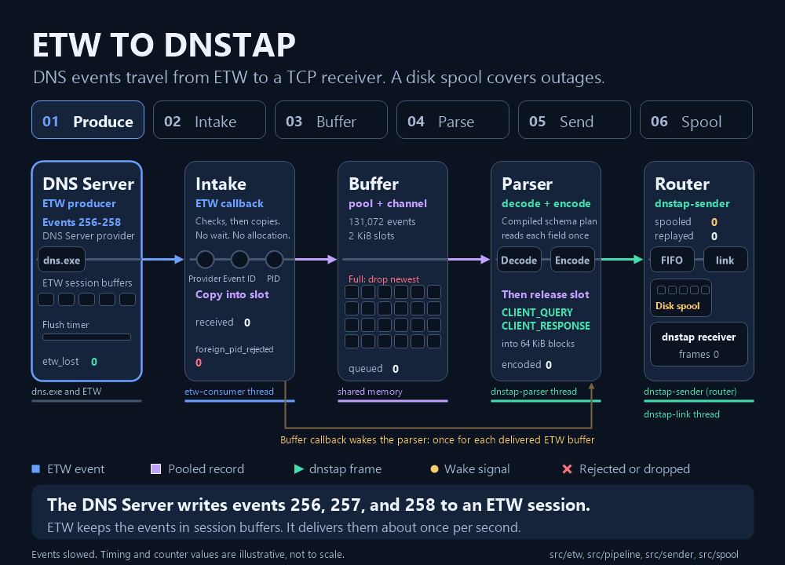

# etw-dnstap

`etw-dnstap` is a Windows service. It reads DNS Server query and response events from Event Tracing for Windows (ETW) and sends them over TCP to a [dnstap](https://dnstap.info/) receiver as Frame Streams records.

> **Status:** Current · **Describes:** the `spool-encryption` branch · **Reviewed:** 2026-11-05

### Quick Start

On the DNS Server host, elevated, with an MSI from [Build the MSI](docs/guide/build.md#build-the-msi):

1. Install:

   ```powershell
   msiexec.exe /i etw-dnstap-<version>-x64.msi /qn /norestart /l*v install.log RECEIVER=192.0.2.10:6000
   ```

2. Restart. ETW applies the session grant at boot, and the service starts with delayed automatic start.
3. `sc.exe query EtwDnstap` shows `RUNNING`. Send DNS traffic and check the receiver.

Details: [Install with the MSI](docs/guide/install.md#install-with-the-msi). Manual install: [build](docs/guide/build.md) `target\x86_64-pc-windows-msvc\release\etw-dnstap.exe`, start `DNS`, [provision](docs/guide/install.md#provision-the-service), run [`Grant-EtwDnstapEtwAccess.ps1`](scripts/provision/README.md).

### Steps / Configuration

- **Identity:** SCM service `EtwDnstap`, `NT AUTHORITY\LocalService`, restricted service SID. Its one ETW right is its own real-time session.
- **Spool:** unaccepted frames wait in `C:\ProgramData\EtwDnstap\spool` by default ([Spool](docs/guide/configuration.md#spool)).
- **Encryption:** AES-128-GCM, key wrapped by a non-exportable Cryptography API: Next Generation (CNG) machine key ([Spool encryption](docs/guide/configuration.md#encryption)).
- **Depends on** `DNS` and `KeyIso` (CNG Key Isolation). If the key store doesn't answer within 3 seconds, the service runs without a spool and logs Event ID 26 ([key](docs/guide/install.md#spool-encryption-key)).
- **Diagnostics:** Application event log, performance counters.
- **TLS** 1.2 or 1.3 is the default. Use `--plaintext` only on a trusted network. Read [SECURITY.md](SECURITY.md) and [TLS](docs/guide/configuration.md#tls) first.
- All guides: [documentation index](docs/README.md). Pipeline: [data path](docs/design/data-path.md).



#### What is captured

| DNS Server event | dnstap message |
| --- | --- |
| 256, query received | `CLIENT_QUERY` |
| 257, response success | `CLIENT_RESPONSE` |
| 258, response failure | `CLIENT_RESPONSE` |

- **258** is a failed response (SERVFAIL, policy REFUSED). A 258 whose packet isn't a response counts in `rejected`. NXDOMAIN is 257.
- 259 `IGNORED_QUERY`, 260, 261, and other IDs increment no counter.
- Message bytes stay as received. A malformed or missing packet is rejected.
- Records have no local port and don't tell authoritative from forwarder roles.

Keyword masks and event-ID filter: [Subscription](docs/guide/configuration.md#subscription).

### Common Gotchas

- **Receiver outage:** reconnect backoff 250 ms to 30 s. With a spool, frames wait on disk. Without one, frames lost during the outage count in `disconnected_dropped` and aren't resent ([Receiver connection](docs/guide/configuration.md#receiver-connection)).
- **Any process can feed the session.** It accepts events from any process that writes to the DNS Server provider, and keeps capturing after a DNS Server crash and recovery restart ([SECURITY.md](SECURITY.md)).
- **Spool encryption protects a copy of the spool folder alone.** SYSTEM, Administrators, code running as the service, an offline system volume without BitLocker, and a kernel memory dump or hibernation file can read the data ([Spool key errors](docs/guide/troubleshooting.md#spool-key-errors)).
- **Data in flight at a failure is lost** ([recovery policy](docs/guide/install.md#5-configure-scm-recovery)).
- **One lab host:** the restricted-SID profile and event 258 capture ran on Windows Server 2025 build 26100 on 2026-11-01. Spool encryption ran at 10,000 queries per second on 2026-11-04. Other builds and rates are untested ([checklist](docs/guide/install.md#validation-checklist-for-the-localservice-restricted-profile), [lab records](docs/README.md#history)). The [pooled VM review](docs/history/pooled-vm-performance-review.md) isn't a capacity claim.

[MIT](LICENSE). Copyright (c) 2026 miketheitguy.
