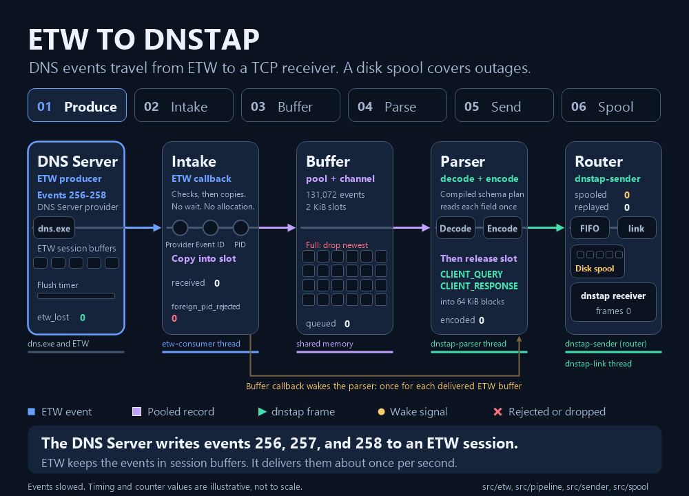

# Data path: from an ETW event to a TCP frame

> **Status:** Current · **Describes:** the code on branch `spool-encryption` as of 2026-11-05 · **Evidence dated:** not applicable (reference, from the source and the local tests) · **Reviewed:** 2026-11-05

### Quick Start

```text
dns.exe -> ETW -> etw-consumer: copy to pool slot -> event channel
  -> dnstap-parser: decode, encode -> dnstap-sender: route
  -> link FIFO -> dnstap-link -> receiver
             \-> disk spool (link down, FIFO full, backlog) -> replay
```

Intake only copies bytes; stage 4 decodes.



### Steps / Configuration

#### Stages

| # | Stage | Thread | Code |
| --- | --- | --- | --- |
| 1 | Produce | `dns.exe` (ETW provider) | `Capture::start` (`src/etw/session.rs`) |
| 2 | Intake | `etw-consumer` | `native_etw_callback`, `copy_record` (`src/etw/intake.rs`) |
| 3 | Buffer | `etw-consumer` (writes), `dnstap-parser` (reads) | `PoolManager` (`src/etw/pool.rs`), the bounded event channel, `native_buffer_callback` |
| 4 | Parse | `dnstap-parser` | `etw::Parser::parse` (`src/etw/schema.rs`), `Encoder::encode` (`src/dnstap.rs`) |
| 5 | Queue and send | `dnstap-parser`, `dnstap-sender`, `dnstap-link`, `dnstap-reconnect` | `QueuedSink` and `Router` (`src/sender.rs`, `src/sender/router.rs`), `LinkThread` (`src/sender/link.rs`), `Spool` (`src/spool.rs`), `NetworkSink` (`src/network.rs`) |

1. **Produce:** events 256, 257, 258 from any process, batched about once per `--etw-flush-seconds` ([settings](pooled-intake.md#subscription-and-event-selection)).
2. **Intake:** waits and allocates nothing. Other providers and IDs drop uncounted; then count `received`, copy to a slot, `try_send` ([ownership](pooled-intake.md#ownership-and-callback-lifecycle)).
3. **Buffer:** regular (2 KiB) and jumbo slots, a `--capacity` channel, fixed at startup ([sizes](pooled-intake.md#memory-budget-and-configuration), [wake rule](ring-buffer.md#parser-wake-and-polling)).
4. **Parse:** count `dequeued`, decode in one pass, encode (256 to `CLIENT_QUERY`, 257 and 258 to `CLIENT_RESPONSE`), release the slot, count `encoded` ([decoder](single-pass-decoder.md), [checks](single-pass-decoder.md#checks-after-decoding)).

##### Queue and send

The parser queues frames and does no socket or disk I/O. The router (`dnstap-sender`) owns
the spool and never waits on the socket. The link (`dnstap-link`) owns the socket.

- **Blocks:** `QueuedSink::write_frame` sends a block at 64 KiB, after 100 ms idle, and at
  least once a second. Router channel 256 blocks; block pool 516 x 136 KiB (68.5 MiB), allocated at startup.
- **Routing:** link FIFO (256 blocks, about 16 MiB) while the link is up with no backlog.
  Spool while the link is down, a backlog or replay batch is out (keeps order), or the FIFO
  is full. A full FIFO spills all its blocks, oldest first, then the new one. Routing reads no socket state.
- **Link:** non-blocking sends, one block at a time; on a full socket, wait up to 50 ms,
  check the stall timer, retry. The session ends after `--receiver-stall-seconds` (default
  15, range 2 to 300) with no bytes accepted while data waits, the only send timeout.
  `SO_SNDBUF` stays default. [Link states](slow-receiver.md).
- **Replay:** batches up to 64 KiB from the spool head to the FIFO, at most 127 out and 1 MiB
  per pass. A batch stays until the link reports what the socket took; a segment goes once
  all its frames do ([Spool](../guide/configuration.md#spool)).
- **Reconnects:** `dnstap-reconnect` backs off 250 ms to 30 s ([Receiver connection](../guide/configuration.md#receiver-connection)).

#### Spool encryption

Format, key, and failures: [Encryption](../guide/configuration.md#encryption), [SECURITY.md](../../SECURITY.md). Internals:

- Segment header (`src/spool/segment.rs`) holds a random nonce prefix; a record (`src/spool/crypt.rs`) is a 12-byte header plus a 16-byte tag.
- Sizes count file bytes; positions, `cursor.bin`, batches, and `replayed` use plaintext frames. `SegmentReader` resumes by walking record headers, then decrypting one record.
- One `NCryptDecrypt` on `spool-key-load` within `KEY_LOAD_TIMEOUT` (3 s) (`src/spool/key.rs`); the service depends on `KeyIso`.
- Key page (`src/spool/locked.rs`, `src/spool/protected.rs`) uses `CRYPTPROTECTMEMORY_SAME_PROCESS`. Each seal or open locks a mutex, checks a SHA-256 value from load, builds the `ring` AES-128-GCM key in a scratch area of the page, re-protects, and zeroes the scratch. Then it overwrites 16 KiB of stack.

#### Startup and shutdown order

Startup, receiver to source, each step first succeeding:

1. Connect the link. Refused: it retries. TLS or protocol failure: the service stops.
2. Check the spool folder, unwrap the key, open the spool.
3. Create the send queue and block pool; start `dnstap-link`, then `dnstap-sender` (after the link's first state).
4. Create the event channel and slot pool.
5. Start `dnstap-parser`.
6. Start the ETW session and `etw-consumer`.

Shutdown, source to receiver:

1. Stop ETW, join `etw-consumer`; enqueuing ends here.
2. Publish `producer_done`, wake the parser.
3. The parser sends its last block (up to 100 ms for room), closes the channel, waits for the router.
4. The router spools the channel and FIFO and seals the segment. Untaken replay data stays on disk; `cursor.bin` keeps the delivered position.
5. The link stops writing at 1 second and hands back unsent data; with no block cut, it sends STOP and FINISH within 2 seconds.

A 10-second watchdog ends a longer shutdown ([deadlines](../guide/configuration.md#startup-and-shutdown-deadlines),
[ETW side](ring-buffer.md#completion-and-resource-ownership)).

#### Regenerate the animation

Edit the [animation sources](../../scripts/docs/pipeline-animation/README.md) when a stage changes, and rebuild the GIF.

### Common Gotchas

#### Where events are lost

Meanings: [Loss counters](measurement-terms.md#loss-counters-live-service). Fixes: [Tune capture for load](../guide/tuning.md).

| Stage | Loss | Counter |
| --- | --- | --- |
| 1 | ETW lost events or buffers | `etw_lost`, `etw_buffers_lost` |
| 2 | Malformed record; TLS state missing or wrong | `callback_errors` |
| 2 | No free slot of the record's class | `pool_exhausted_regular`, `pool_exhausted_jumbo` |
| 3 | Event channel full (newest event dropped) | `ring_dropped` |
| 3 | Event channel has no receiver | `receiver_disconnected` |
| 4 | Decode or encode fails | `rejected` (plus `schema_rejected` for a schema failure) |
| 5 | Router channel full | `queue_dropped` |
| 5 | No spool; receiver down, or a connection fails with unaccepted live frames | `disconnected_dropped` |
| 5 | Spool refuses, evicts, or fails to read or authenticate | `spool_dropped`, `spool_dropped_bytes` |
| 5 | Spool I/O error | `spool_errors` |

- A stage 5 frame counts in at most one of `queue_dropped`, `disconnected_dropped`, `spool_dropped`.
- `intake_dropped` is the sum of the stage 2 and 3 losses; add it to neither ([relationships](../guide/monitoring.md#counter-relationships)).
- With a spool, a [link failure](#link-failure) keeps every frame, except at shutdown after a spill: the live block back from the link is older than the backlog and counts in `disconnected_dropped`.
- **`disconnected_dropped` is no bound on loss.** It counts frames handed to the socket only
  in part and kept by no spool; the receiver discards a cut frame. In the TLS 1.3 key update
  window (risk 19 in the [slow-receiver design](slow-receiver.md)), a whole record the socket
  took still reaches the receiver, yet its frames count. Bytes the kernel accepted before a failure never count, even if it never sent them.
- **`replayed` is no delivery count.** It and `bytes_sent` count socket-accepted bytes.

#### Link failure

The router takes back the FIFO and the link's unsent data:

- Live frames accepted in part (the cut frame, all later ones, and with TLS the unconfirmed piece) go to the spool head, or, with a backlog, to a one-block front list sent first.
- Replay frames accepted in part stay spooled; the read position moves back to the last accepted frame.
- Fully accepted frames are sent once.

#### Allocation on the TLS path

The plaintext path reuses buffers up to the socket: zero heap allocations per event. Under
TLS, rustls (buffered `ClientConnection`) allocates one buffer per record (up to 16 KiB of
plaintext), freed after the send: about 2,500 a second at 41 MB/s.

#### Spool key and segment failures

- A failed folder check, or a key that fails to load or lock: one warning, and the run continues without a spool.
- An unauthenticated record ends its segment; the rest counts in `spool_dropped_bytes`.
- A failed `CryptUnprotectMemory` fails only that operation, as a spool I/O error.
- A key-protection failure suspends the spool and lets live frames bypass it, the only break in strict order ([Spool key errors](../guide/troubleshooting.md#spool-key-errors)).
