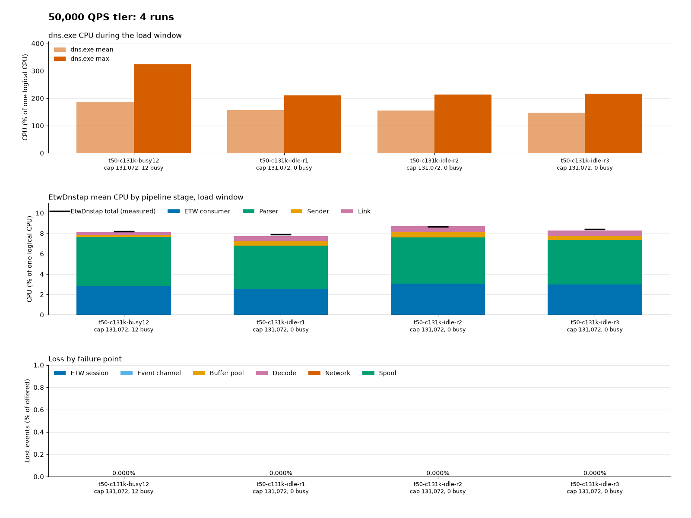
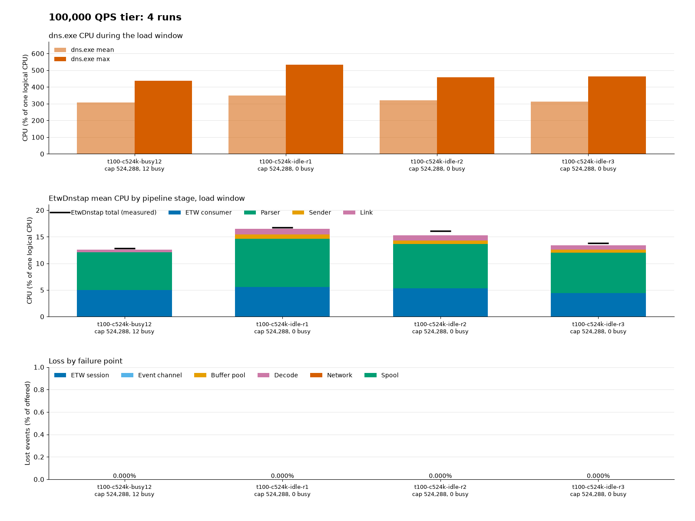

# Tune capture for load

> **Status:** Current · **Describes:** the code at commit `66c3de4` · **Reviewed:** 2026-11-05

Use this guide to choose capture settings for your query rate. It covers the `--etw-*` options,
`--capacity`, and `--spool-max-mib`. For each option's range and syntax, see the
[configuration reference](configuration.md#options). For loss counters, see
[Log events and counters](monitoring.md).

Lab results are in [Guide lab results, 2026-11](../history/guide-lab-results-2026-11.md) and
the other records under [docs/history/](../history/). This guide keeps the conclusions and
the settings.

## ETW buffer minimums

`--etw-min-buffers` is the requested minimum. ETW reserves it at session start, as the
minimum times `--etw-buffer-kib`. It allocates more buffers on demand, up to
`--etw-max-buffers`. Raising the maximum allocates nothing up front.

The default is 12. `0` lets ETW choose. ETW raises the minimum to at least two buffers per
logical processor, so the default of 12 has an effect only on a host with fewer than six
logical processors. ETW may also lower a minimum above its own limit. The maximum rises to at
least the adjusted minimum.

The default maximum is 64. On a host with more than 32 logical processors, ETW's minimum is
above 64, so the maximum rises to match. Peak buffer memory can exceed the requested bound.

The minimum must not exceed `--etw-max-buffers`. Otherwise the service does not start and
reports `ETW minimum buffers (65) must not exceed ETW maximum buffers (64)`, with both values.
ETW cannot change the minimum while the session runs, so a new value takes effect at the next
start.

Microsoft advises setting the minimum and the maximum to the same value when you start tuning.
Raise the maximum if the session drops events during peaks.

ETW can apply other values than the requested ones. The service then writes
`ETW buffers applied` with `etw_min_buffers_applied`, `etw_max_buffers_applied`, and
`etw_buffers_allocated`. If the query fails, the event is not written. The
`ETW Buffers Allocated` counter shows the effective minimum just after start.

## Defaults

<a id="settings-for-200000-queries-per-second"></a>

The defaults are `--etw-buffer-kib 32 --etw-min-buffers 12 --etw-max-buffers 64
--capacity 131072`: 32 KiB buffers, at least 12 of them and at most 64, and a channel of
131,072 events. They are sized for 10,000 queries per second, which is about 20,000 events
per second and 2.06 MB per second of dnstap frames.

Above about 10,000 queries per second, set the values for your rate. See
[Recommended settings for higher rates](#recommended-settings-for-higher-rates). Those values
are not defaults.

> **Tested on one guest.** The lab ran these values at 10,000 queries per second on a Windows
> Server 2025 guest with 12 vCPUs and 8 GiB, on 2026-11-04. Other machines and loads can differ.
> Watch `ring_dropped` and `etw_lost`. The full run record is in
> [Default and tier sizing runs on 12 vCPUs](../history/slow-receiver-validation.md#default-and-tier-sizing-runs-on-12-vcpus-2026-11-04).

The lab made 5 runs at 10,000 queries per second: 3 on an idle guest and 2 with 12 CPU-busy
threads. No run lost an event at any point, and `etw_lost` stayed 0.

| Setting | Largest observed at 10,000 queries per second | Default |
| --- | --- | --- |
| ETW buffer size (`--etw-buffer-kib`) | 32 KiB, no loss | 32 |
| Maximum ETW buffers (`--etw-max-buffers`) | 28 allocated (44 % of 64), at most 13 in use at once | 64 (2 MiB) |
| Minimum ETW buffers (`--etw-min-buffers`) | ETW applied 24 on 12 vCPUs, so an idle session allocated 24 | 12 |
| Channel (`--capacity`) | Peak queue 35,072 (27 % of 131,072), in a busy run | 131,072 |


The graph shows dns.exe CPU (mean and maximum), the EtwDnstap CPU of each pipeline stage (ETW
consumer, parser, sender, and link), and loss by failure point. The lab made the graphs with
`scripts/performance/plot-tier-runs.py`. The service used about 1 % of one CPU. dns.exe used 20
to 34 % on average.

Runs:
[1](../assets/performance/tiers-2026-11-04/p01-b32x64-cap131k-idle-10k.png),
[2](../assets/performance/tiers-2026-11-04/p02-b32x64-cap131k-idle-10k-r2.png),
[3, busy](../assets/performance/tiers-2026-11-04/p03-b32x64-cap131k-busy12-10k.png),
[4](../assets/performance/tiers-2026-11-04/p04-b32x64-cap131k-idle-10k-r3.png), and
[5, busy](../assets/performance/tiers-2026-11-04/p05-b32x64-cap131k-busy12-10k-r2.png).

Why these values:

- **Maximum buffers.** 64 is more than twice the peak of 28 allocated buffers. ETW allocates
  buffers only on demand.
- **Buffer size.** At 32 KiB the session never came near the maximum.
- **Minimum buffers.** ETW applies a minimum of at least two per logical processor. On a 12-vCPU
  guest that is 24, which is why an idle session allocated 24 buffers. The default of 12 has an
  effect only on a host with fewer than 6 logical processors. See
  [ETW buffer minimums](#etw-buffer-minimums).
- **Channel.** The largest peak was 35,072 events, 27 % of 131,072. The lab did not test 65,536.
  ETW sometimes delivers events late and then in one burst, so the default keeps the margin.

Costs:

- ETW buffer memory is at most 2 MiB (64 buffers of 32 KiB), plus what ETW adds on a host with
  more than 32 logical processors. The previous defaults allowed 16 MiB (128 buffers of
  128 KiB). The minimum reserves 12 × 32 KiB = 384 KiB at start, or 768 KiB on a 12-vCPU guest,
  where ETW's own minimum is 24.
- Counted storage at the default capacity is 283.03 MiB. See [Storage](configuration.md#storage).
  The working set at 131,072 is about 356 to 400 MB.
- The startup deadline grows with `--capacity`. See
  [Startup and shutdown deadlines](configuration.md#startup-and-shutdown-deadlines).

The sender queues are sized for the same rate. See [Spool sizing](#spool-sizing).

**Warning.** The service logs at most one warning per run (Event ID 3). It does so when the default
ETW buffer size, buffer counts, flush interval, and `--capacity` are in use. It logs at the end of
the first measurement window in which the received rate exceeds 22,000 events per second, just
above 10,000 queries per second. The window is `--stats-interval-seconds`, or 60 seconds when
that is `0`. The message reads `received rate is above 22,000 events/s; the default buffer
settings were validated at about 20,000 events/s (10,000 queries per second)`. It then points
to the settings in this guide. The warning does not mean events were lost. Watch `ring_dropped`
and `etw_lost`. The service writes Event ID 11 and Event ID 10 when they rise
([Loss and risk warnings](monitoring.md#loss-and-risk-warnings)). If they rise, use the settings
for your rate from [Recommended settings for higher rates](#recommended-settings-for-higher-rates).

## Recommended settings for higher rates

**These values are not defaults.** The service starts with the 10,000 queries-per-second
defaults above. Above about 10,000 queries per second, pass these values on the command line,
for example in the MSI property `SERVICE_ARGS`. See [Install](install.md). Any ETW value or
`--capacity` that differs from its default turns off the [rate warning](#defaults).

Every tier uses `--etw-buffer-kib 128 --etw-min-buffers 12 --etw-max-buffers 128`. Only
`--capacity` changes:

| Queries per second | `--capacity` | Runs with no drop (3 idle, 1 busy with 12 CPU-busy threads) | Largest peak channel depth | Service CPU (% of one CPU) | Peak working set |
| --- | --- | --- | --- | --- | --- |
| 50,000 | 131,072 | 4 of 4 | 70,323 (54 %) | about 9 % | about 0.4 GB |
| 100,000 | 524,288 | 4 of 4 | 251,438 (48 %) | 13 to 17 % | 1.2 to 1.4 GB |
| 200,000 | 262,144 | 4 of 4 | 136,236 (52 %, busy run) | 33 to 39 % | about 0.7 GB |

The lab ran each tier on the same 12-vCPU, 8 GiB guest as the defaults. The graphs were made
with `scripts/performance/plot-tier-runs.py`. Each shows dns.exe CPU, the CPU of each pipeline
stage, and loss by failure point. The full run record is in
[Default and tier sizing runs on 12 vCPUs](../history/slow-receiver-validation.md#default-and-tier-sizing-runs-on-12-vcpus-2026-11-04).

### 50,000 queries per second

```text
--etw-buffer-kib 128 --etw-min-buffers 12 --etw-max-buffers 128 --capacity 131072
```

The channel is the default size. All 4 runs dropped nothing.



Runs:
[1](../assets/performance/tiers-2026-11-04/t50-c131k-idle-r1.png),
[2](../assets/performance/tiers-2026-11-04/t50-c131k-idle-r2.png),
[3](../assets/performance/tiers-2026-11-04/t50-c131k-idle-r3.png), and
[4, busy](../assets/performance/tiers-2026-11-04/t50-c131k-busy12.png).

### 100,000 queries per second

```text
--etw-buffer-kib 128 --etw-min-buffers 12 --etw-max-buffers 128 --capacity 524288
```

100,000 needs a larger channel than 200,000 because of a late-delivery effect (finding L-8 in
the lab record). On the idle 12-vCPU guest, ETW delivered events late, in gaps of 1 to 3
seconds followed by a burst. The cause is on the ETW delivery side and is still open. The gaps
did not change with the channel size. A channel of 524,288 absorbs the bursts: it dropped
nothing, and the largest peak was 48 % of it. The cost is a working set of 1.2 to 1.4 GB.

Smaller channels lost events in earlier idle runs at this rate. 65,536 dropped 0.89 to 1.40
million events, 131,072 dropped 0.31 to 0.46 million, and 262,144 dropped events in 4 of 5 runs
(up to 0.16 million). See
[Event channel 262,144 and 524,288](../history/slow-receiver-validation.md#event-channel-262144-and-524288-at-100000-qps-2026-11-04).



Runs:
[1](../assets/performance/tiers-2026-11-04/t100-c524k-idle-r1.png),
[2](../assets/performance/tiers-2026-11-04/t100-c524k-idle-r2.png),
[3](../assets/performance/tiers-2026-11-04/t100-c524k-idle-r3.png), and
[4, busy](../assets/performance/tiers-2026-11-04/t100-c524k-busy12.png).

### 200,000 queries per second

```text
--etw-buffer-kib 128 --etw-min-buffers 12 --etw-max-buffers 128 --capacity 262144
```

With `--capacity 131072`, the 3 idle runs at 200,000 dropped nothing, but the busy run with 12
CPU-busy threads dropped 63,443 events (0.27 %) at the event channel. ETW lost nothing in that
run: 72 of 128 buffers were allocated. That is why this tier uses 262,144.

Some 200,000 runs had client shortfalls of up to 11 low seconds, so their mean events per
second are below nominal. The drop counts come from the service. At 200,000 the parser averaged
19 to 22 % and the ETW consumer 10 to 14 % of one CPU. No stage was near 100 %.


Runs with `--capacity 262144`:
[1](../assets/performance/tiers-2026-11-04/t200-c262k-idle-r1.png),
[2](../assets/performance/tiers-2026-11-04/t200-c262k-idle-r2.png),
[3](../assets/performance/tiers-2026-11-04/t200-c262k-idle-r3.png), and
[4, busy](../assets/performance/tiers-2026-11-04/t200-c262k-busy12.png).

Runs with `--capacity 131072`, for comparison:
[1](../assets/performance/tiers-2026-11-04/t200-c131k-idle-r1.png),
[2](../assets/performance/tiers-2026-11-04/t200-c131k-idle-r2.png),
[3](../assets/performance/tiers-2026-11-04/t200-c131k-idle-r3.png), and
[4, busy](../assets/performance/tiers-2026-11-04/t200-c131k-busy12.png).

Earlier runs, before the tier runs, compared channel sizes at 200,000 queries per second on the
same guest. The `--capacity 131072` busy run above came later and dropped events:

| `--capacity` | Idle, peak queue | 12 busy CPU threads, peak queue | 24 busy CPU threads | Service working set (peak) |
| --- | --- | --- | --- | --- |
| 65,536 | 24,223 to 61,903 (94%), 0 dropped in 3 runs | 63,940 (98%), 0 dropped | Full. One run dropped 12,264 events | 241 MB |
| 131,072 | 27,385 and 28,129, 0 dropped in 2 runs | 61,239 (47%), 0 dropped | Not run | 356 MB |
| 524,288 | 22,083 and 71,214, 0 dropped in 2 runs | Not run | Not run | 1,261 to 1,399 MB |

At 65,536 the channel came close to full even on an idle guest. See
[200,000 QPS validation](../history/200k-qps-validation.md).

### Sizing for other rates

- One delivery holds up to about `2 × queries/s × --etw-flush-seconds` events (2 per query).
  Keep `--capacity` well above this.
- The measured peak was far lower, because the parser drains the channel during a delivery.
  Treat the rule as a safe upper limit.
- A longer `--etw-flush-seconds` makes each delivery larger. Raise `--capacity` by the same
  factor.
- Larger ETW buffers reduce `etw_lost`. In the lab, 64 KiB × 256 buffers removed the
  `etw_lost` that earlier defaults had at 30,000 queries per second and above.
- The largest `--capacity` is 524,288. Its storage and startup deadline are in
  [Storage](configuration.md#storage) and
  [Startup and shutdown deadlines](configuration.md#startup-and-shutdown-deadlines).
- If `ring_dropped` rises at a rate well below the tier, check the delivery gaps in the lab
  write-up before you raise `--capacity` further.

Earlier lab runs with `--etw-max-buffers 32` and `--capacity 24576` lost events at 200,000
queries per second. Their buffer size is not recorded. See
[200,000 queries per second with 32 buffers and a 24,576-event channel](../history/guide-lab-results-2026-11.md#200000-queries-per-second-with-32-buffers-and-a-24576-event-channel).

## Lower rates

The defaults suit 10,000 queries per second and below. At a lower rate they use more memory than
the load needs, but the ETW buffer memory is at most 2 MiB, so the saving is mostly the channel.
The settings below were tested at 10,000 and 50,000 queries per second. The
[rate warning](#defaults) is off when any ETW buffer value, the flush interval, or `--capacity`
differs from its default.

### Smaller settings, tested at 10,000 queries per second

<a id="low-rate-defaults"></a>

These were the defaults until the 200,000 queries-per-second sizing: `--etw-buffer-kib 16
--etw-max-buffers 64 --capacity 24576`, with `--etw-min-buffers 0`. That is 16 KiB buffers, at
most 64 of them, and a channel of 24,576 events. They use 59.59 MiB of counted storage, a
12-second startup deadline, and at most 1 MiB of ETW buffers.

At 10,000 queries per second (about 20,000 events per second), a 60-second run with these
settings had no ring drops and no `etw_lost`. See
[60-second run with the defaults](../history/guide-lab-results-2026-11.md#60-second-run-with-the-defaults-at-10000-queries-per-second).

ETW delivers real-time events in batches about `--etw-flush-seconds` apart. A batch larger
than the channel drops the excess, unless the parser drains it on arrival. The ETW buffer
callback wakes the parser for each delivered buffer, so it drains each batch as it arrives.

With the defaults before those (12 maximum buffers and an 8,192-event channel), the channel was
full from about 9,000 queries per second. Loss rose with rate. Two 60-second runs with that
channel dropped events after late deliveries. See [Two 60-second runs with the previous
channel](../history/guide-lab-results-2026-11.md#two-60-second-runs-at-10000-queries-per-second-with-the-previous-channel).
The per-rate loss tables are in [ETW flush removal
validation](../history/flush-removal-validation.md) and [ETW buffer wake
validation](../history/buffer-wake-validation.md).

Not tested: other machines and vCPU counts, recursive or mixed workloads, runs longer than
50 seconds, and TLS receivers. The lab used plaintext receivers.

A 10-minute run at 10,000 queries per second used at most 16 buffers, far below 64. See
[10-minute run](../history/guide-lab-results-2026-11.md#10-minute-run-at-10000-queries-per-second).
The 60-second run above is the only run of these settings.

### Older settings, tested at 50,000 queries per second

<a id="high-rate-settings"></a>

```text
--etw-max-buffers 256 --etw-buffer-kib 64 --capacity 65536
```

This was the first 50,000 queries-per-second setting. For current builds, use the
[recommended settings](#50000-queries-per-second). Tested on the 6-vCPU VM with an authoritative load, 50-second runs, and a plaintext receiver.
The per-rate table is in [ETW flush removal validation](../history/flush-removal-validation.md).

- ETW lost no events in any run. The channel dropped no events up to about 44,000 queries per
  second.
- At about 49,400 queries per second, one of two runs filled the channel and dropped 0.28%.
- At about 49,500 queries per second, the service used about 4.4 seconds of CPU per 50-second
  run. The settings before the previous defaults used 8.4 to 8.7 seconds.

**65,536 is enough up to about 44,000 queries per second on this VM. It is marginal at a
sustained 50,000.** The default `--capacity` is now 131,072, which this 6-vCPU VM did not run. The later
12-vCPU runs used `--capacity 65536` and the 256-block send queue and link FIFO, with a 320 Mbit
shaped link at 50,000 queries per second.
Four of four runs dropped no events and spilled nothing, and the channel peaked at 37,000 to
40,000. See
[200,000 QPS sizing runs on 12 vCPUs](../history/slow-receiver-validation.md#200000-qps-sizing-runs-on-12-vcpus-2026-11-04).

These results cover one VM, an authoritative load, 50-second runs, and
`--etw-flush-seconds 1`. Monitor `ring_dropped` and `etw_lost` under the real load after each
change.

Earlier periodic-flush results do not apply, because this build has no periodic flush. See
[Removed periodic flush](../design/ring-buffer.md#removed-periodic-flush). With no flush and an
8,192-event channel, the channel lost most events at 10,000 to 20,000 queries per second. That
result predates the buffer wake and has not been repeated. See
[no periodic flush](../history/guide-lab-results-2026-11.md#no-periodic-flush-channel-loss-of-59-to-79-at-10000-to-20000-queries-per-second) and
[periodic flush](../history/guide-lab-results-2026-11.md#periodic-flush-0-ring-drops-at-10000-and-20000-queries-per-second).

## Spool sizing

The spool holds frames while the receiver is down or slow. `--spool-max-mib` caps it, so it
sets how long an outage the spool can cover. The frame rate sets how fast the cap fills.

The figures use 103 bytes per frame, the average receiver size in the small-answer lab runs,
including the 4-byte length prefix. Each query makes two frames: event 256 and event 257 or
258. Larger answers make larger frames, so the times below can be shorter.

| Queries per second | Frames per second | Bytes per second | MiB per hour | Time to fill the default 4,096 MiB cap |
| --- | --- | --- | --- | --- |
| 1,000 | 2,000 | 206,000 | 707 | about 5.8 hours |
| 10,000 | 20,000 | 2,060,000 | 7,072 | about 35 minutes |
| 50,000 | 100,000 | 10,300,000 | 35,362 | about 7 minutes |
| 200,000 | 400,000 | 41,200,000 | 141,449 | about 104 seconds |

These are calculations from the 103-byte average. The lab has not run a spool outage, so no
figure here is a measured result.

While the receiver drains a backlog, the service holds up to about 8.7 MiB of data it has read but
the receiver has not yet accepted. That is 127 batches of at most 71,684 bytes each. The segments
that hold this data stay on disk whole. They count toward the cap and in `spool_bytes`, and the
cap does not delete them. Including those segments, the total can reach about 8.7 MiB plus two
segments: 24.7 MiB at the smallest cap (64 MiB, with 8 MiB segments), and about 137 MiB with 64 MiB
segments (caps of 512 MiB and above).

- Size the cap for the longest outage you must cover. Multiply MiB per hour by the hours, and
  add a margin. For 10,000 queries per second and a two-hour outage, the spool needs about
  14,144 MiB, so set `--spool-max-mib 16384`.
- `--spool-min-free-mib` (default 2,048) keeps that much free on the volume. The volume must
  also hold that floor and one 64 MiB segment: 16,384 + 2,048 + 64 = 18,496 MiB (about
  18.1 GiB).
- During an outage, the disk takes writes at the bytes-per-second rate. The backlog drains at
  the rate the receiver accepts. At 200,000 queries per second, that is about 41 MB per second
  of writes, then reads at the same rate.
- The send queue, between the parser and the router, is in memory: 256 blocks of about 64 KiB
  (about 16 MiB). It absorbs short router delays and a burst of late ETW events. The link FIFO
  adds another 256 blocks (about 16 MiB) for a slow receiver. Neither absorbs an outage: while
  the receiver is down, the router sends blocks to the spool. The send queue lasts about 8
  seconds at 10,000 queries per second, and about 0.4 seconds at 200,000. At 200,000 queries per
  second the link FIFO covers two Windows Server scheduler quanta (187.5 ms each) of a link
  thread that is not scheduled.

See [The receiver is slow](troubleshooting.md#the-receiver-is-slow) for the steps to take when
the spool grows.

## Next steps

- [Configuration reference](configuration.md)
- [Log events and counters](monitoring.md)
- [Ring capacity and shutdown](../design/ring-buffer.md)
