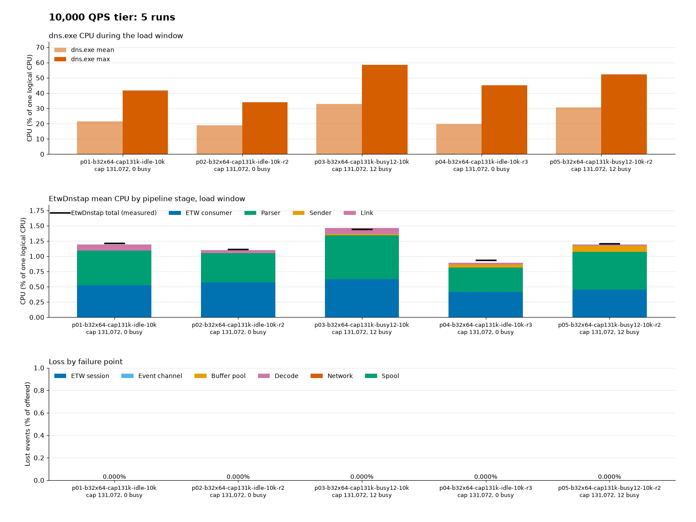
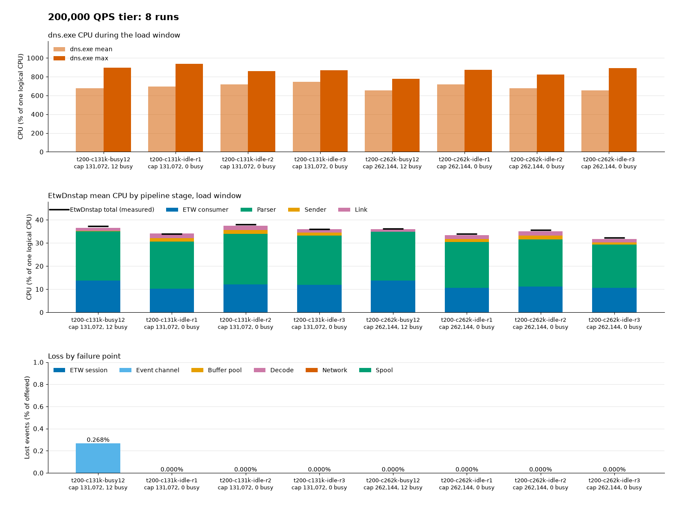

# Tune capture for load

> **Status:** Current · **Describes:** the code on `main` at commit `592a040` · **Reviewed:** 2026-11-05

### Quick Start

The defaults fit up to 10,000 queries per second. Above that, pass tier settings in the MSI property `SERVICE_ARGS` ([Install](install.md)):

```text
# Default, up to 10,000 queries/s
--etw-buffer-kib 32 --etw-min-buffers 12 --etw-max-buffers 64 --capacity 131072

# 100,000 queries/s (other tiers below)
--etw-buffer-kib 128 --etw-min-buffers 12 --etw-max-buffers 128 --capacity 524288
```

Watch `ring_dropped` and `etw_lost` ([monitoring.md](monitoring.md)). To see how each buffer works, read [Buffers as a watershed](../design/buffer-watershed.md). Ranges: [configuration reference](configuration.md#options). Lab results: [docs/history/](../history).

### Steps / Configuration

#### ETW buffer minimums

`--etw-min-buffers` is reserved at start (times `--etw-buffer-kib`); more allocate on demand up to `--etw-max-buffers`. A new value applies at the next start.

- `0`: ETW chooses.
- ETW raises the minimum to two buffers per logical processor, so 12 matters only below six processors. It may lower a minimum above its limit. The maximum rises to the adjusted minimum.
- Above 32 logical processors the maximum rises past 64 and peak buffer memory can exceed the requested bound.
- A minimum above `--etw-max-buffers` stops the service: `ETW minimum buffers (65) must not exceed ETW maximum buffers (64)`.
- Start with equal minimum and maximum; raise the maximum if the session drops events at peaks.
- When ETW applies other values, the service writes `ETW buffers applied` (`etw_min_buffers_applied`, `etw_max_buffers_applied`, `etw_buffers_allocated`). The `ETW Buffers Allocated` counter shows the effective minimum after start.

#### Defaults

<a id="settings-for-200000-queries-per-second"></a>

Sized for 10,000 queries per second: about 20,000 events per second, 2.06 MB per second of dnstap frames. Tested on one guest, no event lost ([record](../history/slow-receiver-validation.md#default-and-tier-sizing-runs-on-12-vcpus-2026-11-04)).

- 64 buffers is over twice the observed peak of 28 allocated, 13 in use.
- 131,072 events keeps a margin over the 27 % peak, since ETW sometimes delivers late in one burst.
- Cost: ETW buffers at most 2 MiB, counted storage 283.03 MiB ([Storage](configuration.md#storage)), working set about 356 to 400 MB. The startup deadline grows with `--capacity` ([deadlines](configuration.md#startup-and-shutdown-deadlines)).



#### Recommended settings for higher rates

Not defaults. Changing any ETW value or `--capacity` turns off the [rate warning](#common-gotchas). Every tier uses `--etw-buffer-kib 128 --etw-min-buffers 12 --etw-max-buffers 128`; only `--capacity` changes. No tier run dropped an event ([record](../history/slow-receiver-validation.md#default-and-tier-sizing-runs-on-12-vcpus-2026-11-04)).

| Queries per second | `--capacity` | Reason |
| --- | --- | --- |
| 50,000 | 131,072 | Peak depth 54 % |
| 100,000 | 524,288 | Absorbs ETW bursts |
| 200,000 | 262,144 | 131,072 dropped events |

##### 50,000 queries per second


##### 100,000 queries per second

ETW delivers in 1 to 3 second gaps then a burst. Smaller channels dropped events: 65,536 up to 1.40 million, 131,072 up to 0.46 million, 262,144 up to 0.16 million ([record](../history/slow-receiver-validation.md#event-channel-262144-and-524288-at-100000-qps-2026-11-04)).


##### 200,000 queries per second

With 131,072 the busy run dropped 63,443 events (0.27 %) at the channel ([validation](../history/200k-qps-validation.md)).



##### Sizing for other rates

- One delivery holds up to about `2 × queries/s × --etw-flush-seconds` events. Keep `--capacity` well above it, and raise it by the same factor as `--etw-flush-seconds`.
- 64 KiB × 256 buffers removed the `etw_lost` that smaller buffers had at 30,000 queries per second and above.
- `ring_dropped` rising well below the tier rate: check the delivery gaps in the lab write-up before raising `--capacity`.

#### Lower rates

The defaults over-allocate for a low rate, mostly in the channel. Changing an ETW buffer value, the flush interval, or `--capacity` turns off the [rate warning](#common-gotchas).

<a id="low-rate-defaults"></a>

Tested at 10,000 queries per second:

```text
--etw-buffer-kib 16 --etw-max-buffers 64 --capacity 24576 --etw-min-buffers 0
```

59.59 MiB counted storage, 12-second startup deadline, at most 1 MiB of ETW buffers, no ring drops and no `etw_lost` in a 60-second run ([run](../history/guide-lab-results-2026-11.md#60-second-run-with-the-defaults-at-10000-queries-per-second), [buffer wake validation](../history/buffer-wake-validation.md)). Untested: other machines and vCPU counts, recursive or mixed workloads, runs over 50 seconds, TLS receivers.

#### Spool sizing

`--spool-max-mib` sets the outage the spool covers. Calculated, not measured: 103 bytes per frame (with the 4-byte length prefix), two frames per query. Larger answers shorten the times.

| Queries per second | Bytes per second | MiB per hour | Time to fill the default 4,096 MiB |
| --- | --- | --- | --- |
| 1,000 | 206,000 | 707 | about 5.8 hours |
| 10,000 | 2,060,000 | 7,072 | about 35 minutes |
| 50,000 | 10,300,000 | 35,362 | about 7 minutes |
| 200,000 | 41,200,000 | 141,449 | about 104 seconds |

- Cap = MiB per hour times hours, plus margin: 10,000 queries per second for two hours is about 14,144 MiB, so `--spool-max-mib 16384`.
- The volume must hold cap, `--spool-min-free-mib` floor, and one 64 MiB segment: 16,384 + 2,048 + 64 = 18,496 MiB (about 18.1 GiB).
- Disk writes at the bytes-per-second rate in an outage, then reads at the receiver's rate (about 41 MB per second at 200,000 queries per second).
- A draining backlog holds up to about 8.7 MiB read but not accepted (127 batches of at most 71,684 bytes). Those segments count toward the cap and `spool_bytes`: 24.7 MiB total at the smallest cap, about 137 MiB at 512 MiB and above.
- The send queue (256 blocks, about 16 MiB) covers about 8 seconds at 10,000 queries per second, 0.4 at 200,000. The link FIFO adds 256 blocks (about 16 MiB). Neither covers an outage.

Spool growing: [The receiver is slow](troubleshooting.md#the-receiver-is-slow).

### Common Gotchas

- **Rate warning:** with default ETW buffer size, buffer counts, flush interval, and `--capacity`, one warning per run (Event ID 3) fires at the end of the first measurement window (`--stats-interval-seconds`, or 60 seconds when `0`) with a received rate above 22,000 events per second: `received rate is above 22,000 events/s; the default buffer settings were validated at about 20,000 events/s (10,000 queries per second)`. It doesn't mean events were lost.
- Watch `ring_dropped` (Event ID 11) and `etw_lost` (Event ID 10), [Loss and risk warnings](monitoring.md#loss-and-risk-warnings). If they rise, use the [tier settings](#recommended-settings-for-higher-rates).
- `--etw-max-buffers 32` with `--capacity 24576` lost events at 200,000 queries per second ([lab record](../history/guide-lab-results-2026-11.md#200000-queries-per-second-with-32-buffers-and-a-24576-event-channel)).
- A minimum above the maximum stops the service ([ETW buffer minimums](#etw-buffer-minimums)).
