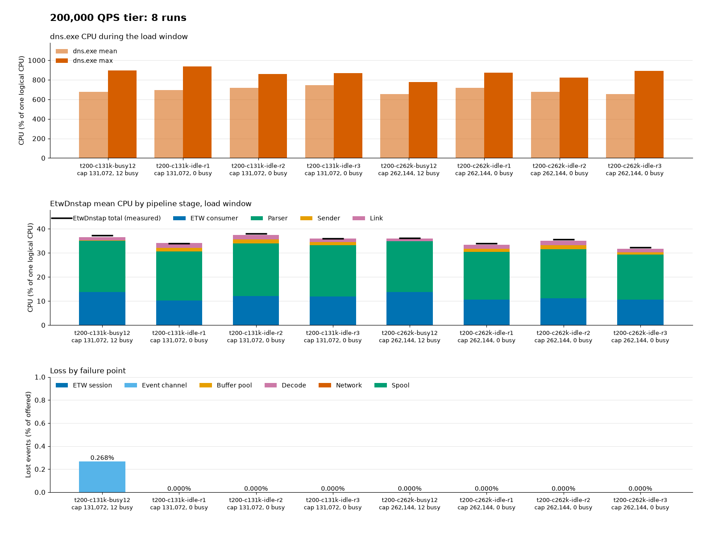

# Slow receiver lab validation

> **Status:** Historical · **Evidence dated:** 2026-11-04 (timestamps in UTC) · **Commits:** `a06f6fd` ("before") and `13972d8` ("after") · **Reviewed:** 2026-11-04

This record covers task L of the
[slow and saturated receiver plan](slow-receiver-plan.md): the first lab
run of the link writer, the progress liveness rule, and the spool rewind
([design](../design/slow-receiver.md)). It answers four questions:

1. With a receiver that is slower than the capture, does the "before" build lose
   frames in `queue_dropped` while the spool has room (F1), and does it end a
   session that is only slow (F2)? Does the "after" build keep every frame and the
   session, and put the overflow in the spool?
2. On a Windows Server guest with every CPU busy, does the replay after a
   60-second outage drain faster than the capture (review V3, finding V3-M-A, and
   task B2)?
3. Does the lab collector discard a frame that a closed connection cuts (design
   risk 6)?
4. Does the receiver-side STOP/FINISH check from task F work, and does it conflict
   with the parser-ramp flow?

The raw run data is lab evidence under `target/performance/slow-receiver-L-20261104/`.
It is not in the repository.

## Summary

| Question | Result |
| --- | --- |
| F1 on "before" | Confirmed. `queue_dropped` rose while the spool held at most 190 MB of a 4,096 MiB cap: 218,681 frames with a 2 MB/s link at 50,000 QPS, 121,603 in an 8-second collector pause, and 120,346 to 136,204 at the start of each outage. |
| F2 on "before" | Confirmed for a stall. An 8-second collector pause ended the session after a 2.01 s write, with 636 frames in `disconnected_dropped`. A rate limit alone never did: the longest write was 1.12 s. |
| "After", slow and paused receiver | Held in all 7 runs with a slow or paused receiver: no `queue_dropped`, no disconnect, every frame delivered, the overflow in the spool. One control run (40 MB/s link) had 10,822 frames in `queue_dropped` at the end of the load, from a router pause that two reruns did not repeat. See [Open items](#open-items). |
| V3-M-A on Windows Server | Closed for this host. With 12 busy threads on 6 vCPUs, the "after" build delivered a 1.46 GB backlog in about 2.1 s (about 700 MB/s), while the capture went on at 10 MB/s. |
| Risk 6, cut frame | Confirmed. DNS-collector 3.2.3 printed only the whole frames in each of three cut variants, and logged a reader error. |
| Task F check | Worked on first use: 34 of 34 stops `confirmed`. No script change was needed. The parser-ramp ordering does not conflict. |

## Environment

| Item | Value |
| --- | --- |
| Guest | DNSTap-WS2025 (`24bafedb-0998-4430-a0c6-7e90350cd9ac`): 6 vCPUs, 4 GiB, Windows Server 2025 Standard Evaluation (build 26100). Checkpoint `slow-receiver-L-pre-2026-11-04` taken before any change. `lab.json` still says 2 vCPUs. |
| Service identity | `NT AUTHORITY\LocalService`, SID type restricted, recovery `restart/5000`, from the MSI. Not changed by this run. |
| Build installed before the run | MSI 0.1.0, ProductCode `{34524511-F48F-45D2-B150-3492BD4B23F3}`, installed 2026-11-03, MSI SHA-256 `2233AE1EE87C92E334D70CE90942FF54A7161E582AB836EE0EDA664C744D680C`, executable SHA-256 `5F5ED754815751A2DE9A3277A969F135904CA1CD64C59CFB852726399422A88A`. |
| "Before" build | `main` at `a06f6fd`, built with `scripts/build/Build-Msi.ps1` in a temporary worktree under `target/`. Executable SHA-256 `3A46F27B78BC3CF3FA4944E1A3DCAD0E0AE51E344561E06495CCC1DFDDB9664E`, MSI SHA-256 `ECF8E91D772AAB34B8E39FB2456F82B3341E743C98372F512621DC4F3709A25D`. |
| "After" build | `slow-receiver` at `13972d8`, built with `scripts/build/Build-Msi.ps1`. Executable SHA-256 `CAD589EE7B85B7E71D3F71D79674FB8F5A84F05B31DF3079054F28CE8AE0092E`, MSI SHA-256 `F43E0A51C4C516AA3EAA2395B65E0B8532BAB4CD8A257E1E3D0A0B341ED197D3`. Both MSIs are version 0.1.0. The link-exception and PE checks of `Build-Msi.ps1` passed for both. |
| Service options | MSI properties `RECEIVER=172.27.215.60:6000`, `SESSION_NAME=EtwDnstap-Lab`, `SERVICE_ARGS="--plaintext --stats-interval-seconds 5"`, the same on both builds. Spool at its defaults: 4,096 MiB cap, 2,048 MiB free-space floor. Stall timeout at its default of 15 s on "after". |
| Receiver | DNSTap-Ubuntu2604 (`d5ca1bde-da5c-4c08-9625-e845c1443b0b`): 4 vCPUs, kernel 7.0.0-38-generic, DNS-collector 3.2.3, plaintext on `172.27.215.60:6000`. Its pipeline `tap` (dnstap) forwards to `discard` (devnull), and the systemd drop-in sets `StandardOutput=null` and `StandardError=null`. It wrote nothing to disk. Checkpoint `slow-receiver-L-pre-2026-11-04`. |
| Client | `dns-stress` built from the current source (`2073411`, absolute pacing) into `target/`. Authoritative load, 4 threads, 256 in flight per thread, 0 timeouts in every run. The older binary at the `lab.json` path predates the pacing fix: it sent 7,400 QPS when asked for 10,000. |

### Rates

Each query makes two frames (query and response). The calibration runs gave
103.015 receiver bytes for each frame at both rates.

| QPS | Frames per second | Capture rate (R_in) |
| --- | --- | --- |
| 10,000 | 20,000 | 2.06 MB/s |
| 50,000 | 100,000 | 10.3 MB/s |

The plan brief assumed one frame per query (1.03 and 5.15 MB/s). The rate limits
below are therefore twice the brief's example values.

## Method

1. Recorded the guest state (service configuration, product, executable hash),
   the receiver's `tc qdisc show`, `tc filter show dev eth0 ingress`,
   `iptables -S` (filter and mangle), `ip6tables -S`, `nft list ruleset`, the
   link list, and the loaded traffic-control modules. Took both checkpoints.
2. Installed each build with `msiexec /i <msi> /qn` and the three properties
   above. `MajorUpgrade AllowSameVersionUpgrades` replaced the installed product.
   Each install exited 3010. The guest was restarted, and the service came up
   with the expected `ImagePath` and executable hash.
3. Ran each case with a driver script (PowerShell 5.1, `LabCommon.psm1`,
   PowerShell Direct):
   - restart the service, so its counters start at 0;
   - sample the performance counters (`typeperf "\EtwDnstap(*)\*"`, 1 s) in the
     guest, and the receiver's `ss -tin` `bytes_received` (1 s; 0.1 s in the last
     run) over ssh to the host;
   - shape the receiver ingress, then run `dns-stress` for 60 s (150 or 200 s in
     the outage cases);
   - keep the shaping for 30 s after the load, remove it, and wait until
     `spool_bytes` is 0 for three polls;
   - stop the service around the task F capture, and keep the Application log
     events of the run (`capture stats` and `output stats` every 5 s).
4. Shaping. Data arrives at the receiver, so the shaping is on ingress. A `u32`
   filter on the `eth0` ingress qdisc sends packets from the guest to TCP port
   6000 to an `ifb` device. The `ifb` device has `tbf rate <R> burst 256kb
   latency 400ms` as root, and `netem delay 100ms limit 200000` as its child when
   a delay is set. ACKs are not shaped, so the delay adds 100 ms to the round
   trip.
5. Stall. `kill -STOP` on the collector for 8 s, then `kill -CONT`.
6. Outage. A temporary `nft` table `inet slowrxL` with a rule that drops packets
   from the guest to port 6000, for 60 s (120 s in the last run). A dedicated
   table was used instead of `iptables`, so removing the table restores the
   ruleset exactly.
7. Busy host. 12 `powershell.exe` processes, each running `while($true){}` at
   normal priority, 2 for each vCPU, from 3 s before the load to the end of the
   load. In the "after" runs the guest sampled `% Processor Time` and the
   processor queue length.

Delivered frames are the receiver bytes divided by 103.015. The **gap** is the
delivered frames less `encoded - (queue_dropped + disconnected_dropped +
spool_dropped)`. A gap of +3 to +56 is the 84-byte handshake of each connection.
A negative gap is frames that no counter holds and the receiver did not get.

**Latency.** The only latency measure is `spool_oldest_age_ms` ("after" only): the
age of the oldest unsent spool segment, an upper bound on the age of the oldest
frame that waits. The table gives its largest value in the run, which is at the
end of the shaped period. The "before" build has no such counter. No per-frame
delivery latency was measured; the collector wrote nothing.

## Case 1: slow receiver, rate and delay

Rate limits: about 4 times R_in (control), about 78 % of R_in ("below"), and about
20 % of R_in ("well below"). "Rx MB/s" is the receiver rate over the 60 s load.

| Case | Build | Encoded | Gap | `queue_dropped` | `disconnected_dropped` | Spooled | Disconnects | Max spool (MB) | Max oldest age (s) | `link_saturated` | Max write wait (ms) | Rx MB/s |
| --- | --- | --- | --- | --- | --- | --- | --- | --- | --- | --- | --- | --- |
| 10k, 8 MB/s, 0 ms | before | 1,199,992 | +3 | 0 | 0 | 0 | 0 | 0 | n/a | n/a | 16 | 1.96 |
| 10k, 8 MB/s, 0 ms | after | 1,200,000 | +3 | 0 | 0 | 0 | 0 | 0 | 0 | 0 | 16 | 1.97 |
| 10k, 1.6 MB/s, 0 ms | before | 1,200,000 | +3 | 0 | 0 | 951,082 | 0 | 91 | n/a | n/a | 79 | 1.53 |
| 10k, 1.6 MB/s, 0 ms | after | 1,200,000 | +3 | 0 | 0 | 935,335 | 0 | 93 | 37.0 | 1 | 595 | 1.52 |
| 10k, 0.4 MB/s, 0 ms | before | 1,199,996 | +3 | 0 | 0 | 1,172,220 | 0 | 121 | n/a | n/a | 1,118 | 0.38 |
| 10k, 0.4 MB/s, 0 ms | after | 1,199,992 | +3 | 0 | 0 | 1,167,830 | 0 | 120 | 83.9 | 1 | 1,125 | 0.38 |
| 10k, 8 MB/s, 100 ms | before | 1,200,000 | +3 | 0 | 0 | 0 | 0 | 0 | n/a | n/a | 204 | 1.97 |
| 10k, 8 MB/s, 100 ms | after | 1,200,000 | +3 | 0 | 0 | 0 | 0 | 0 | 0 | 0 | 301 | 1.97 |
| 10k, 1.6 MB/s, 100 ms | before | 1,200,000 | +3 | 0 | 0 | 1,020,996 | 0 | 92 | n/a | n/a | 204 | 1.50 |
| 10k, 1.6 MB/s, 100 ms | after | 1,200,000 | +3 | 0 | 0 | 951,344 | 0 | 90 | 37.7 | 1 | 301 | 1.51 |
| 50k, 40 MB/s, 0 ms | before | 5,999,992 | +13 | 0 | 0 | 0 | 0 | 0 | n/a | n/a | 1 | 10.11 |
| 50k, 40 MB/s, 0 ms | after | 5,993,226 | +24 | **10,822** | 0 | 215,680 | 0 | 0 | 0 | 0 | 3 | 9.85 |
| 50k, 40 MB/s, 0 ms, rerun 2 | after | 5,999,996 | +13 | 0 | 0 | 196,424 | 0 | 0 | 0 | 0 | 3 | 10.11 |
| 50k, 40 MB/s, 0 ms, rerun 3 | after | 5,985,888 | +51 | 0 | 0 | 575,156 | 0 | 22 | 0.4 | 0 | 4 | 10.09 |
| 50k, no shaping | after | 5,999,421 | +13 | 0 | 0 | 0 | 0 | 0 | 0 | 0 | 0 | 10.15 |
| 50k, 8 MB/s, 0 ms | before | 5,999,968 | +12 | 0 | 0 | 5,895,224 | 0 | 205 | n/a | n/a | 16 | 7.78 |
| 50k, 8 MB/s, 0 ms | after | 5,999,990 | +13 | 0 | 0 | 5,693,036 | 0 | 190 | 21.0 | 1 | 16 | 7.83 |
| 50k, 2 MB/s, 0 ms | before | 5,999,974 | −25 | **218,681** | 0 | 5,758,274 | 0 | 526 | n/a | n/a | 594 | 1.95 |
| 50k, 2 MB/s, 0 ms | after | 5,999,994 | +13 | 0 | 0 | 5,967,742 | 0 | 548 | 77.3 | 1 | 556 | 1.96 |
| 50k, 40 MB/s, 100 ms | before | 5,999,992 | +20 | **53,076** | 0 | 2,114,216 | 0 | 82 | n/a | n/a | 201 | 9.99 |
| 50k, 40 MB/s, 100 ms | after | 5,999,968 | +12 | 0 | 0 | 303,260 | 0 | 21 | 0 | 0 | 300 | 10.09 |
| 50k, 8 MB/s, 100 ms | before | 5,999,958 | +17 | **642** | 0 | 5,989,045 | 0 | 214 | n/a | n/a | 188 | 7.59 |
| 50k, 8 MB/s, 100 ms | after | 5,985,172 | +56 | 0 | 0 | 5,983,193 | 0 | 214 | 23.9 | 1 | 301 | 7.42 |

A 20-second "before" check run at 50k, 8 MB/s, 100 ms had 65,569 frames in
`queue_dropped`, all in the first 6 s of the spill, while the spool held under
60 MB.

Every run: `spool_dropped` 0, `spool_errors` 0, `output_errors` 0, `etw_lost` 0
(except 1,536 in one "before" outage run), and the delivered rate matched the
`tbf` rate. `ring_dropped` (intake, before the sink) was 0 to 14,812 at
50,000 QPS with the default `--capacity`, as in earlier records. It is not a sink
loss.

### Stall: the collector paused for 8 s at 50,000 QPS

| Build | Encoded | Gap | `queue_dropped` | `disconnected_dropped` | Spooled | Disconnects | Max write wait | `link_saturated` | Max oldest age |
| --- | --- | --- | --- | --- | --- | --- | --- | --- | --- |
| before | 5,999,984 | −10,450 | 121,603 | 636 | 667,477 | 1 | 2.01 s | n/a | n/a |
| after | 5,999,245 | +14 | 0 | 0 | 648,289 | 0 | 7.77 s | 0 | 3.9 s |

### Detection on "after"

- `link_saturated` was set in every "below" and "well below" run, 12 to 30 s
  after the load started, and never in a control run or the 8-second pause. It
  cleared 3 to 11 s after the load ended, when the backlog stopped growing,
  although the link was still shaped and the backlog was 14 to 472 MB. This is the
  documented rule ("no longer larger than 10 samples ago").
- `write_max_recent_us` followed the link: 3 to 16 ms with no delay at 8 MB/s and
  above, 0.3 s with 100 ms of delay, 0.6 s at 10,000 QPS with a 1.6 MB/s link,
  0.56 s at 50,000 QPS with a 2 MB/s link, 1.13 s with a 0.4 MB/s link, and the
  whole wait (7.77 s, 15.0 s) in a stall.
- `send_queue_depth_max` was 2 in the 50,000 QPS runs with an 8 or 2 MB/s link
  and no delay, drains included, 23 to 25 with 100 ms of delay, and 30 to 41 in
  two of the three 50k control runs (128 in the first; see
  [Open items](#open-items)). It did not rise during any drain (design risk 15).
  At 10,000 QPS it read 33 to 61 in every run, the control with an 8 MB/s link
  included, with no loss. The cause was not investigated.
- `spool_oldest_age_ms` reached 21 to 38 s with a "below" link and 77 to 84 s with
  a "well below" link, at the end of the 30 s shaped tail.

### Drain after the shaping was removed

With the guest idle, the spool emptied within one 1 s poll of the removal in
every run: 459 MB ("before") and 481 MB ("after") at 50,000 QPS, about 120 MB at
10,000 QPS. That is at least 400 MB/s on both builds.

## Case 2: outage on a busy host (V3-M-A, B2)

50,000 QPS for 150 s, with the receiver cut from 20 s to 80 s. The last run cut it
from 20 s to 140 s of a 200 s load, and sampled the receiver every 0.1 s. "Busy"
is 12 spinning threads on 6 vCPUs: `% Processor Time` was 100 for the whole
outage and drain, with a processor queue length of 14.5 to 15.1 on average
("after" runs; the second "before" run gave 100 and 12.9).

| Run | Build | Encoded | Gap | `queue_dropped` | `disconnected_dropped` | Spooled = replayed | Max spool (MB) | Session lost after the cut | Reconnected after the restore | Backlog delivered in |
| --- | --- | --- | --- | --- | --- | --- | --- | --- | --- | --- |
| idle | before | 14,999,998 | −9,978 | 120,346 | 641 | 6,067,590 | 610 | 2.2 s | 1.1 s | ≤ 1.1 s (625 MB) |
| busy | before | 14,999,960 | −8,947 | 126,175 | 1,904 | 7,250,170 | 736 | 2.2 s | 12.9 s | ≤ 1.7 s (747 MB) |
| busy, rerun | before | 14,998,456 | +35 | 136,204 | 10,806 | 6,942,989 | 701 | 2.3 s | 10.0 s | ≤ 1.5 s (715 MB) |
| idle | after | 14,999,974 | −5,657 | 0 | 0 | 6,372,905 | 644 | 15.1 s | 2.8 s | ≤ 1.5 s (657 MB) |
| busy | after | 14,999,962 | −40,797 | 0 | 0 | 6,910,033 | 700 | 15.5 s | 8.3 s | ≤ 1.8 s (712 MB) |
| busy, 120 s cut, 0.1 s samples | after | 20,000,000 | −41,236 | 0 | 0 | 14,216,070 | 1,436 | 15.5 s | 20.3 s | 2.09 s (1,465 MB) |

- **Drain rate.** In the 0.1 s run the new connection carried 1,464.7 MB in the
  2.09 s after its handshake, 355 to 1,339 MB/s in each 0.1 s step, then fell to
  the live rate of 10 MB/s. That is about 700 MB/s with every CPU busy, while the
  capture went on at 10 MB/s. B2 measured 51 to 368 MB/s on the 24-CPU client host
  at the same load per CPU. The "≤" values in the table are bounded by the 1 s
  counter poll.
- **The backlog shrank while the capture went on** in every run. No frame went to
  `spool_dropped`, and nothing was evicted: the largest spool was 1,436 MB of the
  4,096 MiB cap.
- **No spill before the cut.** In the 20 s before each cut, with every CPU busy,
  `spooled` stayed 0 on "after" (two runs): the 128-block FIFO did not spill at 10.3 MB/s.
  This run did not test 41 MB/s, where design risk 9 places the margin.
- **Reconnect.** The delay after the restore (1.1 to 20.3 s) is the reconnect
  backoff, not the replay.
- **Uncounted loss at the failure.** The negative gaps are bytes that the guest's
  TCP accepted and the receiver never got. On "after", `bytes_sent` was larger
  than the receiver bytes by 4.25 MB in the 0.1 s run, which matches the gap of
  41,236 frames. With the fixed 1 MiB send buffer ("before"), the gap was 0 to
  10,450 frames (up to about 1.08 MB). With autotuning ("after", H4) it was
  5,657 frames idle and 40,797 to 41,236 frames busy (about 4.2 MB). This is the
  cost that design risk 4 predicts: the unseen loss grows with the buffer. It
  applies only to a failed connection; the slow and paused cases had none.

## Case 3: cut frame (design risk 6)

Method: a second DNS-collector 3.2.3 ran in the foreground over ssh, on
`127.0.0.1:6001`, with a `stdout` text logger. Its config and the test client
were in a memory-backed tmpfs and were deleted afterwards. Its output went to the
ssh session only, not to the receiver's disk. The production collector was not
touched by this test. A Python client sent READY, read ACCEPT, sent START and three whole
dnstap frames (`CLIENT_QUERY`, distinct names), and then ended in one of four
ways.

| Variant | Last bytes sent | Close | Lines printed | Collector log |
| --- | --- | --- | --- | --- |
| `stop` (control) | STOP, FINISH read | FIN | 3 whole frames | `framestream reset by sender` (INFO) |
| `body` | length prefix and 46 of 93 body bytes | FIN | 3 whole frames | `framestream reader error: unexpected EOF` (ERROR) |
| `header` | 2 of the 4 length bytes | FIN | 3 whole frames | `framestream reader error: unexpected EOF` (ERROR) |
| `bodyrst` | length prefix and 48 of 96 body bytes | RST | 3 whole frames | `framestream reader error: … connection reset by peer` (ERROR) |

The cut frame (`cut-0.<variant>.cut.test`) was never printed, and no garbled
record appeared. Source (DNS-collector 3.2.3 requires
`github.com/dmachard/go-framestream` v1.8.0):

- `go-framestream` v1.8.0, `framestream.go`, `readFrame`: the length and the body
  are read with `io.ReadFull`. Its error is returned with a `nil` frame.
  `io.ReadFull` returns `io.ErrUnexpectedEOF` when EOF comes after some, but not
  all, of the bytes.
- `go-dnscollector` v3.2.3, `workers/dnstapserver.go`, `HandleConn`: on an error
  from `RecvFrame` the loop logs it, flushes the batch of whole frames, and breaks.
  `frame.Data()` is reached only when the error is `nil`.

A cut that falls exactly on a frame boundary is an ordinary close (`io.EOF`). The
lab collector therefore keeps every whole frame before a cut and discards the cut
frame, which is what B1 and B2 assume.

## Case 4: the receiver STOP/FINISH check (task F)

- The driver used `Start-LabReceiverStopCapture`, `Stop-LabReceiverStopCapture`
  (`scripts/performance/LabCommon.psm1`), and `receiver_stop_finish.py` around
  every service stop: 14 stops on "before", 17 on "after", and 3 check runs.
  All 34 gave `confirmed`: STOP from the service, FINISH from the collector on the
  same port, then a FIN from each side. Every stop took 0.30 to 0.37 s and ended
  `Stopped` with exit code 0.
- No fix was needed. `python -I scripts/performance/test_receiver_stop_finish.py`
  passes (20 tests).
- `windows-parser-stage.ps1` itself was not run. It needs a parser-ramp campaign
  (a receiver READY receipt and the parser-ramp collector, whose raw output goes to
  a file, against the null rule). Its preflight also requires `StartName`
  `LocalSystem` (the MSI installs `NT AUTHORITY\LocalService`), and
  `Get-LabVm -CheckResources` fails because `lab.json` says 2 vCPUs. These checks
  are older than task F.
- **Ordering with `reconcile-parser-ramp.py`.** There is no conflict. The stage
  script runs the capture and the service stop in its `finally` block. The
  receiver's `finish` step (`ubuntu-parser-ramp-control.py`) runs later and needs
  `--sender-stopped`. It samples for a plateau with no established peer on port
  6000 (`pre_stop_publication_samples`), and only then stops the collector. The
  "graceful stop" in the reconcile error text is the collector's stop. The service
  closed its connection at every stop in this run, so no peer remained.

## Findings against the plan

| Item | Expectation | Result |
| --- | --- | --- |
| F1 | "Before": a blocked write stops the spill, so `queue_dropped` rises while the spool has room. | **Confirmed.** 218,681 frames at a 2 MB/s link, 642 to 65,569 with 100 ms of delay, 121,603 in an 8 s pause, 120,346 to 136,204 at each outage. The spool held at most 190 MB of 4,096 MiB at the time. A link at 78 % of R_in with no delay lost nothing: there the writes were short (16 ms). |
| F2 | "Before": a slow receiver looks dead, so it disconnects. | **Confirmed for a stall, not for a rate limit.** The 8 s pause ended the session (write 2.01 s). Rate limits down to 0.4 MB/s gave writes of up to 1.12 s and no disconnect. |
| F5 / H4 | The fixed 1 MiB `SO_SNDBUF` limits a long path. | **Confirmed.** At 50,000 QPS with 100 ms and a 40 MB/s link, "before" spilled 2,114,216 frames and lost 53,076; "after" kept up (10.09 MB/s) and lost none. |
| Criterion 1 | "After": no `queue_dropped` while the spool accepts blocks. | **Held** in every slow, paused, and outage run (10 runs) and in 5 of 6 control runs. One control run had 10,822; see [Open items](#open-items). |
| Criterion 2 | "After": no disconnect while bytes progress, and a stall shorter than the timeout loses nothing. | **Held.** 0 disconnects in all shaped runs and in the 8 s pause, which lost nothing (gap +14). |
| Criterion 3 | Detection counters show saturation and age. | **Held.** `link_saturated` set in every saturated run and in no control run; `spool_oldest_age_ms` up to 84 s. |
| Spool takes the overflow | "After" | **Held.** 0.6 to 14.2 million frames spooled and all replayed; `spool_dropped` 0. |
| V3-M-A (B2) | Replay drains faster than the capture on a Windows Server guest at 2 busy threads per CPU. | **Confirmed.** About 700 MB/s (1.46 GB in 2.09 s) at 100 % CPU, against a 10.3 MB/s capture. |
| Risk 6 | The collector discards a cut frame. | **Confirmed** (case 3). |
| Risk 9 | The 128-block FIFO covers a Server quantum at full rate. | **Not decided.** No spill at 10.3 MB/s with every CPU busy. 41 MB/s was not run. |
| Risk 2 | The disk can take R_in. | **Held at 10.3 MB/s**: 0 `spool_errors`, no `queue_dropped` from disk, up to 1.44 GB on disk. |
| Risk 15 | `send_queue_depth_max` rises during a drain. | **Not seen.** It stayed at 2 in the 50,000 QPS drains, and did not rise in the busy drains. |

## Open items

1. **One `queue_dropped` burst on "after" with a fast link.** In the first 50k
   control run (40 MB/s, no delay), 10,822 frames went to `queue_dropped` at the
   end of the load. In that second, `send_queue_depth_max` reached 128 (the parser
   channel was full), the receiver got 0.2 MB, `spooled` did not change, guest
   CPU was 25 to 31 %, and the service process used 1.5 to 3 % of a CPU. So the
   router took no parser block for about 1 s, and did not spill. Two reruns and
   an unshaped run had 0. Later analysis (2026-11-04, task L1D in the
   [plan](slow-receiver-plan.md#l-1-and-l-6-results)) found no cause in
   the code, and found that the whole service process ran for only about 1.5 % of
   a CPU in the second before the drops. The new counters
   `router_wait_max_recent_us` and `router_pass_max_recent_us`, and a WPR trace,
   are the next step if it recurs.
2. **A spill at the start of the load, with lab shaping on.** In 5 of 6 runs at
   50,000 QPS with an `ifb` filter and a fast link, both builds, the receiver got
   no bytes for about 2.5 s after the load started, and 0.2 to 0.6 million frames
   spilled ("after": no loss). The unshaped run had no spill. This points at the
   lab's ingress shaping, not at the service, but it was not proven.
3. **`link_saturated` during a silent outage.** With the receiver's packets
   dropped, the session stays up until the 15 s stall timeout. The backlog grows
   with the session up, so `link_saturated` was set 11.4 to 12.0 s into each
   outage, 3.4 to 3.6 s before `dnstap receiver connection lost` (three runs). The monitoring guide says
   that growth during an outage is not saturation. That holds only after the
   session ends. Task W may want to say so.
4. **Uncounted loss at a failed connection** is up to about 4.2 MB with the
   autotuned send buffer on a busy host (case 2). Design risk 4 predicted the
   direction, not the size.
5. **`send_queue_depth_max` at 10,000 QPS** read 33 to 61 with no loss in every
   run, also unshaped. Later analysis (task L1D) traced it to one ETW flush burst
   of about 2 MB waiting while the idle router wakes. It is not a defect.
6. **Follow-up runs L1 and L5 (2026-11-04).** See
   [Follow-up runs L1 and L5](#follow-up-runs-l1-and-l5-2026-11-04). Item 1: the drop did
   not recur in 14 runs, and a related stall of the event delivery did (8 runs). Risk 9
   held in every run that reached the link, but 41.2 MB/s on a fully busy host was not
   reached.

## Deviations from the plan

- Rate limits are twice the brief's example values, because each query makes two
  frames (see [Rates](#rates)).
- The outage used an `nft` table instead of `iptables`, so the receiver's
  ruleset is restored exactly.
- Added runs: the 8 s collector pause (F2 needs a stall), two reruns and an
  unshaped run of the 50k control, the idle outage on both builds, and a 120 s
  busy outage with 0.1 s receiver samples.
- The load client is `dns-stress` from the current source, not the binary at the
  `lab.json` path, which could not reach 10,000 QPS.
- The STOP/FINISH check used the `LabCommon.psm1` functions, not
  `windows-parser-stage.ps1` (see case 4).
- The first "before" busy outage has no CPU sample; it was repeated with one.

## Limits

- One run per case, except the 50k control (three runs) and the busy outage
  (two runs per build).
- Plaintext only. No TLS, so the TLS hand-back paths were not run.
- Rates of 10,000 and 50,000 QPS only. 41 MB/s (risk 9) was not run.
- Receiver bytes are sampled each second; a drain shorter than one sample has
  only an upper bound on its time, except in the 0.1 s run.
- No frame order or duplicate check at the receiver: the collector wrote
  nothing, so the check is on byte counts.
- The rate limit is a network limit (`tbf`), so TCP sees a slow path, not a
  closed receive window. Only the 8 s pause closes the window.
- No eviction at the spool cap: the largest backlog was 1.44 GB.

## Lab state after the run

- **Guest:** the "after" MSI (`13972d8`, ProductCode
  `{0FD5A881-9EF0-4835-8A01-E9DEC1B6BC49}`) is installed, with
  `RECEIVER=172.27.215.60:6000`, `SESSION_NAME=EtwDnstap-Lab`, and
  `SERVICE_ARGS="--plaintext --stats-interval-seconds 5"`. The `ImagePath`
  matches the one recorded before the run. The service is running as
  `NT AUTHORITY\LocalService`, SID type restricted, with the same recovery
  actions. The spool holds only `cursor.bin`. The major upgrades kept the
  `backup` folder; neither install was an uninstall, so no data folder was
  deleted. The busy processes, the counter samplers, and the staging folder are
  gone.
- **Receiver:** `tc qdisc show`, the `eth0` ingress filters, `iptables -S`
  (filter and mangle), `ip6tables -S`, the link list, and the loaded
  traffic-control modules match the recorded state line for line. `nft list
  ruleset` matches too (only `inet dnstap_lab`). The `ifb`, `sch_tbf`,
  `sch_netem`, `sch_ingress`, `act_mirred`, and `cls_u32` modules that the run
  loaded were unloaded. The collector config is unchanged (modified
  2026-11-02), with its output to null. The collector process is the same one
  (the pause stopped and continued it). It receives the service's frames again.
  The temporary collector files are deleted.
- The checkpoints `slow-receiver-L-pre-2026-11-04` on both guests are kept.

## Follow-up runs L1 and L5 (2026-11-04)

Two follow-up tasks on the same lab, after the router wait and pass counters
([plan](slow-receiver-plan.md#l-1-and-l-6-results)) were built:

- **L1.** Repeat the L case `after-50k-ctl-d0` (open item 1, finding L-1) with the new
  counters, a WPR trace, and guest and host counters, to find out what holds the
  service.
- **L5.** Run design risk 9: does the 128-block link FIFO cover a Windows Server
  quantum at 41.2 MB/s?

The raw data is lab evidence under `target/performance/slow-receiver-L1L5-20261104/`.
It is not in the repository. Result in one line: the L-1 drop did not recur, but a
related stall did, in 8 of 14 runs. It is a gap in the delivery of events to the
service, not a late router wake. Risk 9 held in
every run that reached the link at full rate, but the runs that tested it hardest
never reached it.

### Method differences from L

| Item | L | Follow-up |
| --- | --- | --- |
| Build | `13972d8` | `1cc66d8` (HEAD), MSI built with `scripts/build/Build-Msi.ps1`. MSI SHA-256 `BB2F578ED98F1534E5A325230EB1391707463FF89A0B24683ACEEBA72F3587E3`, executable SHA-256 `12ACC3994A003A6A78BEAD1EF616E9D57B0BDEE3359F2DF039F925D3D263A79F`. Installed with the same three MSI properties, exit 3010, guest restarted. After the restart the service ran the new hash, and `typeperf -q EtwDnstap` listed "Router Wait Peak (microseconds)" (ID 67) and "Router Pass Peak (microseconds)" (ID 68). |
| Checkpoints | `slow-receiver-L-pre-2026-11-04` | New `slow-receiver-L1L5-pre-2026-11-04` on both guests, taken before any change. All earlier checkpoints kept. |
| Client | `dns-stress`, 4 threads | The same binary. 4 threads for 50,000 QPS, 8 for 100,000, 16 for 200,000. Its `metrics.jsonl` is kept for every run. |
| Guest counters | `\EtwDnstap(*)\*`, processor, queue length, service CPU | Also at 1 s: `\Memory\Pages/sec`, `Page Faults/sec`, `Available MBytes`, `Pages Input/sec`, and for the process instance `etw-dnstap` (checked: one instance, no suffix) `Page Faults/sec`, `Working Set`, `% Processor Time`, `Thread Count`. |
| Host counters | none | Read-only, at 1 s: `\Hyper-V Hypervisor Virtual Processor(DNSTap-WS2025*)`, instances `DNSTap-WS2025:Hv VP 0` to `Hv VP 5`: `CPU Wait Time Per Dispatch`, `% Guest Run Time`, `CPU Contention Time Per Dispatch`, `CPU Wake Up Time Per Dispatch`. |
| WPR | none | Runs r02, r04, r06: `wpr -start CPU -start DiskIO` (memory mode, circular), stopped 5 s after the load ended. This did not work: the CPU profile with stacks wrote about 90 MB/s, so the buffer held only the last 5 s of an 85 s run. Those traces were deleted. Runs r07, r08, r10, r11, r13, r14: a custom profile in file mode (context switch, ready thread, page fault, hard fault, disk I/O events, no stacks, about 150 MB for a run), and in r13 and r14 also the 1 ms sampled profile with stacks. Stopped 5 s after the load ended. `wpr -cancel` on any error path. |
| ETL kept | n/a | The rule was: only for `queue_dropped` > 0 or a router peak above 250,000 us. No run met it, so I kept the file-mode traces of every run that spilled (r07, r10, r11, r13, r14, 0.77 GB in all) and deleted the others. |
| Analysis of traces | n/a | Windows Performance Toolkit `xperf` on the host, text dump of the events and `-a profile -detail` with the Microsoft symbol server. |

The L1 case is unchanged: 50,000 QPS, 4 client threads, 60 s load, `tbf rate 320mbit
burst 256kb latency 400ms` on the receiver ingress through `ifb`, no delay, 30 s tail.
The receiver collector config was checked before the first run: the devnull logger and
`StandardOutput=null`. Delivery was counted from `ss -tin` `bytes_received`
(103.015 bytes a frame), never from the collector. The driver and analysis scripts are
in `target/performance/slow-receiver-L1L5-20261104/scripts/`.

### L1 results

14 runs of the L case: 5 without WPR (r01, r03, r05, r09, r12), 9 with WPR (r02, r04,
r06 in memory mode, r07, r08, r10, r11 in file mode, r13, r14 with stacks). "Stall" is a
sampled second with events received below half of 100,000. "Spill" is the second in
which `spooled` first rose. The peaks are the largest of the 1 s counter samples.

| Run | WPR | Encoded | Delivered (gap) | `queue_dropped` | Spooled | Peak `send_queue_depth_max` | Router wait peak (ms) | Router pass peak (ms) | Write wait peak (ms) | `intake_dropped` | Min events/s, last 10 s | Min service CPU %, last 10 s | Stall, s into load | Spill, s into load |
| --- | --- | --- | --- | --- | --- | --- | --- | --- | --- | --- | --- | --- | --- | --- |
| r01 | no | 5,999,976 | 5,999,989 (+13) | 0 | 330,964 | 42 | 65.7 | 16.7 | 3.2 | 0 | 99,887 | 3.1 | 12-13, 16 | 15 |
| r02 | memory, 5 s | 5,999,994 | 6,000,007 (+13) | 0 | 0 | 2 | 66.1 | 0.9 | 2.9 | 0 | 99,526 | 6.2 | none | none |
| r03 | no | 5,956,817 | 5,956,894 (+77) | 0 | 539,079 | 54 | 69.5 | 19.8 | 3.1 | 43,159 | 99,557 | 7.7 | 22-25 | 3, 24, 32 |
| r04 | memory, 5 s | 5,939,561 | 5,939,599 (+38) | 0 | 332,221 | 47 | 65.4 | 16.4 | 3.9 | 60,439 | 99,615 | 6.2 | 7-10 | 8 |
| r05 | no | 5,976,431 | 5,976,481 (+50) | 0 | 589,665 | 37 | 66.2 | 16.5 | 3.4 | 23,549 | 1 | 0.0 | 12-13, 54-55 | 3, 17, 59 |
| r06 | memory, 5 s | 5,960,513 | 5,960,507 (-6) | 0 | 101,498 | 13 | 65.8 | 21.2 | 4.0 | 39,447 | 99,891 | 6.1 | 23-25 | 26 |
| r07 | file | 5,999,968 | 5,999,980 (+12) | 0 | 219,785 | 42 | 68.2 | 16.4 | 3.5 | 0 | 99,036 | 12.4 | 44 (trace: 42-49) | 50 |
| r08 | file | 5,999,984 | 5,999,997 (+13) | 0 | 0 | 2 | 66.0 | 0.4 | 2.6 | 0 | 99,188 | 7.8 | none | none |
| r09 | no | 5,999,992 | 6,000,005 (+13) | 0 | 245,538 | 36 | 65.7 | 15.6 | 3.2 | 0 | 99,902 | 4.6 | none | 3 |
| r10 | file | 5,970,698 | 5,970,763 (+65) | 0 | 196,361 | 27 | 66.1 | 12.7 | 3.0 | 29,282 | 99,873 | 7.7 | none | 3 |
| r11 | file | 5,997,534 | 5,997,554 (+20) | 0 | 245,688 | 38 | 65.6 | 16.9 | 4.5 | 2,422 | 99,753 | 9.3 | none | 3 |
| r12 | no | 5,999,984 | 5,999,997 (+13) | 0 | 148,370 | 23 | 65.7 | 11.7 | 3.2 | 0 | 99,519 | 3.1 | 7 | 13 |
| r13 | file + stacks | 5,955,273 | 5,955,368 (+95) | 0 | 159,632 | 36 | 66.0 | 13.1 | 3.1 | 44,719 | 99,450 | 7.7 | none | 3 |
| r14 | file + stacks | 5,999,988 | 6,000,001 (+13) | 0 | 250,706 | 29 | 66.7 | 18.3 | 3.2 | 0 | 99,802 | 6.2 | 12-13 (trace: 11-22) | 22 |

Every run: `spool_dropped` 0, `disconnects` 0, `etw_lost` 0, stop and FINISH confirmed,
client timeouts 0, client rate 49,972 to 50,032 a second. The positive gap of +12 to
+95 is the 84-byte handshake of each connection and a few replayed frames, as in L.
The small `Min events/s` values in r05 (1) are the stall at 54 s, 6 s before the load end.

#### Findings

1. **`queue_dropped` did not recur.** It was 0 in all 14 runs (about 83 million
   frames). L-1 is not reproduced. The closest run is r05: a stall at 54 s into the
   load (events received 1 a second, service CPU 0 %), then a spill of 220,885 frames at
   59 s and 23,549 frames in `intake_dropped`. That is the L-1 pattern one step short of
   the 128-block parser channel overflowing.
2. **A delivery stall recurred in 8 of 14 runs** (r01, r03, r04, r05, r06, r07, r12,
   r14), with and without WPR, at any time in the load. In one to three consecutive
   samples the events received per second fall to 0 to 58,000 (nominal 100,000), the
   send rate to 0.0 to 3 MB/s, and the service CPU to 0 to 3 %, while the guest stays 24
   to 27 % busy and `dns-stress` sees every answer. This is the L-1 picture (events
   1,900 a second, send rate 0.2 MB/s, service CPU 1.5 %). The receiver got nothing for
   about 1.5 s in r01 and r07. The events missing in the stall (about 170,000 to
   250,000, which is 17 to 26 MB) come back later in one burst of 150,000 to 250,000
   events in a second (r01: 215,000 and 243,000; r07: 251,000; r14: 240,000).
3. **The stall is not a late router wake or a blocking router call.** The router wait
   peak was 65.4 to 69.5 ms in all 14 runs (the wait times out at 50 ms, so this is
   the normal value plus jitter). The router pass peak was 0.4 to 0.9 ms with no spill
   (r02, r08) and 11.7 to 21.2 ms in runs that spilled (the spool file writes).
   Neither moved in a stall.
4. **The service threads were idle, not held.** The traces of r07 and r14 show, in the
   stall: `etw-consumer`, `dnstap-parser`, `dnstap-sender`, and `dnstap-link` all wait
   with their normal timeouts, and no thread runs for a whole second. `etw-consumer` is
   woken about 1,600 times a second by the `System` process, the same as outside a
   stall, but it uses about 5 ms of CPU a second instead of 35 to 40. After the gap
   (2 s in r07, 1 to 2 s in r14) the events come at the normal rate of 100,000 a
   second for 5 s (r07, 44.7 to 49.8 s) to 9 s (r14), but only in once-a-second
   batches (the 1 s ETW flush interval): the threads use 2 to 5 times less CPU for the
   same rate (parser 23 to 28 ms a second instead of 90 to 130), the service
   working set is 150 MB instead of 92 MB, and the process fault counter reads about
   8,700 a second. Then one burst clears it (r07 at 49.8 s: 251,000 events, 21 hard
   faults, working set back to 92 MB, a spill). Over the load window of r07, r10, r11,
   r13, and r14 the longest wait of any service thread between ready and running was
   0.6 to 1.6 ms. So the threads never waited for a processor.
5. **Not the host, memory, or paging.** `CPU Wait Time Per Dispatch` stayed in its
   normal range (1,700 to 4,500) with no change in a stall; `CPU Contention Time` and
   `CPU Wake Up Time` were 0 in every run. `Available MBytes` stayed above 1,250 (above
   1,950 outside r02), `Pages Input/sec` was 300 to 420 at most
   (one reading of 10,724 in r02, a clean run, while WPR wrote), and the traces of r07 and r14 show
   21 hard faults in the one second of the catch-up burst and none in the stall. The process page
   fault counter read 8,700 to 12,500 a second in the spill runs while the working
   set was about 150 MB, and 5,200 to 5,300 in the clean runs r02 and r08. The traces
   show few fault events. That disagreement is not resolved, and the faults are not
   the cause: they start with the stall.
6. **The ETW buffers did not fill, and nothing was lost.** `% ETW Buffers Used` stayed
   at 6 to 11 %, `etw_lost` was 0, and `encoded` equals `received` in every run. So
   the events were delayed, not dropped, before they reached the service. The extra
   working set (about 58 MB) suggests that they wait in the memory of the service
   process, in the ETW consumer library, but this was not shown. The `dns.exe`
   process kept its CPU (about 900 ms a second) and kept calling `EtwpWriteUserEvent`
   at about the normal rate (sampled profile of r14), so the events are produced in the
   stall. The cause of the late delivery is not known. One candidate is the timestamp
   ordering that `ProcessTrace` does across the per-processor buffers, which waits for
   the 1 s flush when one buffer is quiet. This was not tested.
7. **Spills have two sources.** In r03, r05, r09, r10, r11, and r13 a spill of 150,000
   to 220,000 frames came 2.5 to 3.5 s after the load started, with no stall: this is
   finding L-2 (lab shaping at the load start), unchanged. In r01, r03, r04, r05, r06,
   r07, r12, r14 a spill came 1 to 11 s after the stall began, when the catch-up burst
   arrived: 17 to 26 MB at once is more than the parser channel (8 MiB) and the link
   FIFO (8 MiB) hold while the shaped link drains 40 MB/s, so the FIFO filled and the
   router spilled. `intake_dropped` was above 0 in 7 runs (2,422 to 60,439): four with
   a stall (r03, r04, r05, r06) and three with the load-start spill (r10, r11, r13).
8. **The stall is not caused by the lab shaping.** A 30 s probe at 200,000 QPS with no
   shaping (`l5-probe-200k`) had one stall at 31 s (events 305 a second, service CPU
   0 %) and no spill. The six unshaped L5 runs at 60 s had none, apart from the
   client's own stall noted below.
9. **Verdict on L-1.** What held the service for about 1 s was not a late wake, a long
   router pass, a processor shortage, or paging. The service had no work: events
   reached it about 2 s late, and the delay was cleared with one burst. A burst larger
   than the parser channel (128 blocks) produces `queue_dropped`, which is what L-1
   recorded once. Here the same burst produced a spill and `intake_dropped`, never
   `queue_dropped`. That the L-1 stall had this cause is likely, not proven. The
   cause of the gap in the ETW delivery is open.

The normal baseline of the new counters is in finding 3. In the L5 runs (below) the
router wait peak was 66 to 88 ms on an idle guest, 140 ms on a busy guest at 100,000 QPS,
and 195 to 216 ms with 12 busy threads at 200,000 QPS, where the pass peak stayed under
1 ms. That is what a late wake looks like (the wake lost a quantum), and it is not what
the L1 stalls looked like.

### L5 results

Design risk 9, link unshaped (no `ifb`), 60 s load. "Busy" is 12 `powershell.exe`
processes running `while($true){}` at normal priority, from 3 s before the load to its
end. Runs `l5x-` were added to find the busy level at which 41 MB/s still reaches the
link. `l5-probe-200k` is the 30 s test of the client. The client reached 100,000 and
200,000 QPS in every run (`metrics.jsonl`: mean 99,999 and 200,000 to 200,001 a second,
lowest second 99,912 and 199,883). It does not stall the rate except as noted.

| Run | Busy | QPS (client mean/s) | Encoded | Delivered (gap) | `queue_dropped` | Spooled | Peak `send_queue_depth_max` | Router wait peak (ms) | Router pass peak (ms) | Write wait peak (ms) | `link_saturated` | Rx MB/s | `etw_lost` | `intake_dropped` | Events received/s mean (min) | Guest CPU % mean (max) | Proc. queue mean (max) | Service CPU % mean |
| --- | --- | --- | --- | --- | --- | --- | --- | --- | --- | --- | --- | --- | --- | --- | --- | --- | --- | --- |
| idle 100k | 0 | 100,000 (100,000) | 11,986,312 | 11,986,333 (+21) | 0 | 0 | 2 | 66.1 | 0.4 | 0.4 | 0 | 20.4 | 13,626 | 0 | 199,752 (196,770) | 40 (54) | 0.5 (3) | 30 |
| idle 200k | 0 | 200,000 (200,001) | 23,891,395 | 23,891,131 (-264) | 0 | 0 | 4 | 80.9 | 1.5 | 0.6 | 0 | 40.4 | 103,207 | 0 | 395,256 (236,138) | 71 (83) | 2.1 (7) | 48 |
| busy 100k | 12 | 100,000 (99,999) | 11,610,815 | 11,610,756 (-59) | 0 | 0 | 50 | 139.8 | 0.2 | 1.6 | 0 | 19.6 | 4,673 | 384,496 | 199,685 (186,272) | 100 (100) | 17.3 (27) | 10 |
| busy 200k | 12 | 200,000 (200,000) | 668,068 | 668,181 (+113) | 0 | 0 | 23 | 216.1 | 0.5 | 0.7 | 0 | 1.1 | 23,330,343 | 0 | 10,568 (0) | 100 (100) | 19.0 (45) | 1 |
| busy 200k, repeat | 12 | 200,000 (200,000) | 714,629 | 714,488 (-141) | 0 | 0 | 20 | 195.2 | 0.3 | 1.0 | 0 | 1.2 | 23,285,347 | 0 | 11,404 (0) | 100 (100) | 23.3 (42) | 1 |
| busy 6, 200k (extra) | 6 | 200,000 (196,618) | 9,454,259 | 9,454,057 (-202) | 0 | 0 | 76 | 194.5 | 1.0 | 2.0 | 0 | 16.1 | 13,680,921 | 398,820 | 159,476 (10,577) | 100 (100) | 10.8 (20) | 11 |
| busy 3, 200k (extra) | 3 | 200,000 (194,882) | 23,280,959 | 23,280,798 (-161) | 0 | 0 | 13 | 66.0 | 1.1 | 1.8 | 0 | 39.4 | 133,910 | 0 | 387,266 (30,249) | 88 (93) | 3.7 (8) | 42 |
| probe 200k, 30 s | 0 | 200,000 (199,998) | 11,931,399 | 11,931,411 (+12) | 0 | 0 | 5 | 87.8 | 2.3 | 1.3 | 0 | 38.1 | 68,243 | 0 | 382,575 (305) | 69 (81) | 1.8 (6) | 44 |

Each query makes two events, so 200,000 QPS is about 400,000 events a second and
41.2 MB/s on the wire. Every run: `spool_dropped` 0, `disconnects` 0, stop and FINISH
confirmed, `spool_errors` 0. The `etw_lost` and `intake_dropped` columns are losses
before the sink and are not risk 9. The client's own timeouts (DNS answers it did not
get) were 0 to 5,344 a run (0.04 % at most). The busy 3 run has one client second at
0 and the next at 114,029 (a client stall, 22 to 23 s): the `Events received/s` minimum
of 30,249 in that run is the client, not the service. The `Delivered (gap)` of -59 to -264
at 100,000 and 200,000 QPS is the few frames in flight at the service stop.

#### Findings

1. **Risk 9 did not fail in any run.** `spooled` was 0 and `queue_dropped` was 0 in all
   8 runs, so the link FIFO never filled. The write wait peak was 0.4 to 2.0 ms: the
   link thread never waited on the socket for long. That includes the two runs at
   full rate: 40.4 MB/s on an idle guest (71 % busy) and 39.4 MB/s with 3 busy threads
   (88 % busy). In the busy 3 run the router wait peak was 66 ms, so no thread lost a
   quantum.
2. **The hardest case was not reached.** With 12 busy threads at 200,000 QPS the
   capture path starves before the link: the guest is 100 % busy, the service uses 1 % of a
   CPU, and 97 % of the events are lost in ETW (`etw_lost` 23.3 million), so only 1.1
   to 1.2 MB/s reach the link. With 6 busy threads 16 MB/s reaches it, and 13.7 million
   events are lost in ETW. So the case "full 41.2 MB/s, and a link thread that loses a
   quantum" never happened, and I could not make it happen with CPU load alone. The
   router did lose more than a quantum in the busy 200k runs (wait peak 195 and
   216 ms against 187.5 ms), and the FIFO still had no spill, but at 1 MB/s that proves
   nothing about 41 MB/s.
3. **Busy at 100,000 QPS** (19.6 MB/s, every CPU busy, queue length 17): no spill, no
   `queue_dropped`, router wait peak 140 ms, but 384,496 events (3.2 %) lost at the intake
   ring and 4,673 in ETW: the parser does not keep up on this guest. That is not a
   link FIFO loss.
4. **No spill happened, so there is no cause to name.** A write wait that stays small
   while the FIFO fills would show the link thread not running; no run showed it.
5. **Unshaped, the ETW stall of L1 did not appear in the 60 s runs**, and appeared once
   in the 30 s probe (finding 8 of L1).

Verdict: risk 9 **held** for what the lab can generate (41 MB/s with up to 3 busy threads
on 6 vCPUs, and 20 MB/s with 12), and is **still open** for 41.2 MB/s on a fully busy
host, because the capture path loses the events before they reach the link.

### Deviations and limits

- WPR in memory mode (the built-in `CPU` and `DiskIO` profiles) held only the last
  5 s, so r02, r04, and r06 have no usable trace. The file-mode profile is lighter
  than `CPU`/`DiskIO` (no stacks except in r13 and r14), so it may perturb less, or
  differently.
- Counters are 1 s samples and the guest times move in 15.6 ms ticks. A stall of
  1 s can fall in two samples, and a burst can hide it (r07, r10).
- The cause of the late ETW delivery was not found. The traces rule out
  processor, memory, and host causes for the service threads, but they do not show where
  the events wait.
- r08 (a clean run) and r02 have no ETL. The ETL of r10, r11, and r13 shows no stall
  (their spills are the load-start spill, L-2).
- Extra runs: `l5-probe-200k`, `l5x-busy6-200k`, `l5x-busy3-200k`.

### Lab state after

- **Guest:** the HEAD MSI is installed, ProductCode
  `{81B6B84B-8F14-4885-93EF-E98F0951151E}`, MSI properties
  `RECEIVER=172.27.215.60:6000`, `SESSION_NAME=EtwDnstap-Lab`,
  `SERVICE_ARGS="--plaintext --stats-interval-seconds 5"`. The executable SHA-256 is
  `12ACC3994A003A6A78BEAD1EF616E9D57B0BDEE3359F2DF039F925D3D263A79F`. The service is
  running as `NT AUTHORITY\LocalService`, SID type restricted, recovery
  `restart/5000`, connected to the receiver. The spool holds only `cursor.bin`. The
  busy processes, the samplers, WPR (`wpr -status`: not recording), and the staging
  folder are gone.
- **Receiver:** `tc qdisc show`, the `eth0` ingress filters, `iptables -S` (filter and
  mangle), `ip6tables -S`, `nft list ruleset`, the link list, and the loaded
  traffic-control modules match the step 0 record line for line. The `ifb`, `sch_tbf`,
  `sch_ingress`, `act_mirred`, and `cls_u32` modules that the runs loaded were
  unloaded. The collector config is unchanged (same SHA-256 before and after), and its
  output still goes to null (`StandardOutput=null`, `StandardError=null`, devnull
  logger).
- **Checkpoints:** `slow-receiver-L1L5-pre-2026-11-04` on both guests, kept, with all
  earlier checkpoints.

## 200,000 QPS sizing runs on 12 vCPUs (2026-11-04)

A third lab run on the same day, after commit `6c8dd65` ("Size the sender queues and the ETW and
channel defaults for 200,000 QPS"). That commit raised the link FIFO from 128 to 256 blocks
(16 MiB), the parser channel from 128 to 256 blocks, and set the defaults to
`--etw-buffer-kib 128 --etw-min-buffers 12 --etw-max-buffers 128 --capacity 65536`. The run asks four
questions:

1. **Risk 9.** Does the 256-block link FIFO cover a link thread that loses a Windows Server quantum
   (187.5 ms) at 41.2 MB/s, with no priority boost?
2. **Channel.** Is `--capacity 65536` enough at 200,000 QPS?
3. **ETW defaults.** Does `etw_lost` stay at 0 with the new ETW defaults?
4. **L-1.** Do the larger channel and FIFO absorb the late-delivery bursts of finding L-7 in the case
   `after-50k-ctl-d0`?

The raw data is lab evidence under `target/performance/sizing-200k-20261104/`. It is not in the
repository. The driver and analysis scripts are in its `scripts/` folder.

Result in one line: risk 9 held. All 22 runs had `queue_dropped` 0 and `spooled` 0, including 9 runs
that put about 40 MB/s on the link, one of them with the router wait above one quantum (198 ms). The channel
is not the limit at 200,000 QPS on an idle guest. A different loss showed on 12 vCPUs: at 100,000 QPS
on an idle guest, ETW delivered events in late bursts and the channel overflowed in every run, at
every size tried.

### Method differences from the earlier runs

| Item | L1 and L5 | This run |
| --- | --- | --- |
| Guest | 6 vCPUs, 4 GiB | **12 vCPUs, 8 GiB, static memory** (Dynamic Memory off). Changed with `Stop-VM`, `Set-VMProcessor -Count 12`, `Set-VMMemory -DynamicMemoryEnabled $false -StartupBytes 8GB`, and `Start-VM`, before any build or measured run. The guest reports 12 logical processors and 8 GB. `lab.json` still says 2 vCPUs. |
| Checkpoints | `slow-receiver-L1L5-pre-2026-11-04` | New `sizing-200k-pre-2026-11-04` on both guests, taken before any change. It holds the 6 vCPU, 4 GiB guest. All earlier checkpoints kept. |
| Build | `1cc66d8` | `6c8dd65` (HEAD), built with `scripts/build/Build-Msi.ps1`. MSI SHA-256 `25AA22E06D9DA34C7922C12AA146840B39AC0D3CA2F149DC37C48C5153E0ED6B`, executable SHA-256 `8A800E01244D8E3B1E9128890BAFA2F112D3E6B5CC53117624E8DEDDABE2C5D1`. Installed with the three MSI properties (exit 3010, guest restarted). Later changes of `SERVICE_ARGS` used `REINSTALL=ALL REINSTALLMODE=vomus` with all three properties, then a restart. |
| ETW session in effect | not checked | `capture started` logged `capacity=65536 etw_buffer_kib=128 etw_min_buffers=12 etw_max_buffers=128 etw_flush_seconds=1`. ETW applied `etw_min_buffers_applied=24 etw_max_buffers_applied=128 etw_buffers_allocated=24` (its own minimum is 2 buffers for each of the 12 processors). `Get-EtwTraceSession` showed buffer size 128, minimum 24, maximum 128, flush timer 1. `logman query EtwDnstap-Lab -ets` shows only buffer size 128 and flush timer 1. |
| Counters | "Router Wait Peak" (ID 67) and "Router Pass Peak" (ID 68) listed | The manifest has 44 counters (IDs up to 68). `Get-Counter -ListSet` and `typeperf -q EtwDnstap` list 42 distinct names, including IDs 67 and 68. |
| Host counters | VP wait, guest run time, contention, wake-up | The same four, plus `\Processor(_Total)\% Processor Time` and `\Hyper-V Hypervisor Logical Processor(_Total)\% Total Run Time` and `% Guest Run Time`, at 1 s, in every run (`host-hv.csv`). No build ran on the host during a measured run. |
| Load | 60 s, 30 s shaped tail | 60 s load. 20 s tail on the unshaped runs, 30 s on the shaped L-1 runs. 4, 8, and 16 client threads for 50,000, 100,000, and 200,000 QPS. `dns-stress` is the binary of the earlier runs (the tool sources did not change after it was built). `metrics.jsonl` kept for every run. |
| Busy load | 12 processes | 24, 12, or 6 `powershell.exe` processes running `while($true){}` at normal priority, from 3 s before the load to its end. 24 is 2 for each vCPU. |
| WPR | r02 to r14 | none |

Receiver checks before the first run: the collector config has only the `devnull` logger, and the
unit has `StandardOutput=null` and `StandardError=null`. Delivery was counted from `ss -tin`
`bytes_received` (103.015 bytes a frame). The collector wrote nothing.

All runs are on the 8 GiB guest, so none had to be discarded. Run IDs: `m01` to `m11` are the
default settings, `l1-` is the L-1 case, `c` is `--capacity 131072`, and `x` is `--capacity 262144`.
`m09`, `m10`, and `m11` are extra runs that I added after `m01` (see Deviations and limits).

### Risk 9 and the 200k matrix

Link unshaped, 60 s load, default settings (`--capacity 65536`). `intake_dropped` equals `ring_dropped`
in every run. The gap is the delivered frames less the encoded frames (the 84-byte handshake and a
few frames in flight at the stop).

| Run | Load | Busy | Encoded | Delivered (gap) | `queue_dropped` | Spooled | `intake_dropped` | `ring_dropped` | `etw_lost` | Events/s mean (min) | Rx MB/s |
| --- | --- | --- | --- | --- | --- | --- | --- | --- | --- | --- | --- |
| m01-idle-100k | 100k | 0 | 10,846,480 | 10,846,720 (+240) | 0 | 0 | 892,932 | 892,932 | 0 | 195,090 (676) | 18.4 |
| m09-idle-100k-r2 | 100k | 0 | 9,884,485 | 9,884,639 (+154) | 0 | 0 | 1,403,492 | 1,403,492 | 0 | 186,911 (448) | 16.7 |
| m10-idle-100k-r3 | 100k | 0 | 11,054,959 | 11,055,029 (+70) | 0 | 0 | 945,037 | 945,037 | 0 | 199,947 (0) | 18.7 |
| m02-idle-200k | 200k | 0 | 23,770,371 | 23,770,345 (-26) | 0 | 0 | 0 | 0 | 0 | 395,851 (88,593) | 40.4 |
| m03-idle-200k-r2 | 200k | 0 | 23,997,630 | 23,997,678 (+48) | 0 | 0 | 0 | 0 | 0 | 399,845 (392,776) | 40.7 |
| m11-idle-200k-r3 | 200k | 0 | 23,996,714 | 23,996,753 (+39) | 0 | 0 | 0 | 0 | 0 | 399,943 (394,988) | 40.7 |
| m04-busy24-100k | 100k | 24 | 11,999,940 | 11,999,963 (+23) | 0 | 0 | 0 | 0 | 0 | 199,502 (164,626) | 20.4 |
| m05-busy24-200k | 200k | 24 | 23,987,726 | 23,987,812 (+86) | 0 | 0 | 12,264 | 12,264 | 0 | 399,239 (347,725) | 40.5 |
| m06-busy24-200k-r2 | 200k | 24 | 13,234,056 | 13,233,930 (-126) | 0 | 0 | 463,305 | 463,305 | 10,302,619 | 218,530 (79,248) | 22.4 |
| m07-busy12-200k | 200k | 12 | 23,999,966 | 24,000,012 (+46) | 0 | 0 | 0 | 0 | 0 | 400,176 (380,212) | 40.6 |
| m08-busy6-200k | 200k | 6 | 23,998,670 | 23,998,717 (+47) | 0 | 0 | 0 | 0 | 0 | 400,004 (396,799) | 40.7 |

| Run | Peak send queue (blocks) | Router wait peak (ms) | Router pass peak (ms) | Write wait peak (ms) | `link_saturated` | Guest CPU % mean (max) | Proc. queue mean (max) | Service CPU % | Min available MB | Host CPU % mean (max) | Host LP run % mean (max) | VP wait/dispatch mean (max) |
| --- | --- | --- | --- | --- | --- | --- | --- | --- | --- | --- | --- | --- |
| m01-idle-100k | 122 | 79.3 | 61.3 | 1.6 | 0 | 55.6 (68.5) | 1.6 (6) | 11.5 | 5,852 | 49.5 (58.6) | 55.8 (64.2) | 1,755 (2,946) |
| m09-idle-100k-r2 | 111 | 68.0 | 38.1 | 0.5 | 0 | 52.5 (68.8) | 0.9 (6) | 12.2 | 5,750 | 47.4 (63.0) | 53.3 (65.2) | 1,789 (2,880) |
| m10-idle-100k-r3 | 27 | 65.9 | 21.7 | 2.8 | 0 | 57.8 (67.4) | 1.3 (6) | 13.4 | 5,769 | 50.7 (61.2) | 57.6 (65.6) | 1,766 (3,131) |
| m02-idle-200k | 17 | 82.1 | 18.7 | 1.8 | 0 | 79.9 (87.3) | 2.5 (6) | 31.9 | 5,894 | 70.4 (80.0) | 75.4 (81.1) | 1,930 (2,857) |
| m03-idle-200k-r2 | 34 | 91.1 | 22.1 | 1.3 | 0 | 79.4 (85.4) | 2.3 (6) | 32.6 | 5,926 | 70.3 (79.0) | 75.3 (80.3) | 1,937 (3,098) |
| m11-idle-200k-r3 | 17 | 81.7 | 23.4 | 2.7 | 0 | 81.3 (87.8) | 2.7 (6) | 31.8 | 5,893 | 71.7 (80.0) | 76.0 (82.9) | 1,902 (2,971) |
| m04-busy24-100k | 102 | 287.8 | 0.3 | 1.1 | 0 | 100.0 (100.0) | 25.8 (52) | 15.4 | 5,368 | 65.5 (72.2) | 67.9 (74.4) | 1,639 (2,417) |
| m05-busy24-200k | 121 | 198.2 | 1.7 | 1.1 | 0 | 100.0 (100.0) | 37.6 (81) | 28.8 | 5,311 | 74.2 (80.7) | 77.6 (82.0) | 1,928 (3,103) |
| m06-busy24-200k-r2 | 136 | 171.3 | 2.6 | 1.8 | 0 | 100.0 (100.0) | 38.7 (80) | 21.0 | 5,275 | 73.9 (81.9) | 77.3 (82.8) | 1,904 (3,306) |
| m07-busy12-200k | 104 | 181.4 | 1.4 | 1.5 | 0 | 100.0 (100.0) | 14.6 (29) | 30.5 | 5,618 | 75.7 (82.2) | 78.9 (85.0) | 1,970 (3,112) |
| m08-busy6-200k | 21 | 66.2 | 6.2 | 1.1 | 0 | 87.6 (91.4) | 5.5 (12) | 33.4 | 5,758 | 74.1 (81.6) | 78.4 (83.3) | 2,048 (2,879) |

Every run: `spool_dropped` 0, `disconnects` 0, `link_saturated` 0, stop and FINISH confirmed. "Guest
CPU" and "Proc. queue" are for the guest. "VP wait/dispatch" is the mean over the 12 virtual
processors of `CPU Wait Time Per Dispatch`, with the largest single sample in brackets. The host
columns are discussed under Host contention.

Runs that put about 40 MB/s on the link: `m02`, `m03`, `m11`, `m05`, `m07`, `m08`. All have `spooled` 0
and `queue_dropped` 0. In `m05` (24 busy) the router wait peak was 198 ms, more than one quantum,
at 40.5 MB/s. In `m07` (12 busy) it was 181 ms at 40.6 MB/s. The peak send queue was 121 and 104
blocks of 256. The write wait peak stayed at 1.1 to 1.8 ms in those runs.

#### Findings

1. **Risk 9 passed.** Every run, at every busy level, had `spooled` 0 and `queue_dropped` 0. The
   case the earlier run could not reach now happened. With 12 busy threads on 12 vCPUs (guest 100 %
   busy, processor queue 14.6 mean and 29 max) the capture still gave 400,000 events a second and
   40.6 MB/s reached the link. With 24 busy threads it did in one run of two (`m05`: queue 37.6 mean,
   81 max).
2. **A quantum or nearly one was lost in the busy runs, and the FIFO held.** The router wait peak was
   171 to 288 ms in the four busy 12 and busy 24 runs with the default settings, against 66 to 91 ms
   idle. It was above one quantum (187.5 ms) in `m04` (288 ms, 20 MB/s) and `m05` (198 ms, 40.5 MB/s). The send queue peak was 102 to 136 blocks. The write wait
   peak did not rise, because it counts the socket call, not the time the thread waits to be
   scheduled. So the link thread's own scheduling delay is not measured. `spooled` 0 shows that the
   send queue and FIFO together held what the router and link thread did not move. No run spilled,
   so there is no spill to explain.
3. **Busiest level at which 41 MB/s reached the link: 24 busy threads, in one run of two.** `m06`
   (24 busy) lost 10.3 million events in ETW (`etw_lost`) and only 22.4 MB/s reached the link. At
   12 busy threads 41 MB/s reached the link in both runs (`m07`, and `c03` with `--capacity 131072`).
   At 24 the guest is the limit, not the link FIFO.
4. **`m04` (24 busy, 100,000 QPS)** had the largest router wait peak (288 ms) at 20 MB/s, no spill,
   and no `intake_dropped`.
5. **The losses in the table happen before the send queue.** They are `intake_dropped` (`m01`, `m09`,
   `m10`, `m05`, `m06`) and `etw_lost` (`m06`). See the next two sections.

### Event channel size

The brief said to reinstall with `--capacity 131072` if an idle 200,000 QPS run with 65,536 has
`ring_dropped` or `intake_dropped` above 0. **It did not.** Three idle 200,000 QPS runs (`m02`, `m03`,
`m11`) had both at 0. But the idle 100,000 QPS runs had large `intake_dropped` (table above), and
`m05` and `m06` (busy 24) had some. So I ran the comparison anyway: at 131,072, idle 200,000 QPS
twice, busy 12 at 200,000 QPS once, and idle 100,000 QPS twice; at 262,144, idle 100,000 QPS twice.

| Run | Load | Busy | Encoded | Delivered (gap) | `queue_dropped` | Spooled | `intake_dropped` | `ring_dropped` | `etw_lost` | Events/s mean (min) | Rx MB/s |
| --- | --- | --- | --- | --- | --- | --- | --- | --- | --- | --- | --- |
| c01-cap131k-idle-200k | 200k | 0 | 23,109,607 | 23,109,549 (-58) | 0 | 0 | 0 | 0 | 0 | 384,103 (106,355) | 39.4 |
| c02-cap131k-idle-200k-r2 | 200k | 0 | 23,999,976 | 24,000,024 (+48) | 0 | 0 | 0 | 0 | 0 | 400,010 (394,809) | 40.7 |
| c03-cap131k-busy12-200k | 200k | 12 | 23,997,267 | 23,997,226 (-41) | 0 | 0 | 0 | 0 | 0 | 399,712 (382,832) | 40.5 |
| c04-cap131k-idle-100k | 100k | 0 | 11,555,964 | 11,556,168 (+204) | 0 | 0 | 443,994 | 443,994 | 0 | 200,273 (165) | 19.0 |
| c05-cap131k-idle-100k-r2 | 100k | 0 | 11,535,576 | 11,535,758 (+182) | 0 | 0 | 464,402 | 464,402 | 0 | 200,073 (1,712) | 19.5 |
| x01-cap262k-idle-100k | 100k | 0 | 11,843,306 | 11,843,237 (-69) | 0 | 0 | 156,618 | 156,618 | 0 | 202,820 (0) | 19.8 |
| x02-cap262k-idle-100k-r2 | 100k | 0 | 11,973,693 | 11,973,753 (+60) | 0 | 0 | 26,285 | 26,285 | 0 | 198,302 (0) | 19.7 |

| Run | Peak send queue (blocks) | Router wait peak (ms) | Router pass peak (ms) | Write wait peak (ms) | `link_saturated` | Guest CPU % mean (max) | Proc. queue mean (max) | Service CPU % | Min available MB | Host CPU % mean (max) | Host LP run % mean (max) | VP wait/dispatch mean (max) |
| --- | --- | --- | --- | --- | --- | --- | --- | --- | --- | --- | --- | --- |
| c01-cap131k-idle-200k | 18 | 82.6 | 25.9 | 4.0 | 0 | 77.4 (90.3) | 2.8 (8) | 29.8 | 5,804 | 69.4 (79.0) | 73.9 (82.6) | 1,948 (2,863) |
| c02-cap131k-idle-200k-r2 | 18 | 86.2 | 18.6 | 0.6 | 0 | 81.1 (88.1) | 2.6 (7) | 29.9 | 5,750 | 70.7 (77.6) | 75.7 (79.9) | 1,932 (3,284) |
| c03-cap131k-busy12-200k | 104 | 141.0 | 1.1 | 1.2 | 0 | 100.0 (100.0) | 15.9 (31) | 30.8 | 5,521 | 76.3 (87.2) | 80.1 (88.1) | 2,010 (3,908) |
| c04-cap131k-idle-100k | 183 | 66.0 | 16.4 | 10.4 | 0 | 54.9 (65.9) | 1.3 (6) | 13.5 | 5,680 | 50.0 (56.9) | 55.9 (62.6) | 1,834 (3,281) |
| c05-cap131k-idle-100k-r2 | 29 | 66.0 | 26.3 | 0.1 | 0 | 53.5 (68.9) | 0.8 (4) | 13.4 | 5,595 | 49.8 (58.0) | 55.4 (63.3) | 1,858 (3,102) |
| x01-cap262k-idle-100k | 89 | 68.3 | 16.2 | 0.6 | 0 | 50.5 (67.6) | 1.3 (7) | 13.6 | 5,402 | 46.8 (57.7) | 52.9 (65.0) | 1,789 (3,004) |
| x02-cap262k-idle-100k-r2 | 178 | 73.8 | 10.1 | 1.1 | 0 | 47.3 (66.0) | 1.9 (7) | 12.9 | 5,377 | 45.6 (63.2) | 52.9 (68.1) | 1,825 (3,506) |

Peak channel depth (`Channel Peak Depth`, events), from the 1 s counters:

| Capacity | Idle 200k | Busy 12, 200k | Busy 24, 200k | Idle 100k |
| --- | --- | --- | --- | --- |
| 65,536 | 61,903 (`m02`), 36,236 (`m03`), 24,223 (`m11`) | 63,940 (`m07`) | 65,537 (`m05`, `m06`: full) | 65,537 (`m01`, `m09`, `m10`: full) |
| 131,072 | 27,385 (`c01`), 28,129 (`c02`) | 61,239 (`c03`) | not run | 131,073 (`c04`, `c05`: full) |
| 262,144 | not run | not run | not run | 262,145 (`x01`: full), 262,054 (`x02`) |

Total `intake_dropped` at idle 100,000 QPS: 65,536 gave 892,932, 1,403,492, and 945,037 (3 runs);
131,072 gave 443,994 and 464,402; 262,144 gave 156,618 and 26,285. At 200,000 QPS the three idle
runs with 65,536 and the two with 131,072 lost nothing.

#### Findings

1. **At 200,000 QPS, 65,536 was enough on an idle guest** (3 of 3 runs, 0 dropped) **but with little
   margin.** The peak queue reached 61,903 in `m02` (94 % of the channel) and 63,940 in the busy 12
   run `m07` (98 %). In the busy 24 run `m05` it was full and 12,264 events were dropped.
2. **131,072 has a margin.** With it, the idle peaks were 27,385 and 28,129 and the busy 12 peak was
   61,239 (47 % of the channel). No run at 200,000 QPS dropped an event, idle or busy 12.
3. **At 100,000 QPS on an idle guest the channel overflowed in 7 of 7 runs, at every size.**
   `Events Received/sec` fell to between 0 and a few thousand for one to three seconds, then came back
   as a burst. Each run had 7 to 15 sampled seconds below half of the nominal 200,000 events a second.
   A bigger channel removes part of the loss: 131,072 halved it, and 262,144 cut it by 6 to 50 times.
   It does not remove it. A stall of one or two seconds at 100,000 QPS holds 200,000 to 400,000
   events. The cause is not the channel size. It is the late delivery from ETW (finding 6 of L1, and
   L-7).
4. **The late delivery is more frequent on 12 vCPUs.** On 6 vCPUs the idle 100,000 QPS run of L5 lost
   nothing and its lowest second was 196,770 events. Here the three runs at the same rate lost 8 to
   12 % at the channel. A candidate cause is the one named in L1: ETW delivers events in timestamp
   order across the per-processor buffers, so a quiet processor holds delivery back until its buffer
   is flushed (1 s). A guest with more processors has more quiet buffers at 100,000 QPS. At 200,000
   QPS all 12 processors fill their buffers fast, and the idle runs had no such loss. This is not
   tested.
5. **Some of the dips also show in the client** (`m01` at 53 to 54 s, `m09` at 11 to 13 s with one
   second of 0 queries sent, and at 29 to 30 s). `m10` has 7 dips and no low client second. So the
   dips are not only the client.
6. **The channel has a memory cost.** The service working set peaked at 241 MB (65,536, `m02`), 356 MB
   (131,072, `c01`), and 812 MB (262,144, `x01`). Available memory stayed above 5.2 GB of 8 GB in
   every run.

### ETW defaults (`--etw-buffer-kib 128 --etw-min-buffers 12 --etw-max-buffers 128`)

- `etw_lost` was **0 in every idle run, in every busy 6 and busy 12 run, and in `m04` and `m05`**. It
  was above 0 in one run: `m06` (busy 24, 200,000 QPS), 10,302,619 events, with the guest 100 %
  busy and the processor queue at 38.7 mean and 80 max.
- ETW allocated at most 51 buffers of 128 in any run, at most 15 were in use, and `% ETW Buffers
  Used` peaked at 11.7 %. In `m06` the peak was 48 buffers allocated and 12 in use, so the loss
  happened with 80 buffers still available. A larger `--etw-max-buffers` would not have helped. The
  guest was starved of CPU there.
- The brief said to try `--etw-max-buffers 256` only if `etw_lost` is above 0 when idle at 200,000
  QPS. It was not, so I did not try it.

### The L-1 case with the new sizes

`after-50k-ctl-d0`: 50,000 QPS, 4 client threads, `tbf rate 320mbit burst 256kb latency 400ms` on the
receiver ingress through `ifb`, no delay, 60 s load, 30 s tail, no WPR. Four runs, default settings.
A "stall" is a sampled second with events received below half of 100,000 a second.

| Run | Load | Busy | Encoded | Delivered (gap) | `queue_dropped` | Spooled | `intake_dropped` | `ring_dropped` | `etw_lost` | Events/s mean (min) | Rx MB/s |
| --- | --- | --- | --- | --- | --- | --- | --- | --- | --- | --- | --- |
| l1-r01 | 50k | 0 | 5,999,992 | 6,000,005 (+13) | 0 | 0 | 0 | 0 | 0 | 100,088 (0) | 9.8 |
| l1-r02 | 50k | 0 | 5,999,984 | 5,999,997 (+13) | 0 | 0 | 0 | 0 | 0 | 100,228 (0) | 9.8 |
| l1-r03 | 50k | 0 | 5,999,984 | 5,999,997 (+13) | 0 | 0 | 0 | 0 | 0 | 100,387 (2,543) | 9.8 |
| l1-r04 | 50k | 0 | 5,999,952 | 5,999,964 (+12) | 0 | 0 | 0 | 0 | 0 | 99,209 (0) | 9.8 |

| Run | Peak send queue (blocks) | Router wait peak (ms) | Router pass peak (ms) | Write wait peak (ms) | `link_saturated` | Guest CPU % mean (max) | Proc. queue mean (max) | Service CPU % | Min available MB | Host CPU % mean (max) | Host LP run % mean (max) | VP wait/dispatch mean (max) |
| --- | --- | --- | --- | --- | --- | --- | --- | --- | --- | --- | --- | --- |
| l1-r01 | 160 | 68.0 | 0.4 | 3.4 | 0 | 18.9 (29.9) | 0.4 (7) | 5.3 | 5,836 | 22.1 (31.1) | 27.0 (36.0) | 1,975 (3,092) |
| l1-r02 | 160 | 66.0 | 0.3 | 3.5 | 0 | 17.8 (28.3) | 1.2 (7) | 5.2 | 5,825 | 21.2 (27.6) | 26.1 (31.8) | 2,027 (5,722) |
| l1-r03 | 154 | 66.0 | 0.5 | 4.5 | 0 | 21.9 (39.3) | 1.0 (9) | 5.4 | 5,833 | 24.5 (37.0) | 29.5 (41.4) | 1,980 (3,150) |
| l1-r04 | 155 | 66.0 | 0.3 | 3.3 | 0 | 16.1 (27.5) | 1.1 (8) | 5.4 | 5,847 | 20.4 (28.4) | 24.2 (36.6) | 2,046 (5,606) |

| Run | Stall seconds (events/s) | Peak channel depth | Peak send queue (of 256) |
| --- | --- | --- | --- |
| `l1-r01` | 34.9 s (0) | 37,551 | 160 |
| `l1-r02` | 8.8 s (39,988), 28.0 s (42,734), 47.2 s (0) | 37,021 | 160 |
| `l1-r03` | 11.9 s (6,830), 22.0 s (2,543) | 37,135 | 154 |
| `l1-r04` | 8.9 s (0), 21.0 s (0), 43.1 s (0), 57.3 s (38,803) | 39,917 | 155 |

#### Findings

1. **The larger channel and FIFO absorbed the late-delivery bursts.** `queue_dropped` 0,
   `intake_dropped` 0, and `spooled` 0 in all four runs, with 10 stall seconds in total (every run
   had at least one). In L1 on the old sizes, the same case had `intake_dropped` in 7 of 14 runs and
   a spill in 12 of 14.
2. **How they were absorbed.** The channel peaked at 37,021 to 39,917 events of 65,536, and the send
   queue at 154 to 160 blocks of 256. The old 128-block queue would have been full.
3. **The stall rate did not change.** Every run had 1 to 4 stall seconds, as in L1 (8 of 14 runs
   with a stall). The cause of the stall is still open.
4. **L-2 (spill at load start) did not recur.** `spooled` was 0 in all four runs. In L1 it was a
   spill of 150,000 to 220,000 frames in 6 of 14 runs. The larger send queue takes the load-start
   burst.

### Host contention

The host has 12 cores and 24 logical processors. In this run it ran the 12 vCPU guest, the 4 vCPU
receiver, one other VM, and the 16-thread client.

| Measure (1 s samples, from 5 s into the load to its end) | Range over the 22 runs |
| --- | --- |
| `\Processor(_Total)\% Processor Time` (root partition) | mean 20 to 76 %, largest sample 87.2 % |
| `\Hyper-V Hypervisor Logical Processor(_Total)\% Total Run Time` | mean 24 to 80 %, largest sample 88.1 % |
| Guest `CPU Wait Time Per Dispatch`, mean over the 12 VPs | 1,639 to 2,048 |
| Guest `CPU Wait Time Per Dispatch`, largest single sample | 2,417 to 5,722 |
| `CPU Contention Time Per Dispatch`, `CPU Wake Up Time Per Dispatch` | 0 in every run |

By load: idle 100,000 QPS runs 47 to 51 % (processor) and 53 to 58 % (total run time). The 200,000
QPS runs, idle and busy, 69 to 76 % and 74 to 80 %. The L-1 runs 20 to 25 % and 24 to 30 %. The host
never ran all 24 logical processors flat out, and no run shows contention time.

- The service limits seen here are not host contention. The runs with the worst loss at idle
  (`m01`, `m09`, `m10`) were on a host that was 47 to 51 % busy, with the VP wait at its normal mean
  (1,755 to 1,789). The busy 24 loss (`m06`) had a host at 74 % and a VP wait mean of 1,904, the same
  as `m05`, which did not lose events in ETW.
- The two highest single VP wait samples (5,722 in `l1-r02`, 5,606 in `l1-r04`) came in the lightest
  runs. I did not link them to a stall.

### Deviations and limits

- **Extra runs.** `m09`, `m10` (idle 100,000 QPS) and `m11` (idle 200,000 QPS) were not in the matrix.
  I added them after `m01` lost 892,932 events at idle, to see whether it was a one-off. It was not.
- **Capacity comparison despite the condition.** The condition was not met at 200,000 QPS (see
  above). I ran 131,072 as asked, and also 262,144 because of the 100,000 QPS result. The 262,144
  runs are two, both at 100,000 QPS.
- **No `--etw-max-buffers 256` run.** The condition was not met.
- Busy 24 was run twice at 200,000 QPS and gave opposite results (`m05` reached the link, `m06` did
  not). Two runs do not say how often a 24-thread busy guest starves the capture.
- No idle 100,000 QPS run on 6 vCPUs was repeated, so the comparison in Event channel finding 4 is
  with the single L5 run on 6 vCPUs.
- The link thread's scheduling delay is not measured. The router wait peak is the nearest counter.
- The counters are 1 s samples. A dip of under a second does not show.

### Verdicts

| Question | Verdict |
| --- | --- |
| **Risk 9** | **Held in this lab.** 22 of 22 runs had `spooled` 0 and `queue_dropped` 0. That includes 9 runs at about 40 MB/s (`m02`, `m03`, `m11`, `m05`, `m07`, `m08`, `c01`, `c02`, `c03`), `m05` with the router wait at 198 ms, above one quantum, and `m07` at 181 ms. The 256-block FIFO held with 12 busy threads on 12 vCPUs. At 24 busy threads the capture itself fails in one run of two. |
| **`--capacity` default** | **65,536 passes at 200,000 QPS on an idle guest but has little margin under load** (peak 94 to 98 % of the channel, and 12,264 events dropped with 24 busy threads). **131,072 is the safer default:** no drop in three 200,000 QPS runs (two idle, one busy 12), and a 47 % peak in the busy 12 run. It costs 283.03 MiB of counted storage instead of 145.53 MiB, and a longer startup deadline. It does not fix the 100,000 QPS late-delivery loss, and neither does 262,144. This run does not show that 65,536 is wrong at 200,000 QPS idle. The choice is the owner's. |
| **ETW defaults** | **Hold.** `etw_lost` was 0 in every run except the starved busy 24 run. At most 51 of 128 buffers allocated and 15 in use. No reason to raise `--etw-max-buffers` or the buffer size. |
| **L-1 and L-7** | **Absorbed** in 4 of 4 runs with no `queue_dropped`, `intake_dropped`, or spill. The stall itself still happens. |
| **New finding** | **Late ETW delivery at 100,000 QPS on 12 vCPUs loses 7 to 12 % of events at the channel** (7 of 7 idle runs). The commit did not cause it. Open: the cause, and whether a shorter `--etw-flush-seconds` or smaller buffers remove it. |

### Lab state after

- **Guest:** 12 vCPUs, 8 GiB static memory (Dynamic Memory off). The HEAD MSI is installed with
  exactly the three properties `RECEIVER=172.27.215.60:6000`, `SESSION_NAME=EtwDnstap-Lab`, and
  `SERVICE_ARGS="--plaintext --stats-interval-seconds 5"`, and no extra argument. The last
  reinstall used `REINSTALL=ALL REINSTALLMODE=vomus`, then a restart. ProductCode
  `{6AE10CB8-0685-478E-AAF6-4D1B7CEBC372}`, MSI SHA-256
  `25AA22E06D9DA34C7922C12AA146840B39AC0D3CA2F149DC37C48C5153E0ED6B`, executable SHA-256
  `8A800E01244D8E3B1E9128890BAFA2F112D3E6B5CC53117624E8DEDDABE2C5D1`. The service is running as
  `NT AUTHORITY\LocalService`, SID type restricted, recovery `restart/5000`, connected to the
  receiver. The spool holds only `cursor.bin`. The busy processes, the samplers, WPR, and the
  staging folder are gone.
- **Receiver:** `tc qdisc show`, the `eth0` ingress filters, `iptables -S` (filter and mangle),
  `ip6tables -S`, `nft list ruleset`, the link list, and the loaded traffic-control modules match the
  step 0 record line for line. The `ifb`, `sch_tbf`, `sch_ingress`, `act_mirred`, and `cls_u32`
  modules that the runs loaded were unloaded. The collector config and the null-output drop-in have
  the same SHA-256 as before, the output is still `StandardOutput=null` and `StandardError=null`,
  and the collector process is the one that was running.
- **Checkpoints:** `sizing-200k-pre-2026-11-04` on both guests, kept, with all earlier checkpoints.
  Restoring any checkpoint on `DNSTap-WS2025` returns the guest to 6 vCPUs and 4 GiB.

## ETW buffer size 64 KiB at 100,000 QPS (2026-11-04)

A fourth lab run on the same day, on the same installed build (`6c8dd65`, same MSI file). The
200,000 QPS sizing run left one loss open. At 100,000 QPS on the idle 12-vCPU guest, ETW delivered
events 1 to 3 s late and then in a burst, and the event channel overflowed (`intake_dropped` equal to
`ring_dropped`, `etw_lost` 0, at most 15 ETW buffers in use). The loss was 8 to 12 % of events at
`--capacity 65536` and about 4 % at `--capacity 131072`, with the default `--etw-buffer-kib 128`.

**Hypothesis.** ETW delivers events in timestamp order across the per-processor buffers. A quiet
processor's partly filled buffer holds back delivery until its 1 s flush. Smaller buffers fill and
are handed off sooner, so `--etw-buffer-kib 64` (65,536-byte buffers) should reduce the late
delivery and the loss.

**Result in one line: the hypothesis is not supported.** 64 KiB buffers did not remove the late
delivery and did not reduce the loss beyond the run-to-run spread. At 200,000 QPS they were safe
(`etw_lost` 0) and cost about 3 to 4 points of service CPU.

The raw data is lab evidence under `target/performance/etw64k-20261104/`. It is not in the
repository. The driver and analysis scripts are copies of those of the sizing run, plus one added
script for the ETW buffer, channel, and stall columns.

### Method differences from the sizing run

| Item | Sizing run | This run |
| --- | --- | --- |
| Guest | 12 vCPUs, 8 GiB static | The same. The guest was not resized. |
| Checkpoints | `sizing-200k-pre-2026-11-04` | New `etw64k-pre-2026-11-04` on both guests, taken before any change. It holds the 12 vCPU, 8 GiB guest. All earlier checkpoints kept. |
| Build | `6c8dd65`, MSI SHA-256 `25AA22E06D9DA34C7922C12AA146840B39AC0D3CA2F149DC37C48C5153E0ED6B` | The same MSI file (hash checked before the first install). The repository HEAD has since changed the default `--capacity` (`6577c35`). Every option was set explicitly, so that change does not affect these runs. |
| Options | Defaults, and `--capacity` | Every option set explicitly through `SERVICE_ARGS` for each configuration: `--etw-min-buffers 12 --etw-max-buffers 128 --etw-flush-seconds 1`, plus `--etw-buffer-kib` and `--capacity` as named. Each change used `REINSTALL=ALL REINSTALLMODE=vomus` with the three MSI properties, then a restart. |
| ETW buffer size | 128 KiB | 64 KiB in runs `a`, `b`, and `s`. The control `k01` kept 128 KiB. |
| Shaping, busy load | none, and busy 6 to 24 in some runs | No `tc` shaping (the receiver had no qdisc and no filters before the first run). No busy load. |
| Load | 60 s load, 20 s tail | The same. 8 client threads for 100,000 QPS and 16 for 200,000 QPS. |
| Stall seconds | not counted as such | A stall second is a 1 s sample, from 3 s into the load to its end, with `Events Received/sec` below half of the nominal rate. Each query and each response is one event, so the nominal rate is 200,000 events/s at 100,000 QPS and 400,000 events/s at 200,000 QPS. The 128 KiB baselines were recounted with the same rule. |

Applied buffer size: the `capture started` line logged `etw_buffer_kib=64` in every 64 KiB run (and
`etw_buffer_kib=128` in `k01`), followed by
`etw_min_buffers_applied=24 etw_max_buffers_applied=128 etw_buffers_allocated=24`.
`Get-EtwTraceSession` showed `BufferSize 64`, `MinimumBuffers 24`, `MaximumBuffers 128`, and
`FlushTimer 1`, and `logman query EtwDnstap-Lab -ets` showed `Buffer Size: 64` and
`Buffer Flush Timer: 1`. The 64 KiB size did apply.

Receiver checks: the collector config has only the `devnull` logger, and the unit has
`StandardOutput=null` and `StandardError=null`. Delivery was counted from `ss -tin` `bytes_received`
(103.015 bytes a frame). The collector wrote nothing. No build ran on the host during a measured run.

Run IDs: `k01` is the control (128 KiB, `--capacity 131072`, as `c04` and `c05`). `a01` to `a03` are
64 KiB at `--capacity 65536`. `b01` to `b03` are 64 KiB at `--capacity 131072`. `s01` and `s02` are
64 KiB at `--capacity 131072` and 200,000 QPS. All runs are idle (no busy load).

### Tables

Link unshaped, 60 s load. `intake_dropped` equals `ring_dropped` in every run. The gap is the
delivered frames less the encoded frames (the handshake and a few frames in flight at the stop).

| Run | Load | Busy | Encoded | Delivered (gap) | `queue_dropped` | Spooled | `intake_dropped` | `ring_dropped` | `etw_lost` | Events/s mean (min) | Rx MB/s |
| --- | --- | --- | --- | --- | --- | --- | --- | --- | --- | --- | --- |
| k01-ctl128-cap131k-idle-100k | 100k | 0 | 11,688,522 | 11,688,741 (+219) | 0 | 0 | 311,161 | 311,161 | 0 | 205,046 (0) | 19.5 |
| a01-buf64-cap65k-idle-100k | 100k | 0 | 10,690,189 | 10,690,638 (+449) | 0 | 0 | 1,309,319 | 1,309,319 | 0 | 195,226 (0) | 17.7 |
| a02-buf64-cap65k-idle-100k-r2 | 100k | 0 | 10,511,564 | 10,511,722 (+158) | 0 | 0 | 1,488,376 | 1,488,376 | 0 | 203,389 (0) | 17.5 |
| a03-buf64-cap65k-idle-100k-r3 | 100k | 0 | 11,303,298 | 11,303,623 (+325) | 0 | 0 | 696,654 | 696,654 | 0 | 195,668 (168) | 18.6 |
| b01-buf64-cap131k-idle-100k | 100k | 0 | 11,368,549 | 11,368,512 (-37) | 0 | 0 | 426,233 | 426,233 | 0 | 196,129 (0) | 19.3 |
| b02-buf64-cap131k-idle-100k-r2 | 100k | 0 | 11,352,478 | 11,352,502 (+24) | 0 | 0 | 387,011 | 387,011 | 0 | 198,911 (598) | 19.2 |
| b03-buf64-cap131k-idle-100k-r3 | 100k | 0 | 11,911,508 | 11,911,515 (+7) | 0 | 0 | 87,595 | 87,595 | 0 | 199,854 (0) | 20.1 |
| s01-buf64-cap131k-idle-200k | 200k | 0 | 23,998,636 | 23,998,676 (+40) | 0 | 0 | 0 | 0 | 0 | 400,006 (392,482) | 40.7 |
| s02-buf64-cap131k-idle-200k-r2 | 200k | 0 | 23,999,264 | 23,999,257 (-7) | 0 | 0 | 0 | 0 | 0 | 399,979 (395,399) | 40.7 |

| Run | Peak send queue (blocks) | Router wait peak (ms) | Router pass peak (ms) | Write wait peak (ms) | `link_saturated` | Guest CPU % mean (max) | Proc. queue mean (max) | Service CPU % | Min available MB | Host CPU % mean (max) | Host LP run % mean (max) | VP wait/dispatch mean (max) |
| --- | --- | --- | --- | --- | --- | --- | --- | --- | --- | --- | --- | --- |
| k01-ctl128-cap131k-idle-100k | 138 | 78.1 | 45.2 | 2.5 | 0 | 55.9 (66.5) | 1.3 (6) | 13.5 | 5,669 | 50.8 (62.2) | 57.4 (67.8) | 1,776 (3,016) |
| a01-buf64-cap65k-idle-100k | 211 | 94.8 | 40.5 | 2.3 | 0 | 55.1 (66.8) | 2.1 (6) | 13.3 | 5,812 | 50.9 (59.8) | 57.6 (66.2) | 1,765 (3,166) |
| a02-buf64-cap65k-idle-100k-r2 | 204 | 91.7 | 20.1 | 8.4 | 0 | 54.4 (66.9) | 1.9 (8) | 11.5 | 5,788 | 48.8 (59.3) | 56.1 (63.9) | 1,766 (3,155) |
| a03-buf64-cap65k-idle-100k-r3 | 223 | 67.9 | 28.9 | 0.7 | 0 | 55.6 (68.0) | 2.0 (7) | 13.5 | 5,801 | 50.6 (59.8) | 57.2 (64.1) | 1,801 (3,062) |
| b01-buf64-cap131k-idle-100k | 48 | 67.4 | 54.5 | 0.4 | 0 | 55.0 (68.8) | 1.4 (6) | 14.1 | 5,694 | 48.8 (60.9) | 55.8 (62.9) | 1,788 (3,033) |
| b02-buf64-cap131k-idle-100k-r2 | 44 | 75.7 | 20.1 | 0.9 | 0 | 57.6 (73.2) | 1.3 (5) | 15.3 | 5,668 | 51.2 (61.6) | 57.4 (65.3) | 1,752 (2,967) |
| b03-buf64-cap131k-idle-100k-r3 | 28 | 76.7 | 29.1 | 0.6 | 0 | 59.3 (68.4) | 1.7 (9) | 15.8 | 5,724 | 52.2 (61.1) | 58.8 (67.3) | 1,756 (3,598) |
| s01-buf64-cap131k-idle-200k | 14 | 75.1 | 13.2 | 0.8 | 0 | 82.7 (88.3) | 2.7 (7) | 34.0 | 5,790 | 72.7 (79.0) | 77.2 (82.6) | 1,929 (3,139) |
| s02-buf64-cap131k-idle-200k-r2 | 16 | 97.1 | 17.2 | 2.6 | 0 | 82.1 (89.7) | 2.8 (7) | 33.1 | 5,778 | 72.0 (77.9) | 76.8 (80.3) | 1,936 (3,016) |

Every run: `spool_dropped` 0, `disconnects` 0, `link_saturated` 0, stop and FINISH confirmed.

Loss, stall seconds, peak channel depth, and the ETW buffer counters (1 s samples). Loss is
`intake_dropped` as a share of the events the service received (encoded plus dropped).

| Run | Loss (% of events) | Stall seconds (events/s) | Peak channel depth | ETW buffers allocated / in use, peak | `% ETW Buffers Used`, peak |
| --- | --- | --- | --- | --- | --- |
| k01-ctl128-cap131k-idle-100k | 2.59 | 7: 17.4 s (5,907), 30.5 s (2,684), 42.6 s (1,867), 43.6 s (0), 53.7 s (50,805), 54.7 s (71,248), 55.7 s (61,630) | 131,073 | 38 / 13 | 10.2 |
| a01-buf64-cap65k-idle-100k | 10.91 | 8: 7.0 s (10,779), 10.0 s (0), 23.2 s (2,269), 43.4 s (42,735), 44.4 s (43,902), 54.4 s (44,717), 55.4 s (0), 59.5 s (893) | 65,537 | 44 / 14 | 10.9 |
| a02-buf64-cap65k-idle-100k-r2 | 12.40 | 15: 4.0 s (94,419), 5.0 s (1,014), 7.0 s (14,724), 17.1 s (31,829), 24.2 s (359), 33.2 s (1,025), 34.3 s (36,452), 43.4 s (68,404), 44.4 s (34,829), 47.4 s (1,035), 49.4 s (0), 50.4 s (32,459), 52.4 s (1,299), 56.5 s (70,069), 57.5 s (60,250) | 65,537 | 41 / 14 | 10.9 |
| a03-buf64-cap65k-idle-100k-r3 | 5.81 | 7: 7.0 s (66,864), 8.0 s (1,126), 15.1 s (4,712), 38.3 s (891), 46.4 s (168), 47.4 s (37,601), 59.5 s (35,026) | 65,537 | 52 / 26 | 20.3 |
| b01-buf64-cap131k-idle-100k | 3.61 | 12: 7.3 s (47,449), 14.4 s (50,155), 15.4 s (22,100), 17.4 s (20,475), 18.4 s (1,141), 20.4 s (906), 32.5 s (43,194), 33.5 s (1,007), 39.6 s (15,497), 40.6 s (0), 43.6 s (6,729), 44.7 s (28) | 131,073 | 38 / 15 | 11.7 |
| b02-buf64-cap131k-idle-100k-r2 | 3.30 | 11: 4.0 s (443), 5.0 s (75,692), 7.0 s (10,263), 8.0 s (96,697), 20.1 s (34,124), 22.2 s (598), 23.2 s (90,077), 36.3 s (43,649), 37.3 s (16,793), 40.4 s (46,815), 41.4 s (1,119) | 131,073 | 40 / 15 | 11.7 |
| b03-buf64-cap131k-idle-100k-r3 | 0.73 | 4: 30.3 s (5,046), 40.4 s (0), 49.4 s (366), 53.5 s (51,371) | 131,073 | 49 / 13 | 10.2 |
| s01-buf64-cap131k-idle-200k | 0.00 | 0: none | 40,333 | 69 / 13 | 10.2 |
| s02-buf64-cap131k-idle-200k-r2 | 0.00 | 0: none | 40,225 | 70 / 14 | 10.9 |

Comparison with the 128 KiB runs of the sizing run, with the stall seconds recounted by the same
rule:

| Capacity | 128 KiB: `intake_dropped` (loss %), stall seconds | 64 KiB: `intake_dropped` (loss %), stall seconds |
| --- | --- | --- |
| 65,536 | `m01` 892,932 (7.6 %), 13. `m09` 1,403,492 (12.4 %), 15. `m10` 945,037 (7.9 %), 7. Mean 9.3 %. | `a01` 1,309,319 (10.9 %), 8. `a02` 1,488,376 (12.4 %), 15. `a03` 696,654 (5.8 %), 7. Mean 9.7 %. |
| 131,072 | `c04` 443,994 (3.7 %), 12. `c05` 464,402 (3.9 %), 10. `k01` 311,161 (2.6 %), 7. Mean 3.4 %. | `b01` 426,233 (3.6 %), 12. `b02` 387,011 (3.3 %), 11. `b03` 87,595 (0.7 %), 4. Mean 2.5 %. |

At 200,000 QPS and `--capacity 131072`, 128 KiB (`c01`, `c02`) and 64 KiB (`s01`, `s02`) all had
`intake_dropped` 0 and `etw_lost` 0. Stall seconds were 3 and 0 at 128 KiB, and 0 and 0 at 64 KiB.

Cost at 200,000 QPS, idle, `--capacity 131072`, means over the load, two runs each:

| Item | 128 KiB (`c01`, `c02`) | 64 KiB (`s01`, `s02`) |
| --- | --- | --- |
| Service CPU % | 29.8, 29.9 | 34.0, 33.1 |
| Guest CPU % | 77.4, 81.1 | 82.7, 82.1 |
| Host CPU % | 69.4, 70.7 | 72.7, 72.0 |
| ETW buffers allocated, peak | 42, 40 | 69, 70 |
| ETW memory allocated, peak | 5.3 MiB, 5.0 MiB | 4.3 MiB, 4.4 MiB |
| ETW buffers in use, peak | 15, 14 | 13, 14 |
| `% ETW Buffers Used`, peak | 11.7, 10.9 | 10.2, 10.9 |
| `etw_lost` | 0, 0 | 0, 0 |
| Service working set, peak (MB) | 356, 355 | 354, 354 |

#### Findings

1. **64 KiB did not remove the late delivery.** Every 100,000 QPS run at 64 KiB had stall seconds: 8,
   15, 7 at `--capacity 65536` and 12, 11, 4 at `--capacity 131072`. The 128 KiB runs had 13, 15, 7
   and 12, 10, 7. No 64 KiB run is free of stalls. The stalls have the same shape as before: one or
   two sampled seconds at 0 to a fraction of the nominal rate, then a burst. The longest run of
   consecutive stall samples was 2 s (3 s in the control).
2. **64 KiB did not reduce the loss beyond the spread between runs.** At `--capacity 65536`, 64 KiB
   lost 5.8 to 12.4 % (mean 9.7 %) and 128 KiB lost 7.6 to 12.4 % (mean 9.3 %). At
   `--capacity 131072`, 64 KiB lost 0.7 to 3.6 % (mean 2.5 %) and 128 KiB lost 2.6 to 3.9 % (mean
   3.4 %). The three runs of one configuration differ from each other by more than the two
   configurations differ. `b03` (0.7 %) is the lowest loss seen at 100,000 QPS with 131,072, but
   the same size gave 3.6 % and 3.3 % in `b01` and `b02`. Three runs a configuration cannot show a
   small effect.
3. **The control matched the earlier runs.** `k01` (128 KiB, 131,072) lost 311,161 events and had 7
   stall seconds, near `c04` and `c05` (443,994 and 464,402 events, 12 and 10 stall seconds). Today's
   conditions match the sizing run.
4. **The ETW buffer counters did not change with the size.** Buffers in use peaked at 13 to 15 in
   every run but `a03` (26), the same as at 128 KiB (12 to 15). That is about one buffer for each
   processor. `% ETW Buffers Used` peaked at 10.2 to 11.7 % (20.3 % in `a03`). With the smaller
   buffer, ETW allocated more of them: 38 to 52 at 100,000 QPS and 69 and 70 at 200,000 QPS, against
   32 to 39 and 40 to 51 at 128 KiB. `etw_lost` and `ETW Buffers Lost` stayed at 0 in all nine runs.
5. **Some dips show in the client.** `b01` had one client second of 3,280 queries at 43 s, next to the
   stalls at 43.6 s and 44.7 s. `b02` had client seconds of 89,931, 7,249, and 73,213 at 21 to 23 s,
   next to the stalls at 22.2 s and 23.2 s. So a part of the stalls in those two runs come from the
   client (the query-ID wrap noted earlier), not from ETW. The other 64 KiB runs had no client second
   below 90 % of the rate, and kept their stalls.
6. **`a01` to `a03` pushed more into the send queue.** The peak send queue was 204 to 223 blocks of
   256, against 111, 122, and 27 in `m01`, `m09`, and `m10`. No run spilled or dropped a block
   (`spooled` 0, `queue_dropped` 0). The cause is not known. It may only reflect which bursts the
   channel kept. It leaves little margin in the 256-block FIFO at 65,536, and is one more reason to
   prefer 131,072.
7. **Cost at 200,000 QPS.** `etw_lost` was 0 in both runs, with `% ETW Buffers Used` at 10.2 and
   10.9 % and 69 and 70 of 128 buffers allocated (4.4 MiB of the 8 MiB maximum). There was no
   `intake_dropped` and no stall second, and the channel peaked at 40,333 and 40,225 events. The
   service CPU was 3 to 4 points higher than at 128 KiB (34.0 and 33.1 % against 29.8 and 29.9 %),
   and the guest and host CPU 1 to 5 points higher. That is a small, consistent cost of twice as
   many buffer hand-offs. It rests on two runs a configuration.

### Verdict on the hypothesis

**Not supported.** If a quiet processor's large, partly filled buffer were the cause, halving the
buffer would have shortened the holds and cut the stalls and the loss. It did not. The stall count
and the loss at 64 KiB sit inside the spread of the 128 KiB runs, at both channel sizes. The ETW
counters show the same number of buffers in use (about one for each processor) at both sizes. This
run does not say why the delivery is late. It shows only that the buffer size is not the lever.
The other candidates are untested: the 1 s flush timer, the consumer thread being descheduled on the
guest, and the producer (the DNS Server) delaying its own writes.

Recommendation for the defaults: **keep `--etw-buffer-kib 128`.** 64 KiB gives no gain at 100,000 QPS
and costs 3 to 4 points of service CPU at 200,000 QPS. `--capacity 131072` still about halves the
loss at 100,000 QPS, and no setting tried removes it.

### Deviations and limits

- **No busy 12 run at 200,000 QPS.** The brief asked for it only if 64 KiB with 131,072 removed the
  loss. It did not, so the run was skipped.
- **Three runs a configuration at 100,000 QPS.** The spread between runs of one configuration (for
  example 5.8 to 12.4 %) is as large as any difference between configurations. A smaller effect of
  the buffer size than about 3 points of loss is not excluded.
- **One control run.** `k01` is a single run. It agrees with `c04` and `c05` of the sizing run.
- **Stall rule.** The stall count starts 3 s into the load. The sizing run text says 7 to 15 sampled
  seconds for the 128 KiB runs. The recount with this rule gives 7 to 15 as well.
- **Counters are 1 s samples.** A dip under a second does not show.
- **Restarts.** Each `SERVICE_ARGS` change ended with a guest restart (MSI exit 3010). The guest
  restarted four times, three for the configurations and one for the final restore.
- The 100,000 QPS runs sat at 49 to 52 % host CPU, as in the sizing run (second table).

### Lab state after

- **Guest:** 12 vCPUs, 8 GiB static memory (Dynamic Memory off). The MSI of `6c8dd65` is installed
  with exactly the three properties `RECEIVER=172.27.215.60:6000`, `SESSION_NAME=EtwDnstap-Lab`, and
  `SERVICE_ARGS="--plaintext --stats-interval-seconds 5"`, and no extra argument. The last reinstall
  used `REINSTALL=ALL REINSTALLMODE=vomus`, then a restart. ProductCode
  `{6AE10CB8-0685-478E-AAF6-4D1B7CEBC372}`, executable SHA-256
  `8A800E01244D8E3B1E9128890BAFA2F112D3E6B5CC53117624E8DEDDABE2C5D1`. The service is running as
  `NT AUTHORITY\LocalService`, SID type restricted, recovery `restart/5000`, connected to the
  receiver. The spool holds only `cursor.bin`. The busy processes (none were started), the samplers,
  WPR, and the staging folder are gone.
- **Receiver:** the record of `tc qdisc show`, the `eth0` ingress filters, `iptables -S` (filter and
  mangle), `ip6tables -S`, `nft list ruleset`, the link list, the loaded traffic-control modules, the
  collector config SHA-256, the null-output drop-in SHA-256, and the unit output settings is
  identical to the record taken before the first run (compared with `diff`). The collector process
  is the one that was running.
- **Checkpoints:** `etw64k-pre-2026-11-04` on both guests, kept, with all earlier checkpoints.
  Restoring any checkpoint on `DNSTap-WS2025` returns the guest to 6 vCPUs and 4 GiB.

## Event channel 262,144 and 524,288 at 100,000 QPS (2026-11-04)

A fifth lab run on the same day, on repository HEAD `3333703` ("Accept --capacity up to 524,288
events"). The earlier runs left one loss open. At 100,000 QPS on the idle 12-vCPU guest, ETW delivers
events 1 to 3 s late and then in a burst, and the event channel overflows (`intake_dropped` equal to
`ring_dropped`, `etw_lost` 0). Loss so far: 65,536 about 9 %, 131,072 about 2.5 to 4 %, 262,144
156,618 and 26,285 events in two runs. The question: **raise the channel in powers of two until it
no longer drops, and stop at 524,288.** The stopping rule: if all 3 runs at 262,144 have
`intake_dropped` 0 and `ring_dropped` 0, stop there. Otherwise run 524,288. After the largest size,
one run at idle 200,000 QPS.

**Result in one line: 262,144 still drops (2 of 3 runs). 524,288 did not drop in 3 of 3 runs at
100,000 QPS, and in 2 of 2 runs at 200,000 QPS.** The late delivery itself did not change. The
channel peaked at 47 to 53 % of 524,288 while it absorbed the bursts.

The raw data is lab evidence under `target/performance/capacity512k-20261104/`. It is not in the
repository. The driver and analysis scripts are copies of those of the 64 KiB run, with two
changes (see Method differences).

### Method differences from the 64 KiB run

| Item | 64 KiB run | This run |
| --- | --- | --- |
| Guest | 12 vCPUs, 8 GiB static | The same. Not resized. |
| Checkpoints | `etw64k-pre-2026-11-04` | New `capacity512k-pre-2026-11-04` on both guests, taken before any change. It holds the 12 vCPU, 8 GiB guest. All earlier checkpoints kept. No older checkpoint was restored. |
| Build | `6c8dd65` MSI | HEAD `3333703`, built with `scripts/build/Build-Msi.ps1` (the log shows the executable was compiled in this run). MSI SHA-256 `402702A20B549FBA08278722D27E6A7F2F47F3DC5BCFEDD32A44132839E50FBA`, executable SHA-256 `0112C5BF420745B5BAE33AF7C9060264C210A352AA46D0755C011F1CE8ED755A`. Installed with the three MSI properties (exit 3010, guest restarted). Later changes of `SERVICE_ARGS` used `REINSTALL=ALL REINSTALLMODE=vomus` with all three properties, then a restart. |
| Options | Explicit | Explicit for every measured run: `--plaintext --stats-interval-seconds 5 --etw-buffer-kib 128 --etw-min-buffers 12 --etw-max-buffers 128 --etw-flush-seconds 1`, plus `--capacity 262144` or `--capacity 524288`. |
| Capacity applied | not applicable | `capture started` logged `capacity=262144` and `capacity=524288` (and `capacity=131072` for the default), each with `etw_buffer_kib=128 etw_min_buffers=12 etw_max_buffers=128 etw_flush_seconds=1`. `Get-EtwTraceSession` showed buffer size 128, minimum 24, maximum 128, flush timer 1. |
| Load | 60 s, 20 s tail | The same. 8 client threads for 100,000 QPS, 16 for 200,000 QPS. Link unshaped, no busy load, no `tc` shaping (the receiver record before the first run showed no qdisc and no filter). |
| Added counters | none | The memory sampler also reads `Private Bytes` and `Working Set Peak` of the service process. The driver records three times at each service start: the start call, the return of `Start-Service` (Running), and the first established connection to the receiver. The `capture started` time comes from the Application event log. |
| Stall seconds | Rule of the 64 KiB run | The same rule. A stall second is a 1 s sample, from 3 s into the load to its end, with `Events Received/sec` below half of the nominal rate (200,000 events/s at 100,000 QPS, 400,000 events/s at 200,000 QPS). |

Receiver checks: the collector config has only the `devnull` logger, and the unit has
`StandardOutput=null` and `StandardError=null`. The record taken at the start matched the one taken
after the last run of the previous section, line for line, and matched again before each batch.
Delivery was counted from `ss -tin` `bytes_received` (103.015 bytes a frame). The collector wrote
nothing. No build ran on the host during a measured run (the MSI was built before the first install).

Run IDs: `y01` to `y03` are `--capacity 262144` at 100,000 QPS. `z01` to `z03` are
`--capacity 524288` at 100,000 QPS. `z04` is the planned 200,000 QPS run at 524,288. `z05` is an
extra 200,000 QPS run (see Deviations). All runs are idle.

### Tables

Link unshaped, 60 s load. `intake_dropped` equals `ring_dropped` in every run. The gap is the
delivered frames less the encoded frames (the handshake and a few frames in flight at the stop).

| Run | Load | Busy | Encoded | Delivered (gap) | `queue_dropped` | Spooled | `intake_dropped` | `ring_dropped` | `etw_lost` | Events/s mean (min) | Rx MB/s |
| --- | --- | --- | --- | --- | --- | --- | --- | --- | --- | --- | --- |
| y01-cap262k-idle-100k | 100k | 0 | 11,999,729 | 11,999,736 (+7) | 0 | 0 | 0 | 0 | 0 | 199,637 (21) | 20.1 |
| y02-cap262k-idle-100k-r2 | 100k | 0 | 11,980,834 | 11,980,899 (+65) | 0 | 0 | 19,092 | 19,092 | 0 | 205,668 (0) | 20.3 |
| y03-cap262k-idle-100k-r3 | 100k | 0 | 11,990,532 | 11,990,559 (+27) | 0 | 0 | 9,468 | 9,468 | 0 | 198,852 (8) | 20.1 |
| z01-cap524k-idle-100k | 100k | 0 | 11,767,258 | 11,767,134 (-124) | 0 | 0 | 0 | 0 | 0 | 197,366 (0) | 19.9 |
| z02-cap524k-idle-100k-r2 | 100k | 0 | 11,999,934 | 11,999,958 (+24) | 0 | 0 | 0 | 0 | 0 | 197,309 (1) | 19.7 |
| z03-cap524k-idle-100k-r3 | 100k | 0 | 11,999,982 | 12,000,006 (+24) | 0 | 0 | 0 | 0 | 0 | 205,222 (629) | 20.3 |
| z04-cap524k-idle-200k | 200k | 0 | 22,596,256 | 22,596,228 (-28) | 0 | 0 | 0 | 0 | 0 | 374,812 (2,628) | 38.3 |
| z05-cap524k-idle-200k-r2 | 200k | 0 | 22,749,433 | 22,749,089 (-344) | 0 | 0 | 0 | 0 | 0 | 376,961 (10,771) | 38.6 |

| Run | Peak send queue (blocks) | Router wait peak (ms) | Router pass peak (ms) | Write wait peak (ms) | `link_saturated` | Guest CPU % mean (max) | Proc. queue mean (max) | Service CPU % | Min available MB | Host CPU % mean (max) | Host LP run % mean (max) | VP wait/dispatch mean (max) |
| --- | --- | --- | --- | --- | --- | --- | --- | --- | --- | --- | --- | --- |
| y01-cap262k-idle-100k | 67 | 75.0 | 26.2 | 0.4 | 0 | 56.9 (67.4) | 2.4 (8) | 14.1 | 5,350 | 51.0 (58.9) | 57.6 (64.8) | 1,755 (2,982) |
| y02-cap262k-idle-100k-r2 | 131 | 66.8 | 29.9 | 0.7 | 0 | 56.2 (69.7) | 1.5 (6) | 14.0 | 5,332 | 49.3 (60.7) | 56.1 (64.5) | 1,781 (3,179) |
| y03-cap262k-idle-100k-r3 | 148 | 80.6 | 30.4 | 4.0 | 0 | 55.3 (66.3) | 1.7 (7) | 14.0 | 5,363 | 50.1 (57.9) | 56.8 (65.9) | 1,768 (3,044) |
| z01-cap524k-idle-100k | 70 | 83.6 | 20.8 | 0.3 | 0 | 56.1 (68.2) | 1.6 (6) | 14.1 | 4,856 | 50.6 (60.6) | 57.0 (66.7) | 1,756 (3,038) |
| z02-cap524k-idle-100k-r2 | 223 | 65.9 | 18.3 | 1.8 | 0 | 59.1 (71.8) | 2.0 (9) | 13.5 | 4,829 | 51.7 (58.6) | 58.3 (65.3) | 1,754 (3,732) |
| z03-cap524k-idle-100k-r3 | 158 | 82.8 | 36.5 | 1.1 | 0 | 55.9 (67.0) | 1.5 (6) | 14.1 | 4,848 | 50.6 (62.5) | 57.2 (66.3) | 1,767 (3,084) |
| z04-cap524k-idle-200k | 23 | 118.6 | 14.0 | 2.1 | 0 | 75.0 (87.3) | 2.2 (5) | 30.8 | 4,962 | 66.9 (77.1) | 71.4 (79.9) | 1,926 (3,212) |
| z05-cap524k-idle-200k-r2 | 26 | 90.2 | 15.8 | 1.3 | 0 | 76.9 (88.5) | 2.7 (8) | 31.7 | 4,217 | 68.5 (82.0) | 73.0 (85.0) | 1,921 (3,281) |

Every run: `spool_dropped` 0, `disconnects` 0, `link_saturated` 0, stop and FINISH confirmed.

Loss, stall seconds, peak channel depth, and the ETW buffer counters (1 s samples). Loss is
`intake_dropped` as a share of the events the service received (encoded plus dropped). The
peak depth of `y01` (261,721) is 99.8 % of 262,144.

| Run | Loss (% of events) | Stall seconds (events/s) | Peak channel depth (% of capacity) | ETW buffers allocated / in use, peak | `% ETW Buffers Used`, peak |
| --- | --- | --- | --- | --- | --- |
| y01-cap262k-idle-100k | 0.00 | 9: 5.2 s (1,263), 19.3 s (1,280), 20.3 s (10,599), 27.4 s (80,996), 28.4 s (16,327), 40.5 s (67,308), 41.5 s (21), 44.5 s (2,124), 48.6 s (18,270) | 261,721 (99.8 %) | 34 / 13 | 10.2 |
| y02-cap262k-idle-100k-r2 | 0.16 | 14: 8.1 s (11,079), 11.1 s (4,889), 19.1 s (2,038), 23.2 s (2,056), 25.2 s (67,170), 39.3 s (2,165), 43.3 s (40,525), 47.4 s (0), 49.4 s (36,564), 50.4 s (17,013), 52.4 s (93,616), 54.4 s (1,390), 57.5 s (67,732), 58.5 s (0) | 262,144 (full) | 34 / 13 | 10.2 |
| y03-cap262k-idle-100k-r3 | 0.08 | 16: 4.0 s (1,385), 6.0 s (68,846), 13.0 s (78,470), 14.1 s (663), 16.1 s (83,108), 21.1 s (767), 24.1 s (38,825), 25.1 s (2,252), 28.2 s (18,502), 35.2 s (2,282), 36.2 s (63,573), 39.3 s (2,166), 40.3 s (8), 44.3 s (66,034), 47.4 s (1,365), 54.4 s (1,412) | 262,145 (full) | 34 / 13 | 10.2 |
| z01-cap524k-idle-100k | 0.00 | 14: 5.3 s (1,511), 8.3 s (32,619), 13.3 s (0), 14.3 s (7,333), 18.4 s (224), 19.4 s (85,808), 21.4 s (56,231), 29.5 s (50,901), 34.5 s (1,881), 35.5 s (85,585), 37.5 s (90,794), 38.5 s (11,358), 42.6 s (47,041), 50.6 s (831) | 246,165 (47 %) | 34 / 17 | 13.3 |
| z02-cap524k-idle-100k-r2 | 0.00 | 10: 4.0 s (60,375), 5.1 s (28,566), 10.1 s (1), 28.3 s (41,004), 29.3 s (37,544), 32.3 s (4,239), 43.4 s (45,538), 49.4 s (4,200), 50.4 s (19,447), 59.6 s (1,938) | 272,632 (52 %) | 34 / 13 | 10.2 |
| z03-cap524k-idle-100k-r3 | 0.00 | 12: 8.0 s (95,194), 13.1 s (629), 14.1 s (81,730), 16.1 s (17,811), 19.1 s (1,472), 23.2 s (44,322), 25.2 s (8,501), 26.2 s (2,828), 28.2 s (89,119), 29.2 s (2,269), 46.3 s (10,602), 55.4 s (30,492) | 275,866 (53 %) | 39 / 13 | 10.2 |
| z04-cap524k-idle-200k | 0.00 | 3: 17.2 s (2,628), 18.2 s (181,073), 50.6 s (5,008) | 22,083 (4 %) | 48 / 13 | 10.2 |
| z05-cap524k-idle-200k-r2 | 0.00 | 3: 32.3 s (176,135), 33.4 s (100,499), 55.6 s (10,771) | 71,214 (14 %) | 48 / 13 | 10.2 |

Dropped events at idle 100,000 QPS, 128 KiB buffers, all runs so far:

| Capacity | Runs (dropped events) | Runs with no drop |
| --- | --- | --- |
| 65,536 | 892,932, 1,403,492, 945,037 | 0 of 3 |
| 131,072 | 443,994, 464,402, 311,161 (control `k01` of the 64 KiB run) | 0 of 3 |
| 262,144 | 156,618 and 26,285 (sizing run), 0, 19,092, 9,468 (this run) | 1 of 5 |
| 524,288 | 0, 0, 0 | 3 of 3 |

### Service memory and start time

Service process, from the 1 s memory counters over the load (`Working Set Peak` counter, with the
largest `Working Set` sample in brackets). The "at start" column is the first sample, 3 s after the
service start. The guest has 8 GiB. The available-memory column is the lowest `Available MBytes` in
the run. Before the runs the guest had about 5.9 GB available.

| Capacity | Runs | Working set at start (MB) | Working set peak (MB) | Private bytes peak (MB) | Min available (MB) |
| --- | --- | --- | --- | --- | --- |
| 131,072 | 3 start cycles after the final restore | 303 (2 s after start) | not run under load here; 356 in `c01` of the sizing run | 367 at start | 5,595 to 5,804 in the sizing and 64 KiB runs at 100,000 and 200,000 QPS |
| 262,144 | `y01` to `y03` | 627 to 666 | 799 to 839 (785 to 802) | 822 to 839 | 5,332 to 5,363 |
| 524,288 | `z01` to `z03` (100k) | 1,235 to 1,264 | 1,384 to 1,399 (1,367 to 1,375) | 1,415 to 1,424 | 4,829 to 4,856 |
| 524,288 | `z04`, `z05` (200k) | 1,230 | 1,261 and 1,303 (1,236 and 1,292) | 1,284 and 1,340 | 4,962 and 4,217 |

At 524,288 the service holds about 1.0 GB more than at 131,072. Most of it is there at start, so the
channel memory is touched when the service starts. The peak of 1.4 GB is below the 1.6 GB I expected
from the counted storage (1,108 MiB). Available memory never fell below 4.2 GB of 8 GB.

Start time, in seconds from the `Start-Service` call. "Running" is the return of `Start-Service`.
"Capture started" is the event-log time of the `capture started` line. "Connected" is the first
established connection to the receiver. These are warm starts (the service stopped and started again
with the guest up).

| Capacity | Starts | To Running | To capture started | To connected |
| --- | --- | --- | --- | --- |
| 131,072 | 3 (after the final restore) | 0.27, 0.27, 0.27 | 0.08, 0.08, 0.08 | 0.58, 0.29, 0.29 |
| 262,144 | 3 (`y01` to `y03`) | 0.27, 0.26, 0.27 | 0.14, 0.15, 0.14 | 0.56, 0.50, 0.51 |
| 524,288 | 5 (`z01` to `z05`) | 0.27, 0.52, 0.51, 0.52, 0.53 | 0.26, 0.27, 0.27, 0.28, 0.27 | 0.49, 0.76, 0.74, 0.76, 0.76 |

Start time grows with the capacity but stays far from the 42 s startup deadline (0.3 s to capture
started at 524,288). The first start after each restart (delayed automatic start) logged `spool in
use` 0.22 s before `capture started`. Its SCM start time is not known, so it is not in the table.

### Findings

1. **262,144 is not enough at 100,000 QPS.** Two of three runs dropped events (19,092 and 9,468, 0.16
   and 0.08 %). The channel was full in both, and in `y01` it peaked at 261,721, 423 events below the
   limit. With the two runs of the sizing run, 4 of 5 runs at 262,144 dropped events.
2. **524,288 did not drop in 3 of 3 runs at 100,000 QPS.** The peak depth was 246,165, 272,632, and
   275,866 events, 47 to 53 % of the channel. The largest burst the channel held was 275,866 events,
   which is more than 262,144. The margin over the largest peak seen is a factor of 1.9.
3. **The late delivery did not change.** The 524,288 runs had 14, 10, and 12 stall seconds, the
   262,144 runs 9, 14, and 16, and the 131,072 runs 7 to 12. Stalls last at most 2 samples in a row. A
   bigger channel only holds the burst that follows. It does not shorten the stall. The cause is still
   open (see the 64 KiB run).
4. **The send path absorbed the bursts.** `queue_dropped` 0 and `spooled` 0 in all eight runs. The
   peak send queue was 67 to 223 blocks of 256 at 100,000 QPS (223 in `z02`), so the burst after a
   stall fills most of the FIFO but does not overflow it.
5. **ETW stayed healthy.** `etw_lost` 0 in all eight runs. At most 48 of 128 buffers allocated and 17
   in use (`% ETW Buffers Used` at most 13.3 %).
6. **Service CPU did not change with the capacity.** 13.5 to 14.1 % at 100,000 QPS for both sizes,
   and 30.8 and 31.7 % at 200,000 QPS, as in the sizing run (29.8 to 33.4 %).
7. **200,000 QPS at 524,288: no loss, but the client did not hold the rate.** `z04` and `z05` had
   `intake_dropped` 0, `etw_lost` 0, `queue_dropped` 0, and `spooled` 0. The channel peaked at 22,083
   and 71,214 events (4 and 14 %). The mean was 374,812 and 376,961 events/s, not 400,000. In both
   runs the client had low seconds (it sent 0 queries in 2 and 1 seconds, with 2,916 and 5,195 query
   timeouts), and the service saw what the client sent: the events per second are twice the
   client's queries per second. In the seconds without a client stall, 50 of 56 (`z04`) and 48 of 56
   (`z05`) samples were at or above 380,000 events/s, with a median of 399,785 and 399,515. So the
   capture reached 400,000 events/s whenever the client sent at 200,000 QPS. The large channel has
   no cost in loss at this rate. I cannot say why the client lost queries more often in these two
   runs (earlier 200,000 QPS runs had query timeouts of 0 to 2,638, and client low seconds in 3 of
   12 runs). Memory did not run short (available 4.2 to 5.0 GB).
8. **Client stalls also show at 100,000 QPS.** `z01` had two client seconds of 66,232 and 22,096
   queries (42 and 43 s, 1,270 timeouts), so its encoded count is 11,767,258, not 12,000,000, and
   the stall at 42.6 s comes from the client. `y01` had 225 query timeouts and no low client second.
   The other runs had none. This does not change the drop counts, which come from the service.

### Verdict

| Question | Verdict |
| --- | --- |
| Smallest power-of-two `--capacity` with no drop in 3 of 3 runs at 100,000 QPS, idle, 12 vCPUs | **524,288** (the largest value HEAD accepts). 262,144 failed in 2 of 3 runs here, and in 4 of 5 with the sizing run. |
| Does 524,288 remove the loss? | **It hides the symptom, not the cause.** The stalls remain (10 to 14 a run). The channel holds the bursts with a 1.9 times margin over the largest peak seen. Three runs with no drop do not show that a drop is impossible. |
| Cost | About 1.0 GB more working set than 131,072 (1.4 GB against about 0.35 GB). Start to capture started 0.3 s instead of 0.1 s. No extra CPU. Available memory stayed above 4.2 GB of 8 GB. |
| Full rate | At 200,000 QPS with 524,288: `etw_lost` 0, no drop, and 400,000 events/s in the seconds the client ran at rate. |

The choice of the default stays with the owner. 131,072 holds 200,000 QPS with a margin and costs
0.35 GB. 524,288 is the only size here that held 100,000 QPS with no drop, for 1.4 GB. A host with
less memory would need a smaller value. If the late delivery is found and removed, a smaller
channel will do.

### Deviations and limits

- **One extra run.** `z05` was not in the brief. The brief asked for one 200,000 QPS run. `z04` was
  held down by client stalls (mean 374,812 events/s), so I ran a second one. It had the same client
  stalls. Neither run reached a 400,000 events/s mean.
- **Three runs a size.** A drop that happens in one run of ten would not show. At 262,144 the loss
  spread from 0 to 156,618 events over five runs.
- **No run at 131,072 in this run.** The 131,072 numbers are from the sizing and 64 KiB runs, with
  the same settings. Its start time and idle memory were measured after the final restore, not under
  load.
- **The first start after a restart is not in the start-time table.** The SCM start time is not
  logged for a delayed automatic start.
- **Client stalls.** `z01`, `z04`, and `z05` had client low seconds, and `y01` had query timeouts.
  The loss counts are the service's, but the events/s means and the `encoded` totals of those runs
  are below nominal because of the client.
- **Counters are 1 s samples.** A dip under a second does not show.
- **Restarts.** Each `SERVICE_ARGS` change ended with a guest restart (MSI exit 3010): one for the
  first install, one for each of 262,144 and 524,288, and one for the final restore.
- **Memory estimate.** The expected 1.6 GB was an estimate from the counted storage. The measured
  peak is 1.4 GB.

### Lab state after

- **Guest:** 12 vCPUs, 8 GiB static memory (Dynamic Memory off). The MSI of HEAD `3333703` is
  installed with exactly the three properties `RECEIVER=172.27.215.60:6000`,
  `SESSION_NAME=EtwDnstap-Lab`, and `SERVICE_ARGS="--plaintext --stats-interval-seconds 5"`, and no
  extra argument. Its default capacity is 131,072. The last reinstall used
  `REINSTALL=ALL REINSTALLMODE=vomus`, then a restart. Three stop and start cycles followed, to
  time the start. ProductCode `{6AE59C73-5EA3-4F4E-8FC9-D584C6D4339A}`, MSI SHA-256
  `402702A20B549FBA08278722D27E6A7F2F47F3DC5BCFEDD32A44132839E50FBA`, executable SHA-256
  `0112C5BF420745B5BAE33AF7C9060264C210A352AA46D0755C011F1CE8ED755A`. The service is running as
  `NT AUTHORITY\LocalService`, SID type restricted, recovery `restart/5000`, connected to the
  receiver. The spool holds only `cursor.bin`. The busy processes (none were started), the
  samplers, WPR, and the staging folder are gone.
- **Receiver:** the record of `tc qdisc show`, the `eth0` ingress filters, `iptables -S` (filter and
  mangle), `ip6tables -S`, `nft list ruleset`, the link list, the loaded traffic-control modules,
  the collector config SHA-256, the null-output drop-in SHA-256, the unit output settings, and the
  collector process id is identical to the record taken before the first run (compared with `diff`).
  The service is connected to the receiver.
- **Checkpoints:** `capacity512k-pre-2026-11-04` on both guests, kept, with all earlier
  checkpoints. Restoring `capacity512k-pre-2026-11-04` or `etw64k-pre-2026-11-04` on
  `DNSTap-WS2025` returns the 12 vCPU, 8 GiB guest. Any older checkpoint, including
  `sizing-200k-pre-2026-11-04`, returns it to 6 vCPUs and 4 GiB.

## Default and tier sizing runs on 12 vCPUs (2026-11-04)

A sixth lab run on the same day, on repository HEAD `f070a41` ("Report the CPU use of each pipeline
stage"). The earlier runs sized the limits for 200,000 QPS and 100,000 QPS. The question now: **what
should the defaults be for 10,000 QPS, and what settings do we recommend (not set as defaults) for
50,000, 100,000, and 200,000 QPS?** Each answer comes with per-second data, so graphs can show the
dns.exe CPU, the service CPU for each pipeline stage, and the loss at each failure point. The run also
checks that the new loss warnings (Event IDs 10 to 16) and risk warnings (Event IDs 20 to 28) fire
with the right ID.

**Result in one line:**

| Load | ETW buffers (`--etw-buffer-kib` / `--etw-min-buffers` / `--etw-max-buffers`) | `--capacity` | Evidence |
| --- | --- | --- | --- |
| 10,000 QPS (default) | 32 / 12 / 64 | 131,072 | 5 runs (3 idle, 2 with 12 busy threads): `etw_lost` 0, `ring_dropped` 0. At most 28 of 64 buffers allocated (44 %). Peak channel depth 35,072 (27 %). |
| 50,000 QPS (recommended) | 128 / 12 / 128 | 131,072 | 4 of 4 runs with no drop. Peak channel depth 70,323 (54 %). |
| 100,000 QPS (recommended) | 128 / 12 / 128 | 524,288 | 4 of 4 runs with no drop. Peak channel depth 251,438 (48 %). |
| 200,000 QPS (recommended) | 128 / 12 / 128 | 262,144 | 4 of 4 runs with no drop. Peak channel depth 136,236 (52 %). At 131,072 the busy run dropped 63,443 events. |

Warnings: 12 of the 16 loss and risk IDs fired with the right ID and level (10, 11, 13, 14, 20, 21,
22, 23, 24, 25, 26, 27). IDs 12, 15, 16, and 28 were not triggered (no safe way). No loss or risk
warning was written after the service began to stop, in 4 runs that stopped the service during an
outage or an active loss.

The raw data is lab evidence under `target/performance/tiers-20261104/`. It is not in the repository.
Every run has its own folder `runs/<run-id>/` with `run.json`, `timeseries.csv` (1 s rows, from 10 s
before the load to the end of the 20 s tail), `events.csv` (the Event Log entries of the run), and
`summary.json`. A plotting script can read the first three. The driver, converter, and table scripts
are in `scripts/` of the same folder.

### Graphs

`scripts/performance/plot-tier-runs.py` drew one graph per run and one per tier from the
`runs/<run-id>/` folders. They are in
[`docs/history/assets/performance/tiers-2026-11-04/`](assets/performance/tiers-2026-11-04). A run graph
shows dns.exe CPU, the service CPU for each pipeline stage (ETW consumer, parser, sender, link), the
loss per second at each failure point, and the fill of the event channel, the send queue, and the ETW
buffers. A tier graph compares the runs of one tier: dns.exe CPU (mean and maximum), the mean CPU of
each stage, and the loss by failure point. The warning checks (`w01` to `w11`) have run graphs only;
their `run.json` has `"tier_summary": false`, so they are not in the tier graphs.

| Tier | Tier graph | Run graphs |
| --- | --- | --- |
| 10,000 QPS (default) | [tier-10000.png](assets/performance/tiers-2026-11-04/tier-10000.png) | [p01](assets/performance/tiers-2026-11-04/p01-b32x64-cap131k-idle-10k.png), [p02](assets/performance/tiers-2026-11-04/p02-b32x64-cap131k-idle-10k-r2.png), [p03](assets/performance/tiers-2026-11-04/p03-b32x64-cap131k-busy12-10k.png), [p04](assets/performance/tiers-2026-11-04/p04-b32x64-cap131k-idle-10k-r3.png), [p05](assets/performance/tiers-2026-11-04/p05-b32x64-cap131k-busy12-10k-r2.png) |
| 50,000 QPS | [tier-50000.png](assets/performance/tiers-2026-11-04/tier-50000.png) | [busy12](assets/performance/tiers-2026-11-04/t50-c131k-busy12.png), [idle r1](assets/performance/tiers-2026-11-04/t50-c131k-idle-r1.png), [r2](assets/performance/tiers-2026-11-04/t50-c131k-idle-r2.png), [r3](assets/performance/tiers-2026-11-04/t50-c131k-idle-r3.png) |
| 100,000 QPS | [tier-100000.png](assets/performance/tiers-2026-11-04/tier-100000.png) | [busy12](assets/performance/tiers-2026-11-04/t100-c524k-busy12.png), [idle r1](assets/performance/tiers-2026-11-04/t100-c524k-idle-r1.png), [r2](assets/performance/tiers-2026-11-04/t100-c524k-idle-r2.png), [r3](assets/performance/tiers-2026-11-04/t100-c524k-idle-r3.png) |
| 200,000 QPS | [tier-200000.png](assets/performance/tiers-2026-11-04/tier-200000.png) | 131,072: [busy12](assets/performance/tiers-2026-11-04/t200-c131k-busy12.png), [idle r1](assets/performance/tiers-2026-11-04/t200-c131k-idle-r1.png), [r2](assets/performance/tiers-2026-11-04/t200-c131k-idle-r2.png), [r3](assets/performance/tiers-2026-11-04/t200-c131k-idle-r3.png); 262,144: [busy12](assets/performance/tiers-2026-11-04/t200-c262k-busy12.png), [idle r1](assets/performance/tiers-2026-11-04/t200-c262k-idle-r1.png), [r2](assets/performance/tiers-2026-11-04/t200-c262k-idle-r2.png), [r3](assets/performance/tiers-2026-11-04/t200-c262k-idle-r3.png) |
| Warning checks | none | [w01](assets/performance/tiers-2026-11-04/w01-cap1024-50k.png), [w02](assets/performance/tiers-2026-11-04/w02-etw4k-max24-200k.png), [w03](assets/performance/tiers-2026-11-04/w03-spool64-outage-50k.png), [w04](assets/performance/tiers-2026-11-04/w04-spool64-tbf40-50k.png), [w05](assets/performance/tiers-2026-11-04/w05-nospool-outage-50k.png), [w06](assets/performance/tiers-2026-11-04/w06-nospool-tbf40-50k.png), [w07](assets/performance/tiers-2026-11-04/w07-spooldeny-outage-50k.png), [w08](assets/performance/tiers-2026-11-04/w08-spool64-stop-in-outage-50k.png), [w09](assets/performance/tiers-2026-11-04/w09-nospool-stop-in-outage-50k.png), [w10](assets/performance/tiers-2026-11-04/w10-etw4k-max24-stop-in-loss-200k.png), [w11](assets/performance/tiers-2026-11-04/w11-cap1024-stop-in-loss-50k.png) |

### Method

| Item | This run |
| --- | --- |
| Guest | `DNSTap-WS2025`, 12 vCPUs, 8 GiB static. Not resized. |
| Checkpoints | New `tiers-pre-2026-11-04` on both guests, taken before any change. It holds the 12 vCPU, 8 GiB guest. All earlier checkpoints kept. No older checkpoint was restored. |
| Build | HEAD `f070a41`, built with `scripts/build/Build-Msi.ps1` (the log shows the executable was compiled in this run; no build ran during a measured run). MSI SHA-256 `E773C2196DD9576202290605C94794A70E8F5726922535165274103ECF5DAB5E`, executable SHA-256 `3487CE7876B12AA258525C23F8AA375507A66E2088C4C89DF07CF186F137C12A`. The first install used the three MSI properties (exit 3010, guest restarted). Every later change of `SERVICE_ARGS` used `REINSTALL=ALL REINSTALLMODE=vomus` with all three properties, then a restart. 14 restarts in all. |
| Options | Explicit in `SERVICE_ARGS` for every configuration: `--plaintext --stats-interval-seconds 5 --etw-buffer-kib K --etw-min-buffers N --etw-max-buffers M --etw-flush-seconds 1 --capacity C`, plus `--spool-max-mib 64`, `--no-spool`, or none for the warning checks. |
| Settings applied | `capture started` showed `capacity`, `etw_buffer_kib`, `etw_min_buffers`, `etw_max_buffers` as set. `ETW buffers applied` showed `etw_min_buffers_applied=24` for a request of 12 (and for 0): ETW applies 2 buffers for each of the 12 CPUs as the minimum. So the idle allocation is 24 buffers. |
| New counters | `typeperf -q EtwDnstap` lists "Stage CPU ETW Consumer", "Parser", "Sender", "Link" (IDs 69, 71, 73, 75) and the four "Stage CPU Time" counters (77 to 80). The counter set has 50 counters. All were sampled each second. |
| Sampling | One `typeperf` reads `\EtwDnstap(*)\*` every second. A second reads `\Process(dns)\% Processor Time`, `\Process(etw-dnstap)\% Processor Time`, and the system CPU and queue. A third reads memory and the working set of the service. The receiver is sampled each second with `ss -tin` (bytes received). The client writes its own per-second `metrics.jsonl`. The samplers start about 10 s before the load. The rows of `timeseries.csv` take, for each second, the nearest sample (within 1.1 s). Time 0 is the client start. |
| Load | `dns-stress`, authoritative mode, 60 s load and 20 s tail (30 s load for the warning checks). Threads: 1 for 10,000 QPS (the client kept the rate: 0 low seconds in 5 runs, 9,993 to 10,006 queries a second), 4 for 50,000, 8 for 100,000, 16 for 200,000. Each query makes 2 events. |
| Busy load | 12 `powershell.exe` processes running `while($true){}` at normal priority, from 3 s before the load to the load end. |
| Link | Unshaped, except in the warning checks that say so. The receiver record before the first run showed no qdisc and no filter. |
| Stall seconds | Same rule as the earlier sections: a 1 s sample from 3 s into the load to its end with `Events Received/sec` below half of the nominal rate. |
| Peak channel depth | The maximum of the `Channel Peak Depth` counter. It is a lower bound (the parser samples it). |
| Send queue | The only send queue depth counter is `Send Queue Peak Depth`, the peak of the last 60 s. The `send_queue_depth` column holds it. |

Receiver checks: the collector config has only the `devnull` logger, and the unit has
`StandardOutput=null` and `StandardError=null`. The record taken at the start matched the one of the
previous section line for line. Delivery was counted from `ss -tin` `bytes_received` (103.015 bytes a
frame). The collector wrote nothing.

Run IDs: `p01` to `p05` are the 10,000 QPS probe runs. `t50-`, `t100-`, and `t200-` are the tier
runs (`c131k`, `c262k`, `c524k` give the capacity). `w01` to `w11` are the warning checks.

### 10,000 QPS: the default search

The brief set the steps. Step 1, the probe: `--etw-buffer-kib 32 --etw-min-buffers 12
--etw-max-buffers 64 --capacity 131072`, idle and with 12 busy threads. Step 2, ETW: if allocated
buffers reached 75 % of 64 (48), or `etw_lost` was above 0, raise to 128 buffers. Step 3, capacity:
start at the smallest power of two at or above 2 times the largest peak channel depth (at least
16,384), run 3 idle and 1 busy run, and double on any drop up to 131,072.

The probe needed two idle runs and one busy run. The capacity step starts at 131,072 (see below), which
is the probe's own capacity with the same ETW settings. So the probe runs counted toward step 3, and I
added `p04` (idle) and `p05` (busy) to make 3 idle and 2 busy runs. There was no reinstall between the
two steps.

| Run | Busy | Encoded | `etw_lost` | `etw_buffers_lost` | `ring_dropped` | Peak channel depth | ETW allocated / in use (peak) | Stall s |
| --- | --- | --- | --- | --- | --- | --- | --- | --- |
| p01-b32x64-cap131k-idle-10k | 0 | 1,200,000 | 0 | 0 | 0 | 11,461 | 24 / 5 | 4 |
| p02-b32x64-cap131k-idle-10k-r2 | 0 | 1,200,000 | 0 | 0 | 0 | 5,324 | 24 / 4 | 0 |
| p03-b32x64-cap131k-busy12-10k | 12 | 1,199,998 | 0 | 0 | 0 | 35,072 | 28 / 12 | 10 |
| p04-b32x64-cap131k-idle-10k-r3 | 0 | 1,199,996 | 0 | 0 | 0 | 8,337 | 24 / 4 | 2 |
| p05-b32x64-cap131k-busy12-10k-r2 | 12 | 1,199,998 | 0 | 0 | 0 | 34,038 | 28 / 13 | 5 |

Step 2 (ETW). The most buffers allocated was 28 of 64 (44 %), in the busy runs. That is below the 48
that would trigger a change. `etw_lost` and `etw_buffers_lost` were 0 in all five runs. The idle runs
sat at 24, the ETW minimum on 12 vCPUs. At most 13 buffers were in use. So the smallest setting with
`etw_lost` 0 and allocated at most 50 % of the maximum is the probe setting: **32 KiB, 12, 64**.

Step 3 (capacity). The largest peak depth was 35,072 events (`p03`). Twice that is 70,144. The smallest
power of two at or above it is 131,072, which is also the stopping size. No run had `ring_dropped` or
`intake_dropped` above 0, so the first size with no drop in all runs is **131,072**. The peak depth in
the busy runs was 27 % and 26 % of the channel, a factor of 3.7 below the limit. I did not test 65,536
or less, because the rule starts at 131,072.

Per-run detail of the 10,000 QPS runs. Link unshaped, 60 s load. The CPU columns are percent of one CPU
(100 is one core). The service reads thread time in 15.6 ms clock ticks, so a single stage reading is
a multiple of about 1.5 at this load. Only the means mean much here.

| Run | Busy | Encoded | Delivered (gap) | Dropped by stage | Loss % | Stall s | Events/s mean (min) |
| --- | --- | --- | --- | --- | --- | --- | --- |
| p01-b32x64-cap131k-idle-10k | 0 | 1,200,000 | 1,200,003 (+3) | 0 | 0.000 | 4 | 20,232 (1,239) |
| p02-b32x64-cap131k-idle-10k-r2 | 0 | 1,200,000 | 1,200,003 (+3) | 0 | 0.000 | 0 | 20,097 (14,548) |
| p03-b32x64-cap131k-busy12-10k | 12 | 1,199,998 | 1,200,001 (+3) | 0 | 0.000 | 10 | 19,931 (0) |
| p04-b32x64-cap131k-idle-10k-r3 | 0 | 1,199,996 | 1,199,999 (+3) | 0 | 0.000 | 2 | 20,043 (0) |
| p05-b32x64-cap131k-busy12-10k-r2 | 12 | 1,199,998 | 1,200,001 (+3) | 0 | 0.000 | 5 | 20,361 (0) |

| Run | Peak channel depth (% of capacity) | Peak send queue (of 256) | ETW buffers allocated / in use, peak (max) | dns.exe CPU % mean (max) | Service CPU % mean (max) | ETW consumer | Parser | Sender | Link | Working set peak MB |
| --- | --- | --- | --- | --- | --- | --- | --- | --- | --- | --- |
| p01-b32x64-cap131k-idle-10k | 11,461 (9 %) | 70 | 24 / 5 (64) | 21.9 (42) | 1.3 (6) | 0.5 (2) | 0.6 (3) | 0.0 (0) | 0.1 (2) | 371 |
| p02-b32x64-cap131k-idle-10k-r2 | 5,324 (4 %) | 34 | 24 / 4 (64) | 19.3 (34) | 1.2 (3) | 0.6 (2) | 0.5 (2) | 0.0 (0) | 0.1 (2) | 365 |
| p03-b32x64-cap131k-busy12-10k | 35,072 (27 %) | 56 | 28 / 12 (64) | 33.5 (58) | 1.4 (6) | 0.6 (3) | 0.7 (2) | 0.0 (2) | 0.1 (2) | 369 |
| p04-b32x64-cap131k-idle-10k-r3 | 8,337 (6 %) | 64 | 24 / 4 (64) | 20.3 (45) | 1.0 (5) | 0.4 (2) | 0.4 (3) | 0.1 (2) | 0.0 (2) | 373 |
| p05-b32x64-cap131k-busy12-10k-r2 | 34,038 (26 %) | 54 | 28 / 13 (64) | 31.2 (52) | 1.3 (5) | 0.5 (2) | 0.7 (2) | 0.1 (2) | 0.0 (1) | 366 |

| Run | Stall seconds (events/s) |
| --- | --- |
| p01-b32x64-cap131k-idle-10k | 4: 6 s (1,260), 33 s (1,239), 38 s (3,131), 48 s (6,285) |
| p02-b32x64-cap131k-idle-10k-r2 | 0 |
| p03-b32x64-cap131k-busy12-10k | 10: 9 s (8), 18 s (748), 28 s (0), 32 s (1,441), 38 s (0), 40 s (7,237), 43 s (9,283), 47 s (0), 54 s (8,929), 57 s (0) |
| p04-b32x64-cap131k-idle-10k-r3 | 2: 37 s (0), 44 s (2,220) |
| p05-b32x64-cap131k-busy12-10k-r2 | 5: 11 s (0), 12 s (5,403), 22 s (7,982), 38 s (7,738), 46 s (8,032) |

At 10,000 QPS the service uses about 1.0 to 1.4 % of one CPU (about 0.6 for the parser and 0.5 for
the ETW consumer). dns.exe uses 19 to 22 % idle and 31 to 34 % with the busy threads. The stall
seconds under the busy load are partly a sampling effect. The `typeperf` reader runs on the same busy
guest, so some of its 1 s intervals are late. A low value sits next to a high one (in `p03`, 8 s reads
32,755 events, 9 s reads 8, and 10 s reads 14,841). The receiver rate (`rx_mbps`) stays near 16.5 Mbit/s
through the same seconds.

### Tier runs

All tier runs use `--etw-buffer-kib 128 --etw-min-buffers 12 --etw-max-buffers 128`. Each tier got 3
idle runs and 1 run with 12 busy threads. The rule for the recommended capacity: the first size with no
drop in all 4 runs. Link unshaped, 60 s load, `spool_dropped` 0, `disconnects` 0, `link_saturated` 0,
`etw_lost` 0, `queue_dropped` 0 and `spooled` 0 in every tier run. Stop and FINISH were confirmed in
every tier run. "Delivered (gap)" is the frames counted at the receiver less the frames the service
encoded.

The "Loss %" column is `intake_dropped` as a share of the events the service received. Dropped events
are shown by the stage that lost them: `etw_lost` (ETW), `ring_dropped` (the event channel),
`pool_exhausted`, `rejected`, `queue_dropped` (the send queue), `disconnected_dropped` (receiver down),
and `spool_dropped`. The CPU columns are the mean over the load (from 3 s in) and the maximum, in
percent of one CPU. "Working set peak" is the `Working Set Peak` counter of the service.

#### 50,000 QPS at `--capacity 131072`

| Run | Busy | Encoded | Delivered (gap) | Dropped by stage | Loss % | Stall s | Events/s mean (min) |
| --- | --- | --- | --- | --- | --- | --- | --- |
| t50-c131k-busy12 | 12 | 5,999,998 | 6,000,010 (+12) | 0 | 0.000 | 0 | 100,071 (94,349) |
| t50-c131k-idle-r1 | 0 | 5,999,958 | 5,999,970 (+12) | 0 | 0.000 | 4 | 99,501 (0) |
| t50-c131k-idle-r2 | 0 | 5,999,966 | 5,999,978 (+12) | 0 | 0.000 | 4 | 99,739 (0) |
| t50-c131k-idle-r3 | 0 | 5,999,964 | 5,999,976 (+12) | 0 | 0.000 | 4 | 99,683 (0) |

| Run | Peak channel depth (% of capacity) | Peak send queue (of 256) | ETW buffers allocated / in use, peak (max) | dns.exe CPU % mean (max) | Service CPU % mean (max) | ETW consumer | Parser | Sender | Link | Working set peak MB |
| --- | --- | --- | --- | --- | --- | --- | --- | --- | --- | --- |
| t50-c131k-busy12 | 9,076 (7 %) | 17 | 34 / 12 (128) | 189.9 (323) | 8.3 (21) | 2.9 (7) | 4.9 (14) | 0.2 (2) | 0.3 (2) | 354 |
| t50-c131k-idle-r1 | 57,888 (44 %) | 98 | 28 / 10 (128) | 158.9 (210) | 8.2 (16) | 2.7 (6) | 4.5 (9) | 0.4 (3) | 0.5 (4) | 432 |
| t50-c131k-idle-r2 | 53,600 (41 %) | 115 | 28 / 10 (128) | 158.0 (214) | 9.1 (18) | 3.2 (6) | 4.8 (8) | 0.5 (3) | 0.6 (3) | 434 |
| t50-c131k-idle-r3 | 70,323 (54 %) | 113 | 30 / 13 (128) | 149.8 (216) | 8.8 (19) | 3.1 (8) | 4.6 (10) | 0.4 (3) | 0.6 (3) | 435 |

| Run | Stall seconds (events/s) |
| --- | --- |
| t50-c131k-busy12 | 0 |
| t50-c131k-idle-r1 | 4: 4 s (27,724), 7 s (1,373), 23 s (0), 44 s (0) |
| t50-c131k-idle-r2 | 4: 20 s (0), 36 s (24,394), 38 s (0), 58 s (0) |
| t50-c131k-idle-r3 | 4: 7 s (769), 13 s (2,211), 34 s (0), 53 s (0) |

4 of 4 runs had no drop at 131,072. The channel peaked at 54 % in the worst idle run and 7 % with the
busy threads. The send queue peaked at 115 of 256 blocks. The stall seconds are the late delivery
seen before (events 0 for a second, then a burst). The client held 50,000 queries a second in all 4
runs. **Recommended capacity for 50,000 QPS: 131,072.** The 524,288 and 262,144 steps were not needed.

#### 100,000 QPS at `--capacity 524288`

| Run | Busy | Encoded | Delivered (gap) | Dropped by stage | Loss % | Stall s | Events/s mean (min) |
| --- | --- | --- | --- | --- | --- | --- | --- |
| t100-c524k-busy12 | 12 | 11,999,928 | 11,999,952 (+24) | 0 | 0.000 | 0 | 198,941 (126,272) |
| t100-c524k-idle-r1 | 0 | 11,999,986 | 12,000,010 (+24) | 0 | 0.000 | 1 | 199,942 (60,449) |
| t100-c524k-idle-r2 | 0 | 11,999,934 | 11,999,958 (+24) | 0 | 0.000 | 9 | 196,225 (830) |
| t100-c524k-idle-r3 | 0 | 11,759,458 | 11,759,384 (-74) | 0 | 0.000 | 4 | 194,701 (1,603) |

| Run | Peak channel depth (% of capacity) | Peak send queue (of 256) | ETW buffers allocated / in use, peak (max) | dns.exe CPU % mean (max) | Service CPU % mean (max) | ETW consumer | Parser | Sender | Link | Working set peak MB |
| --- | --- | --- | --- | --- | --- | --- | --- | --- | --- | --- |
| t100-c524k-busy12 | 16,242 (3 %) | 32 | 34 / 12 (128) | 314.5 (438) | 13.2 (22) | 5.2 (11) | 7.3 (16) | 0.1 (2) | 0.5 (3) | 1,238 |
| t100-c524k-idle-r1 | 150,860 (29 %) | 32 | 35 / 16 (128) | 351.5 (532) | 17.2 (29) | 5.8 (12) | 9.4 (16) | 0.8 (5) | 1.1 (6) | 1,329 |
| t100-c524k-idle-r2 | 251,438 (48 %) | 230 | 33 / 13 (128) | 326.5 (459) | 16.3 (44) | 5.4 (20) | 8.5 (21) | 0.6 (3) | 1.0 (4) | 1,366 |
| t100-c524k-idle-r3 | 184,063 (35 %) | 43 | 36 / 17 (128) | 317.8 (463) | 14.0 (28) | 4.6 (11) | 7.8 (15) | 0.6 (5) | 0.8 (6) | 1,382 |

| Run | Stall seconds (events/s) |
| --- | --- |
| t100-c524k-busy12 | 0 |
| t100-c524k-idle-r1 | 1: 52 s (60,449) |
| t100-c524k-idle-r2 | 9: 3 s (98,628), 4 s (2,334), 20 s (1,979), 38 s (41,127), 44 s (80,627), 45 s (829), 47 s (84,182), 48 s (1,747), 60 s (1,554) |
| t100-c524k-idle-r3 | 4: 6 s (91,020), 7 s (1,603), 46 s (2,454), 48 s (79,273) |

4 of 4 runs had no drop at 524,288. This confirms the earlier result (3 of 3 idle runs with no drop)
and adds the busy run, which also dropped nothing. The channel peaked at 48 % in `t100-c524k-idle-r2`
(251,438 events), which is the burst that also filled the send queue to 230 of 256 blocks. That run
wrote the risk warning Event ID 22 at 66.5 s (see the warning checks). `t100-c524k-idle-r3` had two
client low seconds (6 s and 7 s), so its encoded count is 11,759,458 and not 12,000,000. The service
CPU is 13 to 17 % of one CPU and dns.exe uses 3.1 to 3.5 cores. **Recommended capacity for 100,000
QPS: 524,288.** The working set peak is 1.2 to 1.4 GB.

#### 200,000 QPS at `--capacity 131072`

| Run | Busy | Encoded | Delivered (gap) | Dropped by stage | Loss % | Stall s | Events/s mean (min) |
| --- | --- | --- | --- | --- | --- | --- | --- |
| t200-c131k-busy12 | 12 | 23,702,707 | 23,702,820 (+113) | channel 63,443 | 0.267 | 0 | 393,082 (267,310) |
| t200-c131k-idle-r1 | 0 | 22,618,783 | 22,618,683 (-100) | 0 | 0.000 | 2 | 373,412 (3,407) |
| t200-c131k-idle-r2 | 0 | 23,996,684 | 23,996,729 (+45) | 0 | 0.000 | 0 | 399,964 (393,068) |
| t200-c131k-idle-r3 | 0 | 23,756,399 | 23,756,284 (-115) | 0 | 0.000 | 0 | 392,674 (215,797) |

| Run | Peak channel depth (% of capacity) | Peak send queue (of 256) | ETW buffers allocated / in use, peak (max) | dns.exe CPU % mean (max) | Service CPU % mean (max) | ETW consumer | Parser | Sender | Link | Working set peak MB |
| --- | --- | --- | --- | --- | --- | --- | --- | --- | --- | --- |
| t200-c131k-busy12 | 131,073 (100 %) | 94 | 72 / 13 (128) | 694.0 (895) | 38.3 (50) | 14.3 (23) | 22.0 (35) | 0.1 (3) | 1.4 (6) | 420 |
| t200-c131k-idle-r1 | 58,495 (45 %) | 21 | 40 / 13 (128) | 703.8 (936) | 34.6 (48) | 10.5 (19) | 20.8 (34) | 1.4 (5) | 2.1 (6) | 383 |
| t200-c131k-idle-r2 | 21,721 (17 %) | 20 | 43 / 12 (128) | 733.5 (858) | 38.6 (57) | 12.3 (22) | 22.4 (36) | 1.7 (7) | 2.0 (7) | 357 |
| t200-c131k-idle-r3 | 22,544 (17 %) | 18 | 37 / 13 (128) | 760.2 (868) | 36.8 (50) | 12.2 (20) | 22.0 (33) | 1.2 (6) | 1.5 (8) | 386 |

| Run | Stall seconds (events/s) |
| --- | --- |
| t200-c131k-busy12 | 0 |
| t200-c131k-idle-r1 | 2: 44 s (140,840), 50 s (3,406) |
| t200-c131k-idle-r2 | 0 |
| t200-c131k-idle-r3 | 0 |

The three idle runs dropped nothing (peak depth 17 to 45 %). **The run with 12 busy threads dropped
63,443 events (0.27 %) at the event channel.** The channel reached 131,073 events, which is full. The
service wrote Event ID 20 at 41.2 s (peak 106,156, 80 %), then Event ID 11 at 46.2 s (63,443 events),
then the Information event "no longer near full" at 51.3 s. ETW lost nothing: the ETW buffers
allocated peaked at 72 of 128. So 131,072 is not enough at 200,000 QPS when the CPUs are busy. The
rule moves to 262,144.

#### 200,000 QPS at `--capacity 262144`

| Run | Busy | Encoded | Delivered (gap) | Dropped by stage | Loss % | Stall s | Events/s mean (min) |
| --- | --- | --- | --- | --- | --- | --- | --- |
| t200-c262k-busy12 | 12 | 23,939,172 | 23,939,113 (-59) | 0 | 0.000 | 0 | 395,374 (252,460) |
| t200-c262k-idle-r1 | 0 | 23,995,984 | 23,996,040 (+56) | 0 | 0.000 | 0 | 399,813 (394,035) |
| t200-c262k-idle-r2 | 0 | 23,058,766 | 23,058,684 (-82) | 0 | 0.000 | 1 | 386,819 (4,305) |
| t200-c262k-idle-r3 | 0 | 21,849,956 | 21,849,525 (-431) | 0 | 0.000 | 5 | 356,713 (3,807) |

| Run | Peak channel depth (% of capacity) | Peak send queue (of 256) | ETW buffers allocated / in use, peak (max) | dns.exe CPU % mean (max) | Service CPU % mean (max) | ETW consumer | Parser | Sender | Link | Working set peak MB |
| --- | --- | --- | --- | --- | --- | --- | --- | --- | --- | --- |
| t200-c262k-busy12 | 136,236 (52 %) | 99 | 62 / 14 (128) | 670.4 (778) | 36.8 (52) | 14.1 (23) | 21.6 (38) | 0.1 (2) | 1.2 (6) | 713 |
| t200-c262k-idle-r1 | 16,060 (6 %) | 19 | 42 / 13 (128) | 727.2 (874) | 34.2 (54) | 11.0 (19) | 20.2 (30) | 1.3 (5) | 1.7 (8) | 652 |
| t200-c262k-idle-r2 | 17,980 (7 %) | 20 | 40 / 27 (128) | 688.3 (822) | 36.2 (62) | 11.4 (20) | 20.7 (32) | 1.7 (6) | 2.1 (8) | 666 |
| t200-c262k-idle-r3 | 24,177 (9 %) | 24 | 42 / 13 (128) | 664.0 (890) | 32.7 (51) | 10.8 (22) | 19.2 (31) | 0.9 (6) | 1.7 (5) | 668 |

| Run | Stall seconds (events/s) |
| --- | --- |
| t200-c262k-busy12 | 0 |
| t200-c262k-idle-r1 | 0 |
| t200-c262k-idle-r2 | 1: 22 s (4,304) |
| t200-c262k-idle-r3 | 5: 12 s (174,039), 23 s (3,806), 35 s (145,614), 52 s (12,500), 53 s (12,500) |

4 of 4 runs had no drop at 262,144, including the busy run that dropped at 131,072. The busy run's
peak depth was 136,236 (52 % of 262,144), which is a factor of 1.9 below the limit. No run is
CPU-bound in one stage: the largest single stage mean is the parser at 19 to 22 % of one CPU, and
the largest maximum is 38 %. The service uses 33 to 39 % of one CPU in total. dns.exe uses 6.6 to 7.3
cores of the 12. The client fell short in some runs: `t200-c262k-idle-r3` had 11 low seconds (mean
181,619 queries a second), `t200-c131k-idle-r1` 6, `t200-c262k-idle-r2` 4. Those means and the
`encoded` totals are below nominal because of the client. The drop counts come from the service.
**Recommended capacity for 200,000 QPS: 262,144.** The working set peak is 0.65 to 0.71 GB.

#### Recommended settings and what they cost

| QPS | `--etw-buffer-kib` / `--etw-min-buffers` / `--etw-max-buffers` | `--capacity` | Runs with no drop | Largest peak channel depth | Largest ETW buffers allocated | Service CPU mean (max) | Working set peak |
| --- | --- | --- | --- | --- | --- | --- | --- |
| 10,000 (default) | 32 / 12 / 64 | 131,072 | 5 of 5 | 35,072 (27 %) | 28 of 64 | 1.0 to 1.4 % (6) | 365 to 373 MB |
| 50,000 | 128 / 12 / 128 | 131,072 | 4 of 4 | 70,323 (54 %) | 34 of 128 | 8.2 to 9.1 % (21) | 354 to 435 MB |
| 100,000 | 128 / 12 / 128 | 524,288 | 4 of 4 | 251,438 (48 %) | 36 of 128 | 13.2 to 17.2 % (44) | 1,238 to 1,382 MB |
| 200,000 | 128 / 12 / 128 | 262,144 | 4 of 4 | 136,236 (52 %) | 62 of 128 | 32.7 to 36.8 % (62) | 652 to 713 MB |

### Loss and risk warning checks

Short runs (30 s load, 20 s tail unless noted), with the same per-second capture. They are not part of
the tier tables. For the iptables runs the receiver got `iptables -I INPUT 1 -s <guest> -p tcp --dport
6000 -j DROP` 3 s into the load, and the rule was deleted 24 s later (or after the stop for `w08` and
`w09`). For the `tbf` runs the receiver ingress was shaped to 40 Mbit/s with `ifb` and `tbf`, as in
the slow-receiver runs. The load needs about 82 Mbit/s at 50,000 QPS. After the runs I removed the rule
and the shaping, and compared the receiver with its record (see Lab state after).

What each run lost (counters from `capture stopped` and `output stopped`):

| Run | Settings that differ from the tier settings | Load | Lost, by stage |
| --- | --- | --- | --- |
| `w01-cap1024-50k` | `--capacity 1024` | 50,000 QPS | channel 1,080,137 |
| `w02-etw4k-max24-200k` | `--etw-buffer-kib 4 --etw-min-buffers 0 --etw-max-buffers 24` | 200,000 QPS | ETW 6,075,389 events |
| `w03-spool64-outage-50k` | `--spool-max-mib 64`, receiver blocked 3 to 27 s | 50,000 QPS | spool 1,864,671 (2,503,777 spooled, 639,106 replayed) |
| `w04-spool64-tbf40-50k` | `--spool-max-mib 64`, 40 Mbit/s | 50,000 QPS | spool 971,437 (2,886,440 spooled, 1,915,003 replayed) |
| `w05-nospool-outage-50k` | `--no-spool`, receiver blocked 3 to 27 s | 50,000 QPS | send queue 1,235,530, receiver down 1,258,409 |
| `w06-nospool-tbf40-50k` | `--no-spool`, 40 Mbit/s | 50,000 QPS | send queue 1,224,839 |
| `w07-spooldeny-outage-50k` | spool folder write denied to LocalService 3 to 27 s, receiver blocked | 50,000 QPS | spool 2,574,008 (0 spooled) |
| `w08-spool64-stop-in-outage-50k` | `--spool-max-mib 64`, receiver blocked, service stopped at the load end (no tail) | 50,000 QPS | spool 2,270,376, receiver down 638 |
| `w09-nospool-stop-in-outage-50k` | `--no-spool`, receiver blocked, stopped at the load end | 50,000 QPS | send queue 1,248,820, receiver down 1,643,738 |
| `w10-etw4k-max24-stop-in-loss-200k` | as `w02`, stopped at the load end | 200,000 QPS | ETW 6,118,065 events |
| `w11-cap1024-stop-in-loss-50k` | as `w01`, stopped at the load end | 50,000 QPS | channel 1,058,332 |

The results by Event ID. "Seen" is the first time in seconds from the load start. "Cleared" is the
matching Information event with ID 2.

| ID | Trigger and run | Seen? | Level | Cleared (ID 2)? | Problems |
| --- | --- | --- | --- | --- | --- |
| 10 | ETW with 4 KiB buffers, at most 24, 200,000 QPS (`w02`, `w10`) | Yes, 1.0 s and then at each 5 s check (7 lines) | Warning | No clear event is defined | none |
| 11 | Channel of 1,024 at 50,000 QPS (`w01`, `w11`). Also `t200-c131k-busy12` at 46.2 s | Yes, 5.9 s and then each check | Warning | No clear event is defined | none |
| 12 | Pool slots | **Not triggered.** A jumbo slot needs a response of about 4,096 bytes, which the workload does not make. The channel of 1,024 did not exhaust the regular slots. | - | - | - |
| 13 | `--no-spool`, receiver blocked (`w05`, `w09`) and 40 Mbit/s (`w06`) | Yes: `queue_dropped` at 10.9 s, `disconnected_dropped` from 21.0 s | Warning | No clear event is defined | none |
| 14 | 64 MiB spool, receiver blocked (`w03`, `w08`) and 40 Mbit/s (`w04`); folder write denied (`w07`) | Yes: the "spool deleted its oldest segment unsent" line at 9.3 s (`w03`), 12.3 s (`w04`), and the 5 s check line after it | Warning | No clear event is defined | The segment line logged 4 times in 2 s and then stopped, as the repeat rule says |
| 15 | Decoding | **Not triggered.** No safe way to make the parser reject an event. | - | - | - |
| 16 | Inside the service | **Not triggered.** No safe way. | - | - | - |
| 20 | Channel 1,024 (`w01`, 100 % at 5.9 s, same check as the first ID 11). `t200-c131k-busy12` (80 % at 41.2 s, 5 s before its ID 11) | Yes | Warning | Yes: "the event channel is no longer near full" at 41.0 s (`w01`) and 51.3 s (`t200-c131k-busy12`) | none |
| 21 | ETW maximum of 24 (`w02`, `w10`) | Yes, at the first check of the service (100 %). It is written once for each service start. | Warning | No (the allocation stayed at 100 %) | none |
| 22 | `--no-spool` with the receiver blocked (`w05`, 21.0 s) and at 40 Mbit/s (`w06`, 10.9 s). Also `t100-c524k-idle-r2` at 66.5 s (100,000 QPS, 230 of 256 blocks, nothing dropped) | Yes | Warning | Not within the run: it clears when the 60 s peak is below 70 %, and the runs ended less than 60 s after the peak | none |
| 23 | 64 MiB spool, receiver blocked (`w03`, 14.5 s, `w08`) and 40 Mbit/s (`w04`, 14.3 s) | Yes | Warning | Yes: "dnstap link is no longer saturated" at 28.9 s (`w03`, backlog empty) and 24.4 s (`w04`, backlog stopped growing) | none |
| 24 | Receiver blocked. With a spool (`w03`): "dnstap receiver connection lost" at 18.1 s, after 15.0 s with no bytes accepted. With `--no-spool` (`w05`): the same line at 18.1 s and "the dnstap receiver is down and no spool takes frames" at 21.0 s. `w07` (spool unusable): both lines, 18.1 s and 21.1 s | Yes | Warning | Yes: "dnstap receiver reconnected" at 27.8 s to 28.0 s, and "frames are no longer dropped for a receiver outage" at 31.0 s to 31.2 s | none |
| 25 | 64 MiB spool (`w03` at 11.0 s, `w04` at 21.1 s) | Yes | Warning | Yes: "the spool is no longer near its limit" at 31.1 s (`w03`) and 36.2 s (`w04`) | Late against ID 14 in `w04` (see below) |
| 26 | `--no-spool` (`w05`, `w06`, `w09`) | Yes, at the service start | Warning | No clear event is defined | none |
| 27 | Spool folder write denied (`w07`) | Yes: "dnstap spool I/O error error=Access is denied. (os error 5)" at 4.2 s, 14.4 s, and 24.7 s | Warning | No clear event is defined | none |
| 28 | ETW query failure | **Not triggered.** Stopping the ETW session under a live service would end capture, not only the query. I judged it unsafe. | - | - | - |

`w07` denied create-file and create-folder rights on the spool folder to LocalService (SID
`S-1-5-19`) with an inheritable ACE, 0.0 s after the iptables rule, and removed the ACE 24 s later. The
driver log shows the folder ACL before and after: identical.

**Problems found**

1. **No wrong ID and no wrong level.** Every loss and risk line in all 32 runs carries the ID that
   the monitoring guide gives for its message, and the level Warning. A script checked each line's
   message start against the guide (`scripts/chk.py` in the lab data folder, not in the repository). The "reconnect failed" lines carry ID 3, as the
   guide says.
2. **Nothing at stop that is a loss or risk warning.** In the 4 runs that stopped the service while
   the condition was active (`w08` and `w09` during a receiver outage, `w10` during ETW loss, `w11`
   during channel loss), no ID 10 to 16 or 20 to 28 entry was written after the stop call. In `w10`
   and `w11` the only entries were `capture stopped` and `output stopped`. In `w08` and `w09` there
   was one more Warning, ID 3 "shutting down while the dnstap receiver is disconnected; no STOP sent"
   (documented in the troubleshooting guide), and in `w08` one Information entry with ID 2, "dnstap
   spool backlog kept on disk for the next run" (documented in the monitoring guide). They are not
   loss or risk IDs. Read strictly, the rule "nothing at stop except `capture stopped` and `output
   stopped`" has these two exceptions. The `events.csv` column `after_stop_call` marks them. It
   records the final stop only. The restart at the start of each run is not marked.
3. **ID 25 can come late for a small spool.** In `w04` the first spool loss line (ID 14) was at 12.3
   s and ID 25 at 21.1 s. The spool size moves in 8 MiB steps as segments are sealed, replayed, and
   deleted, and the 5 s checks at 11.0 s and 16.0 s saw 47.9 and 50.1 MiB, below the 80 % mark of
   51.2 MiB. The check at 21.1 s saw 55.2 MiB and raised ID 25. In `w03`, ID 25 came 1.7 s after the first ID
   14 line. With the default 4,096 MiB cap an 8 MiB segment is 0.2 % of it, so I expect no effect
   there. I did not test it.
4. **ID 22 does not clear within a short run.** The 60 s peak window keeps it raised for up to a
   minute after the burst. That is the documented rule, not a defect.
5. **ID 21 appears once for each service start.** `w02` shows two ID 21 lines before the load: the
   first from the service instance that the case restarted (just before its `capture stopped`),
   the second from the new instance. Neither repeated while the condition held.
6. **ID 23 came before ID 24.** While the receiver was blocked but the connection was still up, the
   spool backlog trended up and `link_saturated` raised ID 23 (14.5 s), then the stall timer ended
   the session (18.1 s, ID 24). That matches the documented rule.
7. **A real tier run raised two warnings.** `t200-c131k-busy12` wrote ID 20 five seconds before it
   wrote ID 11, so the risk warning was ahead of the loss by one check. `t100-c524k-idle-r2` wrote
   ID 22 with nothing dropped.

### Findings

1. **At 10,000 QPS the ETW session is far from its limits.** Allocated buffers 24 to 28 of 64, at most
   13 in use. The service uses about 1 % of one CPU. The channel peaks at 27 % with 12 busy threads.
2. **The parser and the ETW consumer are the two busiest stages, and neither is near 100 %.** At
   200,000 QPS the parser averages 19 to 22 % of one CPU and the ETW consumer 10 to 14 %. The sender
   and link threads stay below 2.5 %. No stage limits the rate. The late delivery (events 0 for a
   second, then a burst) is not a CPU limit of any stage. The cause is still open.
3. **The channel size is what fails first at 200,000 QPS with busy CPUs.** At 131,072 one of four runs
   dropped 63,443 events. At 262,144 none of four did. ETW held (allocated 62 to 72 of 128).
4. **Memory follows the channel.** Working set peak 0.36 to 0.44 GB at 131,072, 0.65 to 0.71 GB at 262,144,
   1.2 to 1.4 GB at 524,288.
5. **The new warnings behave as documented in 12 of 16 cases. The other 4 were not tried.** The one open
   point is ID 25 against ID 14 on a very small spool (problem 3).

### Verdict

| Question | Verdict |
| --- | --- |
| Defaults for 10,000 QPS | `--etw-buffer-kib 32 --etw-min-buffers 12 --etw-max-buffers 64 --capacity 131072`. 5 of 5 runs with no loss at any stage. 28 of 64 buffers at most (44 %), peak channel depth 35,072 (27 %). 65,536 was not tested. |
| Recommended for 50,000 QPS | `--etw-buffer-kib 128 --etw-min-buffers 12 --etw-max-buffers 128 --capacity 131072`. 4 of 4 runs with no drop. Peak depth 54 %. |
| Recommended for 100,000 QPS | The same ETW values with `--capacity 524288`. 4 of 4 runs with no drop. Peak depth 48 %. 262,144 is not enough (earlier section). |
| Recommended for 200,000 QPS | The same ETW values with `--capacity 262144`. 4 of 4 runs with no drop. Peak depth 52 %. 131,072 dropped 63,443 events in the busy run. |
| Loss and risk warnings | IDs 10, 11, 13, 14, 20, 21, 22, 23, 24, 25, 26, and 27 fire, with the right ID and level, and clear with an ID 2 event where one is defined (20, 23, 24, 25; 22 only after its 60 s window). IDs 12, 15, 16, and 28 were not triggered. |
| Nothing at stop | Holds for IDs 10 to 16 and 20 to 28. Two other entries (an ID 3 warning and an ID 2 information entry) were written at stop while the receiver was down. |

The owner set these values as the defaults (32 / 12 / 64 and 131,072) after this run, and kept the higher tiers as recommendations only. The 10,000 QPS values come from the stated rule,
which starts the capacity at 131,072. The peak depth of 35,072 suggests a smaller channel would also
hold at 10,000 QPS, but that was not measured.

### Deviations and limits

- **Two extra 10,000 QPS runs.** The brief asked for a probe of 2 idle runs and 1 busy run, then 3 idle
  and 1 busy at the starting capacity. The capacity step started at 131,072 with the same ETW values
  as the probe, so I counted the probe runs and added `p04` (idle) and `p05` (busy).
- **Extra warning checks.** `w07` (spool folder denied), and `w08` to `w11` (stop during loss), were not
  in the brief. They test ID 27 and the stop rule.
- **IDs 12, 15, 16, and 28 not triggered.** See the table.
- **Stall seconds under the busy load have a sampling effect.** They include late `typeperf`
  intervals. Treat the stall counts of busy runs as an upper bound.
- **Stage CPU resolution.** The service reads thread time in 15.6 ms ticks, so each reading is a
  multiple of about 1.5 %. Means are fine. A maximum of 2 to 3 at 10,000 QPS is one or two ticks.
- **Client shortfalls at 200,000 QPS.** `t200-c262k-idle-r3` (11 low seconds), `t200-c131k-idle-r1`
  (6), `t200-c262k-idle-r2` (4), and `t100-c524k-idle-r3` (2) have `encoded` totals and events-per-second
  means below nominal because of the client.
- **No host CPU columns.** I did not sample the Hyper-V host counters in this run. The brief did not
  ask for them.
- **`send_queue_depth` is a 60 s peak,** not an instant value, and `channel_depth` is the value of
  the once-a-second gauge. The peak channel depth in the tables is the `Channel Peak Depth` counter.
- **Three runs a size.** A drop that happens in one run of ten would not show.
- **Time alignment.** Each counter in `timeseries.csv` is the nearest 1 s sample. A sample can repeat
  or be skipped by one second where the `typeperf` interval drifts (about 1.01 s).
- **Events before the load.** `events.csv` starts about 16 s before the load and includes the last
  lines of the service instance that the case restarted.

### Lab state after

- **Guest:** 12 vCPUs, 8 GiB static memory (Dynamic Memory off). The MSI of HEAD `f070a41` is
  installed with exactly the three properties `RECEIVER=172.27.215.60:6000`,
  `SESSION_NAME=EtwDnstap-Lab`, and `SERVICE_ARGS="--plaintext --stats-interval-seconds 5"`, and no
  extra argument. The last reinstall used `REINSTALL=ALL REINSTALLMODE=vomus`, then a restart.
  ProductCode `{FE17A170-C981-40F7-B517-E9A930ABFEFD}`, MSI SHA-256
  `E773C2196DD9576202290605C94794A70E8F5726922535165274103ECF5DAB5E`, executable SHA-256
  `3487CE7876B12AA258525C23F8AA375507A66E2088C4C89DF07CF186F137C12A`. The service is running as
  `NT AUTHORITY\LocalService`, SID type restricted, recovery `restart/5000`, connected to the
  receiver. The spool holds only `cursor.bin`. The busy processes, the samplers, WPR, and the staging
  folder are gone. The spool folder ACL has no extra entry.
- **Receiver:** `iptables` left an empty `ip filter` table in the nft ruleset, and the shaping loaded
  five traffic-control modules (`ifb`, `act_mirred`, `cls_u32`, `sch_tbf`, `sch_ingress`). I deleted
  the empty table and unloaded the modules. The record of `tc qdisc show`, the `eth0` ingress
  filters, `iptables -S` (filter and mangle), `ip6tables -S`, `nft list ruleset`, the link list, the
  loaded traffic-control modules, the collector config SHA-256, the null-output drop-in SHA-256, the
  unit output settings, and the collector process id is identical to the record taken before the
  first run (compared with `diff`). The service is connected to the receiver.
- **Checkpoints:** `tiers-pre-2026-11-04` on both guests, kept, with all earlier checkpoints.
  Restoring `tiers-pre-2026-11-04`, `capacity512k-pre-2026-11-04`, or `etw64k-pre-2026-11-04` on
  `DNSTap-WS2025` returns the 12 vCPU, 8 GiB guest. Any older checkpoint returns it to 6 vCPUs and 4 GiB.
