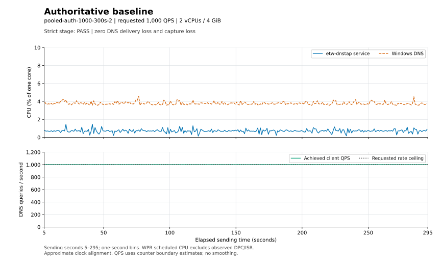
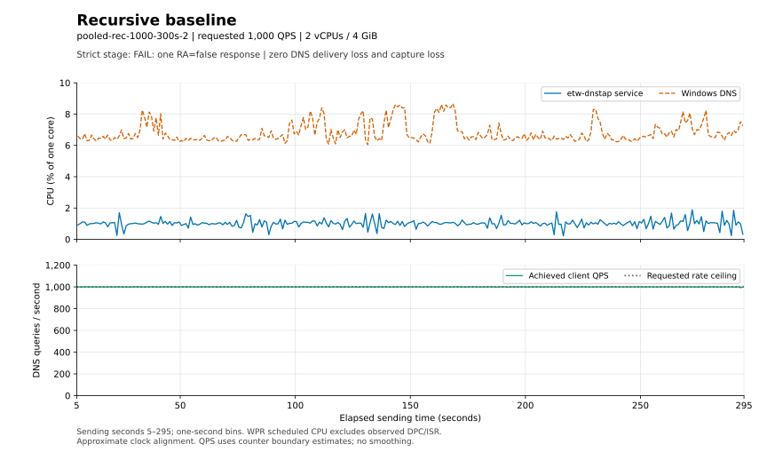
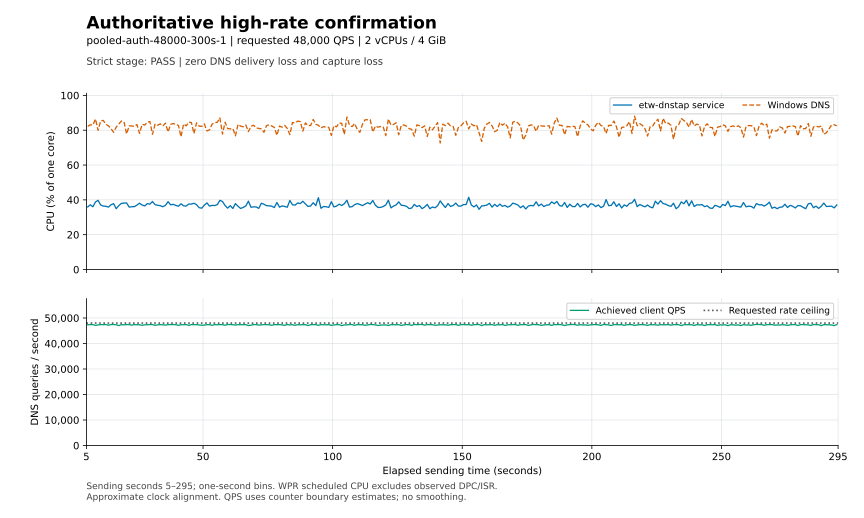
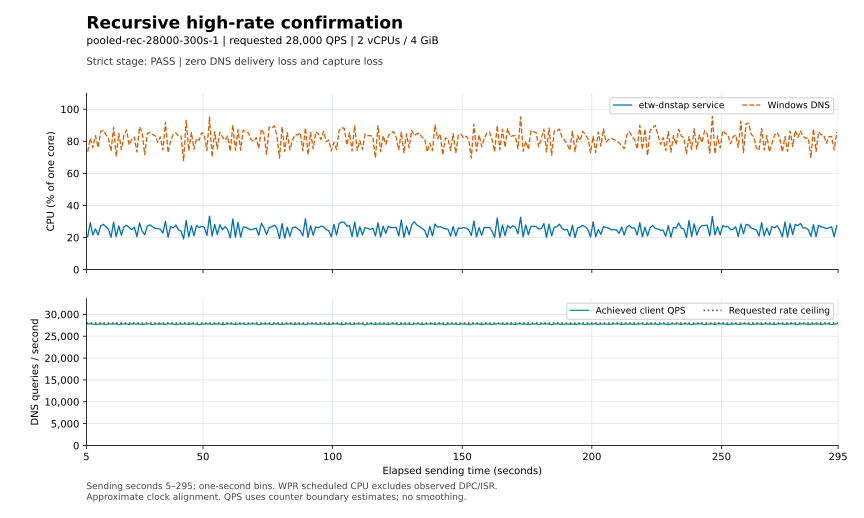

# Pooled intake VM performance review

> **Status:** Current (the latest completed native performance record; the campaign binaries are historical) · **Evidence dated:** October 29, 2026 (campaign `pooled-vm-20261029-0942`) · **Commit:** `2c62a9f` documents these results · **Reviewed:** 2026-11-01

This report helps maintainers assess pooled Event Tracing for Windows (ETW)
capture under actual Windows DNS traffic.

This record describes historical binaries with service JSONL metrics
instrumentation. The TCP-only service has no durable metrics export; its
instrumentation and performance have not been measured by this campaign.
See the [instrumentation compatibility note](../README.md#instrumentation-compatibility-note). Preserved counters,
tables, hashes, and collector artifacts retain their historical meaning.

**Bounded campaign complete.** Both five-minute high-rate confirmations pass
all gates. The 22 measured stages retain **12 strict passes and
10 strict failures**, including overload and DNS/lifecycle qualifications.
All 22 native trace gates pass; that separate result does not clear a strict
stage failure. The two 1,000 QPS repeats exclude the earlier in-load management
inventory. At campaign restoration, normal settings were restored, the reviewed
candidate was retained, and both VMs were Running. These observations are not
an operational capacity guarantee.

See the [campaign plan](pooled-vm-performance-plan.md) for
delegation, approvals, exact commands, fixed workload, resource guards, and
restoration requirements. Evidence root: `target/performance/pooled-vm-20261029-0942`. Table generation:
2026-10-30T01:00:43.595330+00:00.

Use [Measurement terms and result gates](../design/measurement-terms.md) for QPS, record
counts, CPU units, and the independent DNS/capture/lifecycle/trace outcomes.
For the four primary runs, start with [the graphs](#wpr-cpu-and-achieved-qps-over-time);
for every stage, see [the final record ledgers](#workload-and-final-record-ledgers).
Paths such as `build`, `wpa`, and `ubuntu` are relative to the evidence root.

This page is generated by
[`build-pooled-report.py`](../../scripts/performance/build-pooled-report.py).
Update its narrative template and regenerate from the preserved campaign
receipts; keep raw evidence unchanged.

## Observed five-minute confirmations

Each confirmation sends for 300 seconds on the fixed two-vCPU/4 GiB Windows
guest. Both have zero event loss, zero final backlog and output errors, valid
DNS responses, clean Service Control Manager (SCM) exit, exact receiver ledgers,
and full zero-loss Windows Performance Recorder (WPR) coverage. CPU counters use
Windows Performance Data Helper (PDH). These are observed sustained results for the stated A-record and
recursive upstream mix, not universal capacity guarantees.

| Run | Mode | Requested / achieved DNS QPS | Queries sent / valid | Actual upstream Q / R (% of sends) | Received / encoded ETW records | Encoded records / sending s | CPU one core / VM % | PDH valid / send s | Private peak MiB | DNS p99 upper ms |
| --- | --- | --- | --- | --- | --- | --- | --- | --- | --- | --- |
| `pooled-auth-48000-300s-1` | authoritative | 48,000 / 47,303.24 | 14,190,973 / 14,190,973 | 0 / 0 (0.00%) | 28,381,946 / 28,381,946 | 94,606.49 | 36.0372 / 18.0186 | 299.453 / 300.000 | 41.180 | 0.270335 |
| `pooled-rec-28000-300s-1` | recursive | 28,000 / 27,758.24 | 8,327,473 / 8,327,473 | 1,418,559 / 1,418,559 (17.03%) | 19,492,064 / 19,492,064 | 64,973.55 | 24.7405 / 12.3702 | 299.481 / 300.000 | 41.035 | 0.466943 |

The ETW rates divide complete final record counts, including drain, by sending
duration. PDH CPU uses only validated intervals inside the sending window.
These windows differ slightly; no partial-window CPU integral is divided by
whole-run records to claim an exact CPU cost per record. Recursive TTL zero
does not force a cache miss per repeated name.

The next higher short stages lose capture records: authoritative 56,000 requested
QPS drops 65,155 of 6,593,410 received events (0.9882%); recursive 32,000 drops
7,535 of 4,379,440 (0.1721%). Their direct DNS clients still complete all queries
validly. These fixed-order observations bracket this campaign's clean capture
results; they do not establish universal platform capacity or DNS packet-loss
limits. The perturbed original authoritative 48,000 QPS stage remains excluded
from the intrinsic bracket and is preserved separately.

## WPR CPU and achieved QPS over time

The four primary five-minute runs have matched one-second WPR process CPU and
client query-rate graphs for sending seconds 5–295. CPU uses percent of one core
on the two-vCPU, 4 GiB guest; the upper panels show native scheduled process CPU
excluding observed deferred procedure calls and interrupt service routines
(DPC/ISR), distinct from the PDH tables in this report. The
lower panels separate achieved client sends from the requested rate ceiling.
Approximate clock alignment and counter interpolation limit timing precision.
See the [graph methods, numeric CSVs, provenance, and reproduction command](pooled-vm-performance-graphs.md).
The recursive baseline retains one RA=false response and remains a strict
failure despite zero DNS delivery loss and capture loss.

## Build and measured configuration

The locked release invocation, formatting, strict all-target Clippy, reviewed
source identities, actual PE checks, CLI defaults, and build receipt are in
`build`. Cargo reused the reviewed release artifacts; the resulting SHA-256 is
`98FDAB43AA24AE1BE31A7AABCCBDD67A2F64C87DC1C50C428B638B3C091F5D7C`.
The protected baseline `CA3342D8…55264347` remains preserved. Production source
and effective hardening settings stay unchanged during measurement.

The Windows target retains 2 vCPUs, fixed 4 GiB RAM, SCM-only LocalSystem,
enabled service SID, only `SeChangeNotifyPrivilege`, and protected executable/
SCM ACLs. Measured runs use default queue 8,192 and jumbo capacity 64, adding
only a unique metrics prefix. The host client uses two workers, 256 outstanding
requests each, a two-second deadline, and the same 5,000 A-name rotation. A
global requested rate is a ceiling; the achieved-rate gate is at least 98%.
These A workloads do not establish jumbo-pool or heavy DNSSEC capacity.

The authoritative confirmation and subsequent stages use the explicitly
approved temporary Ubuntu data volume for raw receiver JSON, with archives on
the original root volume. CPU, RAM, network, collector YAML, and Frame Streams
behavior stay fixed; only the collector's stdout path changes. Its 64 GiB VHDX
is attached at SCSI 0:2, fully initialized before load, and has filesystem UUID
`3046058a-a6b1-4e74-97f5-a63905494a1f`. Rows identify this receiver-storage
boundary; do not imply matched storage against earlier root-volume stages.

## Workload and final record ledgers

DNS validation failures include flag checks; an RA=false response was received
and is not a lost DNS query/response. Timeouts and send/receive socket errors
are shown separately. Upstream query/reply counts and queries as a percentage
of client sends expose each recursive stage's actual workload intensity;
repeated names and TTL zero do not imply one upstream query per client query.
Received/encoded are ETW records, not DNS packet counts. Intake columns are
ring-full / pool-exhausted / receiver-disconnected. Output/lifecycle columns
show output operation errors / SCM exit code. HWM means observed queue high-water
mark in events. Exact receiver reconciliation
means every encoded record matches durable JSON and all four ingress/egress
counters, including correctly reconciled lossy stages. A strict stage pass
requires all DNS flags, achieved rate, loss, lifecycle, receiver, orchestration,
and native trace gates; the documented continuation qualifications do not turn
a failed stage into a strict pass.

| Run / qualification | Mode | Strict stage | Seconds | Requested / achieved QPS | DNS validation failures (RA subset) | Timeouts / socket errors | Upstream Q / R (% Q/sent) | Received / encoded | Intake categories | Output / SCM | Receiver | HWM |
| --- | --- | --- | --- | --- | --- | --- | --- | --- | --- | --- | --- | --- |
| `pooled-auth-1000-300s-1` (management observer) | authoritative | PASS | 300 | 1,000 / 999.67 | 0 (RA 0) | 0 / 0 | 0 / 0 (0.00%) | 599,802 / 599,802 | 0 / 0 / 0 | 0 / 0 | exact | 3,566 |
| `pooled-rec-1000-300s-1` (management observer) | recursive | FAIL | 300 | 1,000 / 999.62 | 1 (RA 1) | 0 / 0 | 156,264 / 156,264 (52.11%) | 912,302 / 912,302 | 0 / 0 / 0 | 0 / 0 | exact | 3,790 |
| `pooled-auth-2000-60s-1` | authoritative | PASS | 60 | 2,000 / 1,998.75 | 0 (RA 0) | 0 / 0 | 0 / 0 (0.00%) | 239,850 / 239,850 | 0 / 0 / 0 | 0 / 0 | exact | 4,574 |
| `pooled-auth-4000-60s-1` | authoritative | PASS | 60 | 4,000 / 3,994.88 | 0 (RA 0) | 0 / 0 | 0 / 0 (0.00%) | 479,386 / 479,386 | 0 / 0 / 0 | 0 / 0 | exact | 8,032 |
| `pooled-auth-8000-60s-1` (management observer) | authoritative | PASS | 60 | 8,000 / 7,971.15 | 0 (RA 0) | 0 / 0 | 0 / 0 (0.00%) | 956,538 / 956,538 | 0 / 0 / 0 | 0 / 0 | exact | 3,934 |
| `pooled-auth-16000-60s-1` | authoritative | PASS | 60 | 16,000 / 15,908.67 | 0 (RA 0) | 0 / 0 | 0 / 0 (0.00%) | 1,909,040 / 1,909,040 | 0 / 0 / 0 | 0 / 0 | exact | 887 |
| `pooled-auth-32000-60s-1` | authoritative | PASS | 60 | 32,000 / 31,696.00 | 0 (RA 0) | 0 / 0 | 0 / 0 (0.00%) | 3,803,520 / 3,803,520 | 0 / 0 / 0 | 0 / 0 | exact | 2,093 |
| `pooled-auth-64000-60s-1` | authoritative | FAIL | 60 | 64,000 / 62,573.43 | 0 (RA 0) | 0 / 0 | 0 / 0 (0.00%) | 7,508,812 / 6,098,935 | 1,409,877 / 0 / 0 | 0 / 0 | exact | 8,192 |
| `pooled-auth-48000-60s-1` (management observer; excluded threshold) | authoritative | FAIL | 60 | 48,000 / 47,296.28 | 0 (RA 0) | 0 / 0 | 0 / 0 (0.00%) | 5,675,554 / 5,673,351 | 2,203 / 0 / 0 | 0 / 0 | exact | 8,192 |
| `pooled-auth-48000-60s-2` | authoritative | PASS | 60 | 48,000 / 47,288.98 | 0 (RA 0) | 0 / 0 | 0 / 0 (0.00%) | 5,674,678 / 5,674,678 | 0 / 0 / 0 | 0 / 0 | exact | 3,967 |
| `pooled-auth-56000-60s-1` (finish reset) | authoritative | FAIL | 60 | 56,000 / 54,945.08 | 0 (RA 0) | 0 / 0 | 0 / 0 (0.00%) | 6,593,410 / 6,528,255 | 65,155 / 0 / 0 | 1 / 1066 | exact | 8,192 |
| `pooled-auth-48000-300s-1` (receiver data volume) | authoritative | PASS | 300 | 48,000 / 47,303.24 | 0 (RA 0) | 0 / 0 | 0 / 0 (0.00%) | 28,381,946 / 28,381,946 | 0 / 0 / 0 | 0 / 0 | exact | 6,174 |
| `pooled-rec-2000-60s-1` (finish reset; receiver data volume) | recursive | FAIL | 60 | 2,000 / 1,998.75 | 2 (RA 2) | 0 / 0 | 63,035 / 63,035 (52.56%) | 365,920 / 365,920 | 0 / 0 / 0 | 1 / 1066 | exact | 6,080 |
| `pooled-rec-4000-60s-1` (finish reset; receiver data volume) | recursive | FAIL | 60 | 4,000 / 3,989.62 | 0 (RA 0) | 0 / 0 | 121,655 / 121,655 (50.82%) | 722,064 / 722,064 | 0 / 0 / 0 | 1 / 1066 | exact | 2,967 |
| `pooled-rec-8000-60s-1` (receiver data volume) | recursive | PASS | 60 | 8,000 / 7,966.90 | 0 (RA 0) | 0 / 0 | 242,643 / 242,643 (50.76%) | 1,441,314 / 1,441,314 | 0 / 0 / 0 | 0 / 0 | exact | 967 |
| `pooled-rec-16000-60s-1` (receiver data volume) | recursive | FAIL | 60 | 16,000 / 15,922.13 | 2 (RA 2) | 0 / 0 | 258,780 / 258,780 (27.09%) | 2,428,216 / 2,428,216 | 0 / 0 / 0 | 0 / 0 | exact | 1,239 |
| `pooled-rec-32000-60s-1` (receiver data volume) | recursive | FAIL | 60 | 32,000 / 31,691.27 | 0 (RA 0) | 0 / 0 | 288,244 / 288,244 (15.16%) | 4,379,440 / 4,371,905 | 7,535 / 0 / 0 | 0 / 0 | exact | 8,192 |
| `pooled-rec-24000-60s-1` (receiver data volume) | recursive | PASS | 60 | 24,000 / 23,800.92 | 0 (RA 0) | 0 / 0 | 279,040 / 279,040 (19.54%) | 3,414,190 / 3,414,190 | 0 / 0 / 0 | 0 / 0 | exact | 2,291 |
| `pooled-rec-28000-60s-1` (finish reset; receiver data volume) | recursive | FAIL | 60 | 28,000 / 27,759.65 | 4 (RA 4) | 0 / 0 | 278,804 / 278,804 (16.74%) | 3,888,766 / 3,888,766 | 0 / 0 / 0 | 1 / 1066 | exact | 4,966 |
| `pooled-rec-28000-300s-1` (receiver data volume) | recursive | PASS | 300 | 28,000 / 27,758.24 | 0 (RA 0) | 0 / 0 | 1,418,559 / 1,418,559 (17.03%) | 19,492,064 / 19,492,064 | 0 / 0 / 0 | 0 / 0 | exact | 5,293 |
| `pooled-auth-1000-300s-2` (receiver data volume) | authoritative | PASS | 300 | 1,000 / 999.70 | 0 (RA 0) | 0 / 0 | 0 / 0 (0.00%) | 599,820 / 599,820 | 0 / 0 / 0 | 0 / 0 | exact | 3,634 |
| `pooled-rec-1000-300s-2` (receiver data volume) | recursive | FAIL | 300 | 1,000 / 999.68 | 1 (RA 1) | 0 / 0 | 155,074 / 155,074 (51.71%) | 909,954 / 909,954 | 0 / 0 / 0 | 0 / 0 | exact | 4,786 |

For the lossy stages in this table, missing captured operations are the direct-client
or actual-upstream packet count minus the exact archived operation count.
Their sum equals native ring-admission loss. These are missing capture records;
the direct DNS client separately measures whether queries or responses were lost.

| Run / qualification | Missing CLIENT_QUERY | Missing CLIENT_RESPONSE | Missing RESOLVER_QUERY | Missing RESOLVER_RESPONSE | Sum = ring drops |
| --- | --- | --- | --- | --- | --- |
| `pooled-auth-64000-60s-1` | 705,662 | 704,215 | 0 | 0 | 1,409,877 |
| `pooled-auth-48000-60s-1` (management observer; excluded threshold) | 1,103 | 1,100 | 0 | 0 | 2,203 |
| `pooled-auth-56000-60s-1` (finish reset) | 32,622 | 32,533 | 0 | 0 | 65,155 |
| `pooled-rec-32000-60s-1` (receiver data volume) | 2,499 | 2,506 | 1,264 | 1,266 | 7,535 |

The remaining native loss categories and final closure are shown separately.
Ignored and rejected records are parser outcomes; output operation errors appear
in the workload table because a failed final exchange can occur after every
encoded record reaches the receiver. A valid final ETW statistics query with
zero cumulative loss establishes the final ETW loss gate; transient statistics
query errors remain visible. Both capture and parser ledger residuals must be zero.

| Run / qualification | Callback errors | Ignored / rejected | Output limit / failed events | ETW events / buffers lost | Final stats valid / query errors | Final backlog | Capture / parser residual |
| --- | --- | --- | --- | --- | --- | --- | --- |
| `pooled-auth-1000-300s-1` (management observer) | 0 | 0 / 0 | 0 / 0 | 0 / 0 | True / 0 | 0 | 0 / 0 |
| `pooled-rec-1000-300s-1` (management observer) | 0 | 0 / 0 | 0 / 0 | 0 / 0 | True / 0 | 0 | 0 / 0 |
| `pooled-auth-2000-60s-1` | 0 | 0 / 0 | 0 / 0 | 0 / 0 | True / 0 | 0 | 0 / 0 |
| `pooled-auth-4000-60s-1` | 0 | 0 / 0 | 0 / 0 | 0 / 0 | True / 0 | 0 | 0 / 0 |
| `pooled-auth-8000-60s-1` (management observer) | 0 | 0 / 0 | 0 / 0 | 0 / 0 | True / 0 | 0 | 0 / 0 |
| `pooled-auth-16000-60s-1` | 0 | 0 / 0 | 0 / 0 | 0 / 0 | True / 0 | 0 | 0 / 0 |
| `pooled-auth-32000-60s-1` | 0 | 0 / 0 | 0 / 0 | 0 / 0 | True / 0 | 0 | 0 / 0 |
| `pooled-auth-64000-60s-1` | 0 | 0 / 0 | 0 / 0 | 0 / 0 | True / 0 | 0 | 0 / 0 |
| `pooled-auth-48000-60s-1` (management observer; excluded threshold) | 0 | 0 / 0 | 0 / 0 | 0 / 0 | True / 0 | 0 | 0 / 0 |
| `pooled-auth-48000-60s-2` | 0 | 0 / 0 | 0 / 0 | 0 / 0 | True / 0 | 0 | 0 / 0 |
| `pooled-auth-56000-60s-1` (finish reset) | 0 | 0 / 0 | 0 / 0 | 0 / 0 | True / 0 | 0 | 0 / 0 |
| `pooled-auth-48000-300s-1` (receiver data volume) | 0 | 0 / 0 | 0 / 0 | 0 / 0 | True / 0 | 0 | 0 / 0 |
| `pooled-rec-2000-60s-1` (finish reset; receiver data volume) | 0 | 0 / 0 | 0 / 0 | 0 / 0 | True / 0 | 0 | 0 / 0 |
| `pooled-rec-4000-60s-1` (finish reset; receiver data volume) | 0 | 0 / 0 | 0 / 0 | 0 / 0 | True / 0 | 0 | 0 / 0 |
| `pooled-rec-8000-60s-1` (receiver data volume) | 0 | 0 / 0 | 0 / 0 | 0 / 0 | True / 0 | 0 | 0 / 0 |
| `pooled-rec-16000-60s-1` (receiver data volume) | 0 | 0 / 0 | 0 / 0 | 0 / 0 | True / 0 | 0 | 0 / 0 |
| `pooled-rec-32000-60s-1` (receiver data volume) | 0 | 0 / 0 | 0 / 0 | 0 / 0 | True / 0 | 0 | 0 / 0 |
| `pooled-rec-24000-60s-1` (receiver data volume) | 0 | 0 / 0 | 0 / 0 | 0 / 0 | True / 0 | 0 | 0 / 0 |
| `pooled-rec-28000-60s-1` (finish reset; receiver data volume) | 0 | 0 / 0 | 0 / 0 | 0 / 0 | True / 0 | 0 | 0 / 0 |
| `pooled-rec-28000-300s-1` (receiver data volume) | 0 | 0 / 0 | 0 / 0 | 0 / 0 | True / 0 | 0 | 0 / 0 |
| `pooled-auth-1000-300s-2` (receiver data volume) | 0 | 0 / 0 | 0 / 0 | 0 / 0 | True / 0 | 0 | 0 / 0 |
| `pooled-rec-1000-300s-2` (receiver data volume) | 0 | 0 / 0 | 0 / 0 | 0 / 0 | True / 0 | 0 | 0 / 0 |

## CPU, memory, and latency

Service CPU is the duration-weighted PID-validated PDH mean, in percent of one
CPU and percent of this two-vCPU VM. CPU work and valid interval coverage are
separate. Memory peaks show bytes / MiB. Latency percentiles are histogram upper
bounds for matched responses, exclude timeouts, and have no coordinated-omission
correction. WPR scheduled CPU includes interrupt attribution unless explicitly
excluded and must not be forced to equal PDH or sampled CPU.

| Run / qualification | Service CPU one core / VM % | CPU-s / valid s | Rows | DNS one-core % | Private peak B / MiB | Working peak B / MiB | p99 upper ms |
| --- | --- | --- | --- | --- | --- | --- | --- |
| `pooled-auth-1000-300s-1` (management observer) | 0.6782 / 0.3391 | 2.0313 / 299.504 | 299 | 3.6518 | 43,630,592 / 41.609 | 49,152,000 / 46.875 | 0.466943 |
| `pooled-rec-1000-300s-1` (management observer) | 0.9600 / 0.4800 | 2.8749 / 299.479 | 300 | 6.8268 | 43,986,944 / 41.949 | 49,672,192 / 47.371 | 0.851967 |
| `pooled-auth-2000-60s-1` | 1.2723 / 0.6361 | 0.7568 / 59.481 | 60 | 7.6956 | 44,109,824 / 42.066 | 49,766,400 / 47.461 | 0.270335 |
| `pooled-auth-4000-60s-1` | 2.4029 / 1.2015 | 1.4293 / 59.483 | 60 | 13.8948 | 44,158,976 / 42.113 | 49,819,648 / 47.512 | 0.245759 |
| `pooled-auth-8000-60s-1` (management observer) | 4.8459 / 2.4230 | 2.8824 / 59.480 | 60 | 28.5643 | 43,298,816 / 41.293 | 48,947,200 / 46.680 | 0.249855 |
| `pooled-auth-16000-60s-1` | 10.1232 / 5.0616 | 6.0219 / 59.486 | 60 | 56.4275 | 43,024,384 / 41.031 | 48,664,576 / 46.410 | 0.221183 |
| `pooled-auth-32000-60s-1` | 21.3799 / 10.6900 | 12.7187 / 59.489 | 60 | 74.3343 | 43,032,576 / 41.039 | 48,697,344 / 46.441 | 0.212991 |
| `pooled-auth-64000-60s-1` | 42.3933 / 21.1966 | 25.2159 / 59.481 | 60 | 83.3843 | 43,294,720 / 41.289 | 48,971,776 / 46.703 | 0.983039 |
| `pooled-auth-48000-60s-1` (management observer; excluded threshold) | 35.1481 / 17.5740 | 20.9008 / 59.465 | 57 | 78.3096 | 43,061,248 / 41.066 | 48,775,168 / 46.516 | 0.270335 |
| `pooled-auth-48000-60s-2` | 35.3533 / 17.6766 | 21.0253 / 59.472 | 60 | 77.2043 | 43,040,768 / 41.047 | 48,750,592 / 46.492 | 0.294911 |
| `pooled-auth-56000-60s-1` (finish reset) | 45.0348 / 22.5174 | 26.7871 / 59.481 | 60 | 79.5895 | 43,024,384 / 41.031 | 48,754,688 / 46.496 | 0.688127 |
| `pooled-auth-48000-300s-1` (receiver data volume) | 36.0372 / 18.0186 | 107.9145 / 299.453 | 300 | 79.0827 | 43,180,032 / 41.180 | 48,893,952 / 46.629 | 0.270335 |
| `pooled-rec-2000-60s-1` (finish reset; receiver data volume) | 1.7990 / 0.8995 | 1.0707 / 59.517 | 60 | 13.3638 | 44,376,064 / 42.320 | 49,864,704 / 47.555 | 0.786431 |
| `pooled-rec-4000-60s-1` (finish reset; receiver data volume) | 3.1912 / 1.5956 | 1.8985 / 59.493 | 60 | 26.4488 | 43,634,688 / 41.613 | 49,025,024 / 46.754 | 0.655359 |
| `pooled-rec-8000-60s-1` (receiver data volume) | 6.8798 / 3.4399 | 4.0939 / 59.506 | 60 | 44.8148 | 43,028,480 / 41.035 | 48,398,336 / 46.156 | 0.540671 |
| `pooled-rec-16000-60s-1` (receiver data volume) | 14.0544 / 7.0272 | 8.3580 / 59.469 | 60 | 66.6752 | 43,024,384 / 41.031 | 48,418,816 / 46.176 | 0.499711 |
| `pooled-rec-32000-60s-1` (receiver data volume) | 27.9855 / 13.9928 | 16.6480 / 59.488 | 60 | 79.1570 | 43,032,576 / 41.039 | 48,488,448 / 46.242 | 0.466943 |
| `pooled-rec-24000-60s-1` (receiver data volume) | 20.3718 / 10.1859 | 12.1139 / 59.464 | 60 | 75.3023 | 43,069,440 / 41.074 | 48,476,160 / 46.230 | 0.458751 |
| `pooled-rec-28000-60s-1` (finish reset; receiver data volume) | 26.1692 / 13.0846 | 15.5390 / 59.379 | 60 | 77.8060 | 43,028,480 / 41.035 | 48,427,008 / 46.184 | 0.450559 |
| `pooled-rec-28000-300s-1` (receiver data volume) | 24.7405 / 12.3702 | 74.0930 / 299.481 | 300 | 78.4281 | 43,028,480 / 41.035 | 48,599,040 / 46.348 | 0.466943 |
| `pooled-auth-1000-300s-2` (receiver data volume) | 0.6522 / 0.3261 | 1.9531 / 299.465 | 300 | 3.7459 | 43,614,208 / 41.594 | 49,086,464 / 46.812 | 0.237567 |
| `pooled-rec-1000-300s-2` (receiver data volume) | 1.0591 / 0.5296 | 3.1718 / 299.471 | 300 | 6.5843 | 43,827,200 / 41.797 | 49,192,960 / 46.914 | 0.753663 |

The optional receiver visibility-delay distribution is unavailable: these exact
archive scans did not enable the monitor/provider-time calculation, and no
archive is rescanned to manufacture it. Preserved one-second file-size samples
show coarse output visibility; their cadence is not a measured per-packet
network latency or fsync durability bound. Direct DNS latency remains separate.

The generator and Ubuntu resource measurements for the primary 300-second runs
are shown separately. Host client CPU is weighted over sampled sending-window
intervals and normalized to one core and the 24-logical-processor host. Memory
columns are sampled peaks. Host total CPU is an arithmetic sample mean. Ubuntu
collector/upstream CPU estimates interpolate one-second Ubuntu samples at the
client sending boundaries. They remain distinct from the Windows PDH-valid
intervals and are not exact common-window or CPU-per-record measurements.

| Run | Host client CPU one core / host % | CPU intervals | Client private / working peak MiB | Host total CPU mean % | Ubuntu collector one-core % estimated | Ubuntu upstream one-core % estimated |
| --- | --- | --- | --- | --- | --- | --- |
| `pooled-auth-48000-300s-1` | 198.807 / 8.284 | 233 | 6.406 / 10.414 | 23.751 | 30.900 | 0.000 |
| `pooled-rec-28000-300s-1` | 198.427 / 8.268 | 234 | 6.398 / 10.355 | 22.966 | 22.247 | 9.182 |
| `pooled-auth-1000-300s-2` | 199.381 / 8.308 | 233 | 6.355 / 10.309 | 11.129 | 0.723 | 0.000 |
| `pooled-rec-1000-300s-2` | 198.720 / 8.280 | 234 | 6.398 / 10.348 | 12.380 | 1.061 | 1.616 |

## Descriptive comparison with the capacity-only baseline

The historical 300-second capacity-only runs and the clean pooled 1,000 QPS
repeats use the same client settings and two-vCPU/4 GiB Windows VM. The table
shows actual event rates and upstream fractions because nominal QPS alone does
not establish equal recursive work. The historical WPR trace retains only part
of its workload in memory mode; the pooled runs record the full stage in file
mode with 128 MiB configured WPR buffers. Receiver storage also differs. These
single trials describe resource use under their stated methods and do not
establish a causal CPU saving from pooling, a run-to-run variance, or a reason
to shrink either pool or queue. The larger pooled private-memory footprint
includes its preallocated storage; process private bytes are distinct from
the counted 37.32 MiB pool/channel budget.

| Run / instrumentation | Mode | Actual QPS | Encoded records/s | Upstream Q / client sent | Service CPU one core / VM % | CPU-s / valid s | Private peak MiB | DNS p99 upper ms | p99 / historical | DNS validity failures |
| --- | --- | --- | --- | --- | --- | --- | --- | --- | --- | --- |
| `ringfix-capacity8192-auth-300s-1` (capacity-only; partial memory-mode WPR) | authoritative | 998.80 | 1,997.59 | 0.00% | 0.9243 / 0.4621 | 2.7657 / 299.220 | 4.633 | 0.393215 | 1.000x | 0 |
| `pooled-auth-1000-300s-2` (pooled; full file-mode WPR; clean observer) | authoritative | 999.70 | 1,999.40 | 0.00% | 0.6522 / 0.3261 | 1.9531 / 299.465 | 41.594 | 0.237567 | 0.604x | 0 |
| `ringfix-capacity8192-rec-300s-1` (capacity-only; partial memory-mode WPR) | recursive | 999.56 | 3,018.29 | 50.98% | 1.0799 / 0.5400 | 3.2344 / 299.505 | 4.582 | 0.770047 | 1.000x | 1 |
| `pooled-rec-1000-300s-2` (pooled; full file-mode WPR; clean observer) | recursive | 999.68 | 3,033.18 | 51.71% | 1.0591 / 0.5296 | 3.1718 / 299.471 | 41.797 | 0.753663 | 0.979x | 1 |

The preserved [capacity-only report](../history/ring-buffer-fix-validation.md) supplies
the historical method and limitations. Original pooled 1,000 QPS runs remain
in the full tables with their management-observer qualification; the clean
repeats provide the primary pooled baseline resource measurements.

## Thread and handle coverage

All per-thread PID/TID, CPU/user/kernel rates, context-switch rates, state, and
wait-reason samples remain in the raw BLG/CSV and per-run `analysis.json`.
Consecutive identity transitions invalidate rates and are counted in this table rather
than interpreted as CPU spikes. Actual WPR thread lifetimes and CPU Precise
data supplement interval-sampled thread state; they do not recreate missing
application loss counters.

| Run / qualification | Threads | Handles | Thread samples | Incomplete | Invalid PID | Rejected thread rates |
| --- | --- | --- | --- | --- | --- | --- |
| `pooled-auth-1000-300s-1` (management observer) | 7–9 | 99–102 | 299 | 0 | 0 | 34 |
| `pooled-rec-1000-300s-1` (management observer) | 7–9 | 99–102 | 300 | 0 | 0 | 37 |
| `pooled-auth-2000-60s-1` | 7–9 | 102–102 | 60 | 0 | 0 | 19 |
| `pooled-auth-4000-60s-1` | 7–9 | 102–102 | 60 | 0 | 0 | 19 |
| `pooled-auth-8000-60s-1` (management observer) | 7–9 | 102–102 | 60 | 0 | 0 | 19 |
| `pooled-auth-16000-60s-1` | 7–9 | 102–102 | 60 | 0 | 0 | 19 |
| `pooled-auth-32000-60s-1` | 7–9 | 102–102 | 60 | 0 | 0 | 19 |
| `pooled-auth-64000-60s-1` | 7–9 | 102–102 | 60 | 0 | 0 | 19 |
| `pooled-auth-48000-60s-1` (management observer; excluded threshold) | 7–9 | 102–102 | 57 | 0 | 0 | 19 |
| `pooled-auth-48000-60s-2` | 7–9 | 102–102 | 60 | 0 | 0 | 19 |
| `pooled-auth-56000-60s-1` (finish reset) | 7–9 | 102–102 | 60 | 0 | 0 | 19 |
| `pooled-auth-48000-300s-1` (receiver data volume) | 7–9 | 99–102 | 300 | 0 | 0 | 36 |
| `pooled-rec-2000-60s-1` (finish reset; receiver data volume) | 7–9 | 102–102 | 60 | 0 | 0 | 19 |
| `pooled-rec-4000-60s-1` (finish reset; receiver data volume) | 7–9 | 102–102 | 60 | 0 | 0 | 19 |
| `pooled-rec-8000-60s-1` (receiver data volume) | 7–9 | 102–102 | 60 | 0 | 0 | 19 |
| `pooled-rec-16000-60s-1` (receiver data volume) | 7–9 | 102–102 | 60 | 0 | 0 | 19 |
| `pooled-rec-32000-60s-1` (receiver data volume) | 7–9 | 102–102 | 60 | 0 | 0 | 19 |
| `pooled-rec-24000-60s-1` (receiver data volume) | 7–10 | 102–102 | 60 | 0 | 0 | 24 |
| `pooled-rec-28000-60s-1` (finish reset; receiver data volume) | 7–9 | 102–102 | 60 | 0 | 0 | 19 |
| `pooled-rec-28000-300s-1` (receiver data volume) | 7–9 | 99–102 | 300 | 0 | 0 | 34 |
| `pooled-auth-1000-300s-2` (receiver data volume) | 7–9 | 99–102 | 300 | 0 | 0 | 38 |
| `pooled-rec-1000-300s-2` (receiver data volume) | 7–9 | 99–102 | 300 | 0 | 0 | 36 |

The following service I/O and page-fault rates are arithmetic means of valid
one-second PDH samples. Page faults include soft faults; they are not hard-fault
counts. Virtual bytes measure reserved address space, not committed or resident
memory. Guest available memory is in MiB. Process I/O counters do not establish
network record delivery or disk durability; the exact receiver ledger remains
the delivery evidence.

| Run / qualification | Virtual peak B | Faults/s | Read / write B/s | Read / write / other ops/s | Guest available MiB min | CPU queue max |
| --- | --- | --- | --- | --- | --- | --- |
| `pooled-auth-1000-300s-1` (management observer) | 2,203,448,729,600 | 71.398 | 0.000 / 553.785 | 0.000 / 0.992 / 0.027 | 2095.0 | 4 |
| `pooled-rec-1000-300s-1` (management observer) | 2,203,448,766,464 | 134.594 | 0.000 / 555.681 | 0.000 / 0.993 / 0.026 | 2022.0 | 4 |
| `pooled-auth-2000-60s-1` | 2,203,448,881,152 | 160.699 | 0.000 / 556.897 | 0.000 / 1.000 / 0.132 | 2238.0 | 1 |
| `pooled-auth-4000-60s-1` | 2,203,449,061,376 | 287.700 | 0.000 / 558.157 | 0.000 / 1.000 / 0.133 | 2247.0 | 1 |
| `pooled-auth-8000-60s-1` (management observer) | 2,203,448,537,088 | 192.374 | 0.000 / 560.053 | 0.000 / 1.000 / 0.131 | 2074.0 | 1 |
| `pooled-auth-16000-60s-1` | 2,203,448,274,944 | 3.836 | 0.000 / 562.146 | 0.000 / 1.000 / 0.131 | 2254.0 | 2 |
| `pooled-auth-32000-60s-1` | 2,203,448,274,944 | 8.527 | 0.000 / 564.991 | 0.000 / 1.000 / 0.133 | 2246.0 | 3 |
| `pooled-auth-64000-60s-1` | 2,203,448,537,088 | 821.568 | 0.000 / 578.024 | 0.000 / 1.001 / 0.149 | 2257.0 | 3 |
| `pooled-auth-48000-60s-1` (management observer; excluded threshold) | 2,203,448,274,944 | 387.928 | 0.000 / 568.523 | 0.000 / 1.000 / 0.140 | 2257.0 | 4 |
| `pooled-auth-48000-60s-2` | 2,203,448,274,944 | 136.886 | 0.000 / 566.204 | 0.000 / 1.000 / 0.135 | 2495.0 | 3 |
| `pooled-auth-56000-60s-1` (finish reset) | 2,203,448,274,944 | 549.150 | 0.000 / 575.734 | 0.000 / 1.004 / 0.152 | 2500.0 | 3 |
| `pooled-auth-48000-300s-1` (receiver data volume) | 2,203,448,340,480 | 163.031 | 0.000 / 565.182 | 0.000 / 0.991 / 0.030 | 2587.0 | 4 |
| `pooled-rec-2000-60s-1` (finish reset; receiver data volume) | 2,203,448,848,384 | 184.820 | 0.000 / 548.709 | 0.000 / 0.983 / 0.133 | 2775.0 | 1 |
| `pooled-rec-4000-60s-1` (finish reset; receiver data volume) | 2,203,448,864,768 | 197.609 | 0.000 / 559.380 | 0.000 / 1.000 / 0.134 | 2758.0 | 2 |
| `pooled-rec-8000-60s-1` (receiver data volume) | 2,203,448,274,944 | 4.623 | 0.000 / 561.482 | 0.000 / 1.000 / 0.132 | 2722.0 | 2 |
| `pooled-rec-16000-60s-1` (receiver data volume) | 2,203,448,274,944 | 4.155 | 0.000 / 563.677 | 0.000 / 1.000 / 0.131 | 2726.0 | 2 |
| `pooled-rec-32000-60s-1` (receiver data volume) | 2,203,448,274,944 | 62.795 | 0.000 / 572.451 | 0.000 / 1.001 / 0.131 | 2704.0 | 2 |
| `pooled-rec-24000-60s-1` (receiver data volume) | 2,203,450,372,096 | 10.622 | 0.000 / 564.745 | 0.000 / 1.000 / 0.131 | 2717.0 | 3 |
| `pooled-rec-28000-60s-1` (finish reset; receiver data volume) | 2,203,448,274,944 | 14.885 | 0.000 / 565.299 | 0.000 / 1.000 / 0.131 | 2669.0 | 3 |
| `pooled-rec-28000-300s-1` (receiver data volume) | 2,203,448,274,944 | 22.049 | 0.000 / 563.519 | 0.000 / 0.990 / 0.026 | 2661.0 | 4 |
| `pooled-auth-1000-300s-2` (receiver data volume) | 2,203,448,717,312 | 99.824 | 0.000 / 554.959 | 0.000 / 0.993 / 0.027 | 2684.0 | 1 |
| `pooled-rec-1000-300s-2` (receiver data volume) | 2,203,449,057,280 | 141.985 | 0.000 / 557.362 | 0.000 / 0.997 / 0.027 | 2692.0 | 2 |

## Actual WPR evidence and limitations

Every stage retains an actual native ETL from the validated single full-stage
file-mode profile: CPU sampling, CSwitch/ReadyThread and stacks, process/thread
lifetimes, disk/file I/O, and hard faults, with 128 × 1,024 KiB buffers. Native
headers, event retention, lost-event/buffer counters, and continuous scheduling
coverage are inspected per run. See the separate
[trace analysis](pooled-vm-trace-analysis.md) and per-run `wpa` evidence.

An inspected zero-loss ETL is distinct from an optional WPA export. The initial
1,000 QPS stages have matched and broad exported views; the first 64,000 QPS
failure has focused early/late views. Other discovery stages have native
inspection gates and retained ETLs; their optional exports remain deferred.
The final coverage table records inspection and selected exports separately.

| Run / qualification | ETL bytes | Header retained s | Actual scheduling coverage s | Lost events / buffers | Sending interval | Native trace gate | Successful optional WPA views |
| --- | --- | --- | --- | --- | --- | --- | --- |
| `pooled-auth-1000-300s-1` (management observer) | 776,994,816 | 320.198768 | 0–320.204962; continuous | 0 / 0 | contained | pass | broad, matched |
| `pooled-rec-1000-300s-1` (management observer) | 663,748,608 | 320.689019 | 0–320.697657; continuous | 0 / 0 | contained | pass | broad, matched |
| `pooled-auth-2000-60s-1` | 193,986,560 | 79.297179 | 0–79.297719; continuous | 0 / 0 | contained | pass | none; ETL inspected |
| `pooled-auth-4000-60s-1` | 285,212,672 | 79.318923 | 0–79.319147; continuous | 0 / 0 | contained | pass | none; ETL inspected |
| `pooled-auth-8000-60s-1` (management observer) | 483,393,536 | 79.309317 | 0–79.309405; continuous | 0 / 0 | contained | pass | none; ETL inspected |
| `pooled-auth-16000-60s-1` | 806,354,944 | 79.797580 | 0–79.799534; continuous | 0 / 0 | contained | pass | none; ETL inspected |
| `pooled-auth-32000-60s-1` | 1,112,539,136 | 80.099556 | 0–80.100141; continuous | 0 / 0 | contained | pass | none; ETL inspected |
| `pooled-auth-64000-60s-1` | 1,785,724,928 | 84.069067 | 0–84.069261; continuous | 0 / 0 | contained | pass | early, late |
| `pooled-auth-48000-60s-1` (management observer; excluded threshold) | 1,577,058,304 | 84.239121 | 0–84.240050; continuous | 0 / 0 | contained | pass | none; ETL inspected |
| `pooled-auth-48000-60s-2` | 1,408,237,568 | 82.061765 | 0–82.061981; continuous | 0 / 0 | contained | pass | none; ETL inspected |
| `pooled-auth-56000-60s-1` (finish reset) | 1,666,187,264 | 82.432998 | 0–82.433183; continuous | 0 / 0 | contained | pass | none; ETL inspected |
| `pooled-auth-48000-300s-1` (receiver data volume) | 6,859,784,192 | 320.178539 | 0–320.181360; continuous | 0 / 0 | contained | pass | broad, matched |
| `pooled-rec-2000-60s-1` (finish reset; receiver data volume) | 263,192,576 | 80.758128 | 0–80.758244; continuous | 0 / 0 | contained | pass | none; ETL inspected |
| `pooled-rec-4000-60s-1` (finish reset; receiver data volume) | 390,070,272 | 80.744253 | 0–80.750248; continuous | 0 / 0 | contained | pass | none; ETL inspected |
| `pooled-rec-8000-60s-1` (receiver data volume) | 564,133,888 | 81.668708 | 0–81.670128; continuous | 0 / 0 | contained | pass | none; ETL inspected |
| `pooled-rec-16000-60s-1` (receiver data volume) | 838,860,800 | 81.589317 | 0–81.589760; continuous | 0 / 0 | contained | pass | none; ETL inspected |
| `pooled-rec-32000-60s-1` (receiver data volume) | 1,168,113,664 | 82.152163 | 0–82.154389; continuous | 0 / 0 | contained | pass | early-loss, late-loss |
| `pooled-rec-24000-60s-1` (receiver data volume) | 1,003,487,232 | 81.680043 | 0–81.680789; continuous | 0 / 0 | contained | pass | none; ETL inspected |
| `pooled-rec-28000-60s-1` (finish reset; receiver data volume) | 1,105,199,104 | 82.352032 | 0–82.354323; continuous | 0 / 0 | contained | pass | none; ETL inspected |
| `pooled-rec-28000-300s-1` (receiver data volume) | 5,250,220,032 | 323.209982 | 0–323.215879; continuous | 0 / 0 | contained | pass | broad, matched |
| `pooled-auth-1000-300s-2` (receiver data volume) | 516,947,968 | 321.592921 | 0–321.596867; continuous | 0 / 0 | contained | pass | broad, matched |
| `pooled-rec-1000-300s-2` (receiver data volume) | 646,971,392 | 321.407682 | 0–321.411451; continuous | 0 / 0 | contained | pass | broad, matched |

The derivative `wpa/trace-gates-v1.json` records canonical hashes and exact
inspection source paths without changing any raw receipt. An exported view
samples its stated interval; it does not establish full-stage absence of waits,
locks, faults, or application loss.

The release has no matching PDB/CodeView record. Rust application function names
cannot be recovered reliably from unrelated symbols. Module/address and named
thread attribution remain available. File/hard-fault coverage with zero target
events is a measured zero, not a claim that the provider was disabled.

The clean low-rate repeats' matched 20-second views retain median positive
parser Wait intervals of about 15.95 ms. These are scheduler waits, not DNS
latency or proof of the source's configured 2 ms park deadline. The continuously
dropping authoritative 64k late view has substantial parser Ready time and no
positive Wait observations; recursive 32k loss-centered views contain both
Ready and Wait. Those wider windows cannot identify the exact overflowing burst
or establish a TDH lock, timer, driver, or sole scheduler cause. See the measured
[primary scheduling comparisons](pooled-vm-trace-analysis.md#primary-five-minute-comparisons)
and [recursive loss windows](pooled-vm-trace-analysis.md#recursive-32k-loss-centered-windows).

Corrected 290-second I/O views retain one 4 KiB service read/hard fault in
`tdh.dll` during the authoritative repeat and 272 DNS pagefile reads/faults
totaling 10,006,528 bytes during the recursive confirmation. The other primary
service/DNS pairs have zero in-view disk events or hard faults. Explicit event
time filtering excludes WPA rows returned outside the requested view. Observed
service FileIo writes point to metrics JSONL; cached writes and TCP output have
different accounting. These observations do not establish an I/O bottleneck.
Exact sources, thread lifetimes and boundary qualifications remain in the
[trace tables](pooled-vm-trace-analysis.md#primary-five-minute-comparisons) and
`wpa/native-comparison-v1.json`; all ten comparison views and 44 native actions
complete successfully.

The initial 64,000 QPS stage lost 1,409,877 of 7,508,812 ETW records (18.7763%)
at channel admission while all 3,754,406 DNS requests completed valid. Loss
appears throughout all 60 sampled sending intervals. Focused native scheduling
shows substantial parser Ready time during persistent backlog; naming a TDH or
lock cause requires additional proof. Empty-queue waits in low-load traces
do not establish the cause of a full-queue high-rate failure.

## Measurement qualifications and lifecycle findings

An approximately twelve-hour idle gap follows the first 18 completed stages.
Read-only recovery at 2026-10-30 00:03 UTC verifies the exact VM/resources/hash,
stopped SCM service, no active WPR or campaign counter/load process, and no
Windows 28,000 QPS artifacts. The unused Ubuntu READY epoch has only 1,026 raw
bytes and no connection; its files remain under `ubuntu/stale-ready-20261029-1141`.
The pending midpoint receives fresh READY and clock bounds before load. Neither
VM is restarted, and no interrupted Windows load is presented as completed.
See `recovery-preflight-20261030.json` and the preserved fresh stage budgets.

Post-load runner review identifies a separate WPR cleanup limitation: native
start can succeed before the helper writes ownership and returns to the
controller's `traceStarted` assignment. A failure in that window can leave a
recording active. The generic marker is insufficient to identify a live
recording safely; no stale-marker cancellation or unvalidated cleanup change is
introduced. Future recovery must preserve state and verify current ownership
before stopping anything. This error path is not observed in these stages;
recovery/final checks show no recording left active. See
`build/wpr-cleanup-review-20261030.json` and the campaign plan.

The historical management audit, helper diff, and exact read-only fix proof are
preserved in `build/management-overlap-audit-v1.json` and
`build/status-helper-fix.diff`. Original 1,000 QPS runs and auth 8,000 QPS include
an in-load 5,000-record DNS management inventory. Their capture evidence remains
valid but CPU comparison is qualified. The original 48,000 QPS run is explicitly
perturbed and excluded from the intrinsic threshold bracket; its two drop
intervals overlap the management call envelope. Causation is not proven. Its
raw failure remains preserved, followed by one coordinator-authorized clean
replacement. Subsequent load uses only existing guards and native metric tails.

The first authoritative run's controller reported a null wrapper exit code;
the actual DNS client exit was zero and complete raw evidence reconciled. The
raw controller failure and `completion-assessment.json` remain preserved. The
retained-handle correction was checked with non-load child exit codes zero and
seven before later load.

The following stages have a distinct failed lifecycle: operation errors increase
only at final finish, while every encoded record reaches the exact receiver
archive. Each raw Application Event ID 1 matches the service PID and final time
and records the exact STOP/FINISH Winsock 10054 chain. SCM returns 1066 with
service-specific code 1. Final native/parser ledgers close with zero backlog;
these sub-millisecond final operations do not indicate the two-second deadline.
The coordinator permits continuation only under this exact documented exception;
each stage remains a strict lifecycle failure.

| Run | PID | Application record | Event UTC | Live / final operation errors | Final operation ms | SCM / specific exit | Encoded = exact receiver |
| --- | --- | --- | --- | --- | --- | --- | --- |
| `pooled-auth-56000-60s-1` | 4784 | 127 | 2026-10-29T10:28:50.7720946Z | 0 / 1 | 0.4412 | 1066 / 1 | 6,528,255 |
| `pooled-rec-2000-60s-1` | 2500 | 132 | 2026-10-29T11:06:47.0141949Z | 0 / 1 | 0.4621 | 1066 / 1 | 365,920 |
| `pooled-rec-4000-60s-1` | 4536 | 135 | 2026-10-29T11:13:47.2363564Z | 0 / 1 | 0.5466 | 1066 / 1 | 722,064 |
| `pooled-rec-28000-60s-1` | 2932 | 254 | 2026-10-30T00:06:30.1443184Z | 0 / 1 | 0.5697 | 1066 / 1 | 3,888,766 |

The receiver stays active through each stable end marker. Its pinned effective
configuration has `reset-conn=true`; source inspection shows `SetLinger(0)` after
FINISH flush, consistent with this final-only mechanism. A reset log appears on
clean runs too, and source/configuration evidence does not prove the exact wire
cause of any occurrence. The same error chain exists in the pre-deployment
baseline. No timeout, Frame Streams option, code, or FINISH validation is changed.
See each `stages/RUN/lifecycle-assessment.json`, raw event XML, and the independent
[trace and source analysis](pooled-vm-trace-analysis.md).

## Restoration and validation

`windows-campaign/final-policy-proof.json` verifies the running SCM service,
retained `98FD…1F5D7C` binary, original normal arguments without metrics/capacity
overrides, LocalSystem identity, service SID, only `SeChangeNotifyPrivilege`,
and exact executable/SCM ACL matches. DNS recursion, cache, and forwarder settings
match the protected baseline; all 5,000 authoritative A records remain and only
the owned temporary recursive forwarder is removed. No WPR recording or
campaign counter collector remains. `windows-campaign/restoration-final.json`
and `windows-campaign/final-query-proof.json` retain the restoration and normal
authoritative answer with TTL 300.

Ubuntu restoration precedes Windows normal SCM startup. Its protected collector
configuration, stdout destination, socket sysctls, temporary firewall/workload
fixtures, and normal services are restored. The verified temporary data volume
is cleanly unmounted and detached while its VHDX file is retained. See
`ubuntu/restoration-final.json`, `ubuntu/temporary-data-disk-unmounted.json`, and
`ubuntu/temporary-data-disk-detached.json`. Raw journal CQ/CR and the exact normal
query assessment remain in `ubuntu/restoration-console-proof.txt` and `.json`.
`ubuntu/restoration-vm-proof.json` verifies both fixed-resource running VMs.
Those receipts record both original VMs Running with unchanged resources; historical traces,
archives, configurations, and failed-stage evidence remain preserved.

The pre-load formatting, strict Clippy, locked release and PE checks remain in
`build`; source and binary stay unchanged during measurements. The focused
summary regression checks actual clean, RA-only, final-reset and ring-loss
receipts in fresh output files and verifies original summary hashes unchanged;
all four cases pass (`build/summary-gates-check-20261030-v2.json`). The report
predicate also rejects independent extra-client-error, upstream-loss, running
service, and nonzero-stopped-PID cases derived from a clean receipt. The diagnostic
helper's boolean argument array correction changes only post-load selection;
raw diagnostic outputs remain preserved. Report generation and local Markdown
links are checked after final integration. The optional receiver visibility-delay
distribution remains unavailable, and no receiver archive is rescanned for it.
